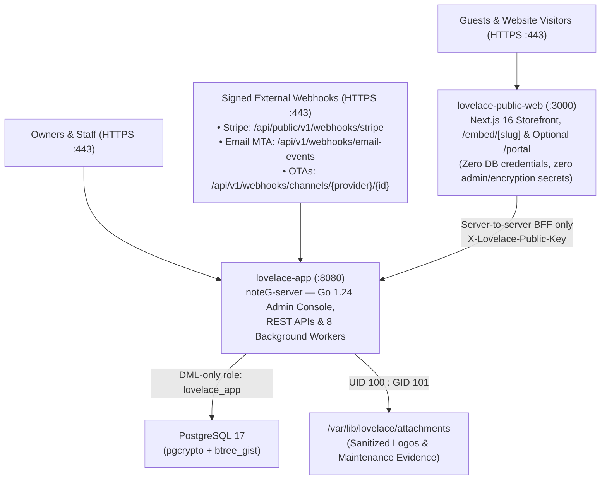

# Lovelace Documentation Hub

Welcome to the official documentation for the **Lovelace Hospitality, Campsite & Holiday Let Booking Platform**.

Lovelace is an open, security-hardened multi-property booking and operations platform designed for campsites, glamping retreats, holiday cottages / Airbnbs, boutique hotels, and B&Bs.

---

## Documentation Guides

| Guide | What It Covers |
| :--- | :--- |
| **[0. Property Owner's Everyday Handbook (Illustrated)](owner-handbook/README.md)** | **Start here for non-technical hospitality owners:** Plain-English, jargon-free step-by-step instructions with **20 annotated screenshots** covering daily arrivals, check-in/out & ledgers, housekeeping changeovers, phone bookings, rooms/pitches & extras, scheduled season releases, seasonal prices, maintenance & safety schedules, guest records & email templates, OTA channels, reports & accountant CSVs, WordPress/website embeds, larger text settings, and safety backups. |
| **[1. Local & Self-Hosted Server Guide](guides/01-local-and-self-hosted-server.md)** | 2-minute local Docker evaluation (`docker-compose.dev.yml`), production Ubuntu/Debian Linux deployment (`docker-compose.yml`), 3-role PostgreSQL 17 startup flow, automatic HTTPS with **Caddy** or **Nginx**, firewall rules, and hardened bare-metal `systemd` units. |
| **[2. Cloud Deployment Guide (AWS, GCP & Azure)](guides/02-cloud-deployments-aws-gcp-azure.md)** | Production reference architectures and step-by-step commands for **AWS** (ECS Fargate + RDS PostgreSQL 17 + EFS + S3), **Google Cloud** (Cloud Run `--no-cpu-throttling` + Cloud SQL + Filestore/GCS), and **Microsoft Azure** (Container Apps + Flexible Server + Azure Files/Blob). |
| **[3. Railway & PaaS Deployment Guide](guides/03-railway-and-paas-deployment.md)** | Deploying Lovelace on **Railway** (plus **Fly.io** and **Render**) using private IPv6 `.railway.internal` networking, persistent volumes (`uid=100, gid=101`), least-privilege DB roles, and custom HTTPS domains. |
| **[4. First-Boot Setup, Advanced Configuration, Embeds & Maintenance](guides/04-first-login-configuration-and-maintenance.md)** | **Complete illustrated setup manual (14 screenshots):** First-login password rotation & 8 recovery codes, all **7 steps** of the Guided Setup Wizard, multi-property routing, custom logo & WCAG branding preview, workspace profiles & layout builder, scheduled releases, live OTA sync (**Beds24**, **Smoobu**, **Lodgify**, **Channex**), email webhooks & `DISPATCH_UNKNOWN` reconciliation, 6-role RBAC, preventative maintenance, Guest Portal dual-gate setup, **WordPress Plugin (`.zip`)** & HTML embeds, and Argon2id `.zip.enc` backups/restore. |
| **[5. Deep Troubleshooting & Hospitality Catastrophe Playbook](guides/05-troubleshooting-and-disaster-recovery.md)** | Deep infrastructure diagnostics for **Self-Hosted**, **AWS/GCP/Azure**, and **Railway**, **21 hospitality catastrophe rescues** (Campsites, Glamping, B&Bs, Cottages/Hotels, Multi-Site Operators), plus **Part III: 15 code-verified operational, security, webhook, OTA, Guest Portal, reporting & WordPress troubleshooting scenarios (Issues 22–36)**. |
| **[6. Complete Feature, Tool, CLI & Permission Reference](guides/06-complete-feature-and-tool-reference.md)** | Exhaustive technical manual indexing **every** Admin WebUI screen, REST endpoint family, inbound webhook, CLI binary & flag (`noteG-server`, `lovelace-migrate`, `lovelace-seed`), helper script, all **8 background workers**, the **6-role × 28-permission RBAC matrix**, allowed template `{{placeholders}}`, Next.js storefront/Guest Portal routes, and WordPress blocks/shortcodes. |

### Specialist Architecture & Engineering Specifications
- [System Architecture & Five-Phase Blueprint](architecture.md)
- [Security Controls, RBAC & Cryptographic Boundaries](security.md)
- [Personal Data Inventory & GDPR Lifecycle](privacy-pii-inventory.md)
- [Operations & Privilege Separation Runbook](operations.md)
- [Admin REST API Reference (`/api/v1`)](api.md) · [OpenAPI Admin v1](openapi-admin-v1.yaml) · [OpenAPI Public v1](openapi-public-v1.yaml)
- [OTA Channel Manager Provider Adapter Contracts](providers.md)
- [Branding, Accessibility & Workspace Personalisation](branding.md) · [PWE-1..5 Specification](personalisation-workspace-experience.md)
- [Phase 3 Milestone 4 — Self-Service Guest Portal Specification](phase3-milestone4-guest-portal.md)

---

## System Topology at a Glance

Every production Lovelace instance consists of **two strictly isolated HTTP services** backed by **PostgreSQL 17** and a **private attachment storage directory**:

### Why Two Separate Services?
1. **`lovelace-app` (`Dockerfile`, binary `noteG-server` — named in homage to Ada Lovelace's 1843 *Note G*, port `8080`):** Serves the server-rendered **Lovelace Admin Console** (`/login`, `/onboarding`, `/workspace`, `/calendar`, `/reservations`, `/maintenance`, `/guests`, `/reports`, `/settings/backups`), signed inbound webhooks (`/api/public/v1/webhooks/stripe`, `/api/v1/webhooks/email-events`, `/api/v1/webhooks/channels/{providerCode}/{connectionID}`), 8 background workers (hold expiry, email outbox, communication automation, preventative maintenance, OTA channel sync, stale auth/portal pruning, and scheduled cloud backups), and the internal `/api/public/v1/*` JSON API.
2. **`lovelace-public-web` (`apps/public-web/Dockerfile`, port `3000`):** Serves the guest-facing booking website (`/`, `/stays`, `/book`, `/lookup`, optional `/portal`), embeddable website widgets (`/embed/[slug]`), and the official WordPress plugin's catalog endpoint (`/api/public/catalog`). It talks to `lovelace-app` strictly server-to-server using `X-Lovelace-Public-Key` (`LOVELACE_PUBLIC_API_SECRET`) and **never** holds database credentials or encryption keys.

### Three-Role PostgreSQL 17 Privilege Separation
Lovelace enforces least-privilege database separation in all environments (`scripts/postgres/ensure-roles.sh`):
1. **Bootstrap Admin (`postgres` / cloud admin):** Used *only* during initial provisioning to enable `pgcrypto` and `btree_gist` and create the two non-superuser roles below.
2. **Migration Owner (`lovelace_migrator`):** `NOSUPERUSER NOCREATEDB NOCREATEROLE`. Owns schema `public` and runs `lovelace-migrate` (`cmd/migrate`) during deployments.
3. **Runtime App Role (`lovelace_app`):** `NOSUPERUSER NOCREATEDB NOCREATEROLE`. Strictly DML-only (`SELECT`, `INSERT`, `UPDATE`, `DELETE` — no `DROP`, `ALTER`, `TRUNCATE`, or `CREATE`). In `LOVELACE_ENV=production`, `noteG-server` **refuses to start** if connected as a privileged or superuser role.

---

## Choosing a Deployment Target

| Requirement | 1. Self-Hosted Linux Server | 2. AWS / GCP / Azure | 3. Railway / PaaS |
| :--- | :--- | :--- | :--- |
| **Typical Monthly Cost** | ~$8–$20/mo (2 vCPU / 4 GB VPS) | ~$45–$120/mo (managed DB + containers + LB) | ~$12–$30/mo (usage-billed containers + volume) |
| **Setup Time** | ~20 minutes | ~45–60 minutes | ~15 minutes |
| **TLS Certificates** | Automatic via Caddy / Certbot | Managed via ACM / Cloud Run / Azure | Automatic out of the box |
| **OS & DB Patching** | Managed by you (`apt` + Docker) | Managed by cloud provider | Container rebuilds + image tags |
| **Horizontal Scaling Note** | Single-node (`1` `app` + `1` `public-web`) | Pin `min=1, max=1` task/instance* | `1` replica per service* |

*\*Rate limiters in `lovelace-app` and `lovelace-public-web` use process-local sliding windows designed for `1` replica of each service (which comfortably handles thousands of bookings per day).*

---

## Complete Environment Variables Reference

### 1. Backend Service (`lovelace-app` / `noteG-server`)

| Variable | Required in Prod | Default | Description |
| :--- | :--- | :--- | :--- |
| `LOVELACE_ENV` | **Yes** | `development` | Set to `production` (or `staging`). Activates fail-closed security & secret checks. |
| `LOVELACE_LISTEN_ADDR` | Yes | `127.0.0.1:8080` | Bind address inside container/host (`0.0.0.0:8080` in Docker/cloud; `:8080` on IPv6 meshes). |
| `DATABASE_URL` | **Yes** | — | PostgreSQL 17 connection string using the DML-only `lovelace_app` role. |
| `LOVELACE_ENCRYPTION_KEY` | **Yes** | *(dev fallback)* | 32-byte key (`64` hex chars from `openssl rand -hex 32` or 44-char base64) for AES-256-GCM encryption (OTA tokens & cloud backup credentials) and keyed HMAC-SHA256 digests (admin recovery codes & Guest Portal OTPs). **Back up this key safely!** |
| `LOVELACE_PUBLIC_ORIGIN` | **Yes** | `http://127.0.0.1:3000` (`""` in prod) | Public `https://` origin(s) of `lovelace-public-web` (comma-separated if multiple). |
| `LOVELACE_PUBLIC_API_SECRET` | **Yes** | — | Random shared secret (`openssl rand -hex 32`) authenticating `public-web` → `app` (`X-Lovelace-Public-Key`). |
| `LOVELACE_COOKIE_SECURE` | **Yes** | `false` | Must be `true` in production so `lovelace_session` cookies require HTTPS. |
| `LOVELACE_SESSION_TTL` | Optional | `12h` | Absolute maximum lifetime of an authenticated admin session (`admin_sessions.expires_at`). |
| `LOVELACE_SESSION_IDLE_TTL` | Optional | `2h` | Sliding idle timeout for an authenticated admin session. |
| `LOVELACE_LOGIN_MAX_FAIL_IP` | Optional | `20` | Max failed admin sign-ins from a single client IP within `LOVELACE_LOGIN_WINDOW` before HTTP `429`. |
| `LOVELACE_LOGIN_MAX_FAIL_ACCOUNT` | Optional | `8` | Max failed admin sign-ins for a target email within `LOVELACE_LOGIN_WINDOW` before HTTP `429`. |
| `LOVELACE_LOGIN_WINDOW` | Optional | `15m` | Sliding window duration for admin login brute-force counters (`login_attempts`). |
| `LOVELACE_TRUST_PROXY` | Recommended | `false` | Set `true` behind a reverse proxy / load balancer so `X-Forwarded-For` is walked right-to-left. |
| `LOVELACE_TRUSTED_PROXIES` | **Yes** (if `TRUST_PROXY=true`) | — | Comma-separated proxy CIDRs allowed to set `X-Forwarded-For` (required explicitly in production). |
| `LOVELACE_AUTO_SEED` | **Must be `false`** | `false` | Demo data seeder; startup fails closed if `true` in `production`. |
| `LOVELACE_BOOTSTRAP_ADMIN_EMAIL` | First boot | — | Provisions initial global `owner_admin` when `admin_users` is empty (`0` rows). |
| `LOVELACE_BOOTSTRAP_ADMIN_PASSWORD` | First boot | — | Initial temporary password (`12`–`256` chars); forces rotation + recovery codes on first sign-in. Ignored once any user exists. |
| `LOVELACE_BOOTSTRAP_ADMIN_NAME` | Optional | `Owner Administrator` | Display name for the bootstrapped `owner_admin`. |
| `LOVELACE_ATTACHMENT_DIR` | Yes | `/tmp/lovelace-attachments` | Persistent writable directory (`uid=100, gid=101`) for sanitized property logos & maintenance files (`/var/lib/lovelace/attachments`). |
| `LOVELACE_MAX_ATTACHMENT_BYTES` | Optional | `10485760` (`10 MiB`) | Max single attachment upload size (`1024`..`52428800` bytes / `50 MiB` max). |
| `LOVELACE_REQUIRE_EMAIL` | Recommended | `false` (`true` in compose) | When `true`, `/readyz` requires SMTP to be configured. Always enforced automatically if any property has `stripe_enabled=true` or `guest_portal_enabled=true`. |
| `LOVELACE_EMAIL_FROM` | Yes (for email) | `bookings@example.com` | Verified sender address for booking confirmations & notifications. |
| `LOVELACE_SMTP_ADDR` | Yes (for email) | — | `host:port` of STARTTLS/plain SMTP relay (e.g. `smtp.resend.com:587` or `email-smtp.eu-west-2.amazonaws.com:587`; use STARTTLS port `587`, not implicit TLS `465`). |
| `LOVELACE_SMTP_USERNAME` | Optional | — | SMTP auth username (e.g. `resend`). |
| `LOVELACE_SMTP_PASSWORD` | Optional | — | SMTP auth password / API key. |
| `LOVELACE_EMAIL_WEBHOOK_SECRET` | Optional | — | HMAC-SHA256 secret verifying `X-Email-Signature: sha256=<hex>` on `POST /api/v1/webhooks/email-events`. |
| `LOVELACE_STRIPE_SECRET_KEY` | When Stripe enabled | — | Live `sk_live_...` or `rk_live_...` key in production (`sk_test_` rejected in prod). Leave empty while `stripe_enabled=false`. |
| `LOVELACE_STRIPE_WEBHOOK_SECRET` | When Stripe enabled | — | Matching `whsec_...` signing secret for `POST /api/public/v1/webhooks/stripe`. |
| `LOVELACE_STRIPE_API_BASE_URL` | Optional | `https://api.stripe.com` | Stripe REST API base URL (override only for isolated integration test harnesses). |
| `LOVELACE_STRIPE_SUCCESS_URL` | Optional | *(derived from `LOVELACE_PUBLIC_ORIGIN`)* | Optional server-side override template for Stripe Checkout return URL (must match allowlisted HTTPS public origin). |
| `LOVELACE_STRIPE_CANCEL_URL` | Optional | *(derived from `LOVELACE_PUBLIC_ORIGIN`)* | Optional server-side override template for Stripe Checkout cancel URL. |
| `LOVELACE_STRIPE_SANDBOX` | **Must be `false`** | `false` | Local test checkout simulator; prohibited in `staging` and `production`. |
| `LOVELACE_GUEST_PORTAL_ENABLED` | Optional | `false` | Global feature gate for `/portal` self-service guest portal (paired with per-property `guest_portal_enabled`; keep `false` unless explicitly enabling). |

### 2. Migration Command (`lovelace-migrate`)

| Variable | Required | Description |
| :--- | :--- | :--- |
| `MIGRATION_DATABASE_URL` | **Yes** | PostgreSQL 17 DSN using `lovelace_migrator` (`postgres://lovelace_migrator:<pw>@<host>:5432/<db>?sslmode=require`). |

### 3. Public Booking Frontend (`lovelace-public-web`)

| Variable | Required | Default | Description |
| :--- | :--- | :--- | :--- |
| `LOVELACE_ENV` | **Yes** | `development` | Match backend `LOVELACE_ENV` (`production` / `staging` / `development`). |
| `LOVELACE_API_BASE_URL` | **Yes** | `http://127.0.0.1:8080` | Internal server-to-server URL of `lovelace-app` (e.g. `http://app:8080` or `http://lovelace-app.railway.internal:8080`). |
| `LOVELACE_PUBLIC_API_SECRET` | **Yes** | — | Must match `LOVELACE_PUBLIC_API_SECRET` on `lovelace-app` byte-for-byte. |
| `LOVELACE_PROPERTY_SLUG` | **Yes** | `demo-property` | Default property slug served at `/`, `/stays`, `/book`, `/lookup`, and `/portal` when `?property=` is omitted. |
| `NEXT_PUBLIC_SITE_URL` | **Yes** | `http://127.0.0.1:3000` | Public HTTPS URL of `lovelace-public-web` (must match an origin in `LOVELACE_PUBLIC_ORIGIN`). |
| `LOVELACE_TRUST_PROXY` | Recommended | `false` | Set `true` behind reverse proxy / load balancer for accurate client IP rate limiting & `X-Forwarded-Host` origin verification. |
| `LOVELACE_TRUSTED_PROXIES` | Recommended | `127.0.0.1/32,::1/128` | Proxy CIDRs trusted for `X-Forwarded-For` / `X-Forwarded-Proto`. |
| `LOVELACE_STRIPE_SANDBOX` | **Must be `false`** | `false` | Must be `false` in `staging` and `production`. |
| `PORT` / `HOSTNAME` | Optional | `3000` / `0.0.0.0` | Set `HOSTNAME=::` on IPv6 private meshes such as Railway or Fly.io. |
