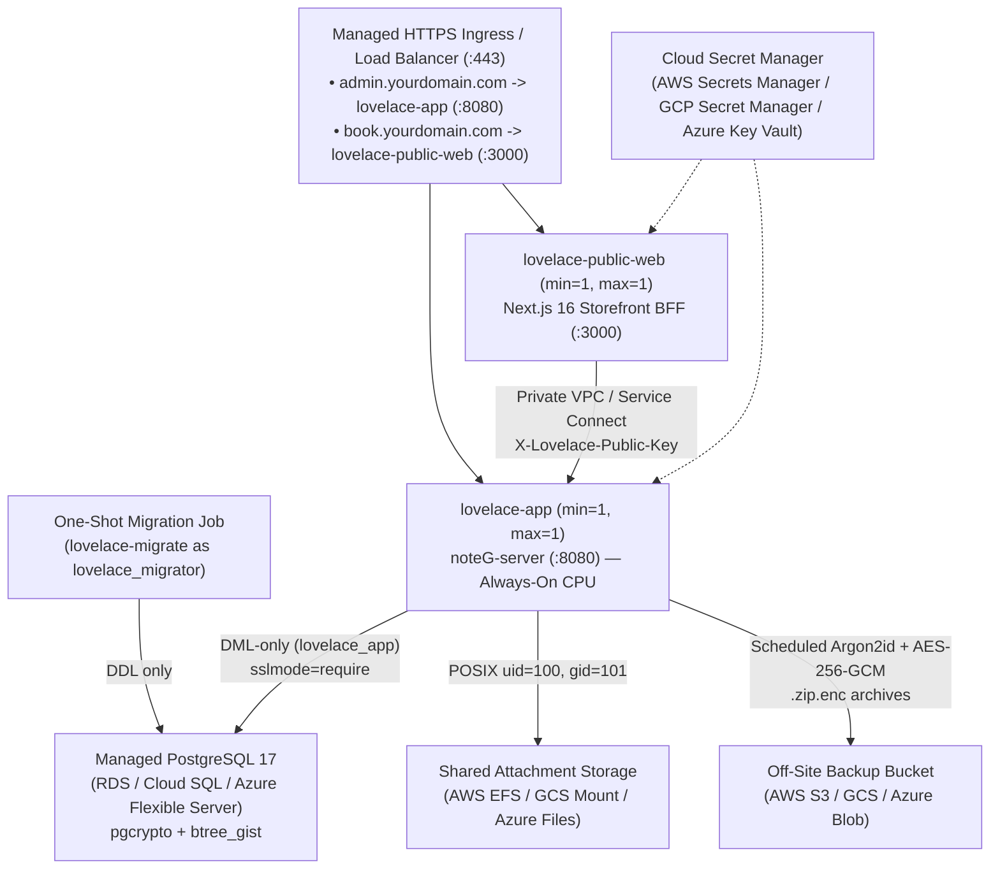

# Guide 2: Cloud Deployments on AWS, Google Cloud (GCP) & Microsoft Azure

This guide covers deploying Lovelace on managed cloud infrastructure across **Amazon Web Services (AWS)**, **Google Cloud Platform (GCP)**, and **Microsoft Azure** with managed PostgreSQL 17, persistent attachment storage, managed secrets, and automated encrypted off-site cloud backups.

---

## Managed Cloud Reference Topology

Across AWS, GCP, and Azure, every managed Lovelace deployment follows the same security-isolated layout:



---

## Shared Prerequisite: Initializing Managed PostgreSQL 17

All three major clouds provide managed PostgreSQL 17 where the initial admin account (`postgres` / `rds_superuser` / `cloudsqlsuperuser` / `azure_pg_admin`) is **not** a full OS superuser. Follow these exact steps once after creating your managed PostgreSQL 17 instance so `scripts/postgres/ensure-roles.sh` and `lovelace-migrate` succeed cleanly:

### 1. Cloud-Specific Extension Pre-Check
- **AWS RDS / Aurora PostgreSQL 17:** `pgcrypto` and `btree_gist` are pre-allowlisted by default.
- **Google Cloud SQL for PostgreSQL 17:** `pgcrypto` and `btree_gist` are pre-allowlisted by default.
- **Azure Database for PostgreSQL Flexible Server 17:** Allowlist both extensions before connecting:
  ```bash
  az postgres flexible-server parameter set \
    --resource-group <RG> \
    --server-name <PG_SERVER> \
    --name azure.extensions \
    --value "PGCRYPTO,BTREE_GIST"
  ```

### 2. Create Database, Grant Role Delegation & Run Migrations
From a bastion host, Cloud Shell, or CI runner inside your private VPC/VNet with PostgreSQL 17 `psql` installed:

```bash
export PGHOST="<PRIVATE_DB_HOST>"
export PGPORT="5432"
export PGSSLMODE="require"
export POSTGRES_DB="lovelace"
export POSTGRES_BOOTSTRAP_USER="<CLOUD_PG_ADMIN_USER>"
export PGPASSWORD="<CLOUD_PG_ADMIN_PASSWORD>"
export LOVELACE_MIGRATOR_PASSWORD="$(openssl rand -hex 24)"
export LOVELACE_APP_PASSWORD="$(openssl rand -hex 24)"

# 1. Create the application database and pre-create lovelace_migrator so the managed admin
#    has role membership required by PostgreSQL 16/17 for ALTER SCHEMA ... OWNER TO:
psql -h "$PGHOST" -U "$POSTGRES_BOOTSTRAP_USER" -d postgres -v ON_ERROR_STOP=1 <<SQL
CREATE DATABASE lovelace;
CREATE ROLE lovelace_migrator WITH LOGIN PASSWORD '${LOVELACE_MIGRATOR_PASSWORD}' NOSUPERUSER NOCREATEDB NOCREATEROLE NOINHERIT;
GRANT lovelace_migrator TO "${POSTGRES_BOOTSTRAP_USER}";
SQL

# 2. Run Lovelace's idempotent role & extension bootstrapper:
./scripts/postgres/ensure-roles.sh

# 3. Apply all embedded SQL migrations (0001..0031) as lovelace_migrator:
MIGRATION_DATABASE_URL="postgres://lovelace_migrator:${LOVELACE_MIGRATOR_PASSWORD}@${PGHOST}:5432/lovelace?sslmode=require" \
  go run ./cmd/migrate

# 4. Re-run ensure-roles.sh once so lovelace_app receives strict DML-only grants on all tables:
./scripts/postgres/ensure-roles.sh
```

Store `LOVELACE_MIGRATOR_PASSWORD` (for future upgrade jobs) and `LOVELACE_APP_PASSWORD` (for runtime `DATABASE_URL`) in your cloud Secret Manager.

> [!IMPORTANT]
> **Scaling & Liveness Rules Across All Clouds:**
> 1. Pin both `lovelace-app` and `lovelace-public-web` to **`1` active instance (`min=1, max=1`)**. Both services run fast in-memory sliding-window rate limiters per process, and `lovelace-app` runs 8 background workers (15-minute basket hold expiry, email outbox delivery, communication automation, preventative maintenance, OTA sync, stale auth/portal pruning, and scheduled cloud backups) that expect an always-on instance.
> 2. Point **container kill/liveness probes** at **`/healthz`**, and point **external uptime monitors & deployment readiness gates** at **`/readyz`** (so a transient upstream SMTP hiccup does not cause your orchestrator to restart containers).
> 3. Register external webhooks against `admin.yourdomain.com`:
>    - Stripe: `https://admin.yourdomain.com/api/public/v1/webhooks/stripe`
>    - Email MTA (optional): `https://admin.yourdomain.com/api/v1/webhooks/email-events`
>    - OTA Channels (optional): `https://admin.yourdomain.com/api/v1/webhooks/channels/{providerCode}/{connectionID}`

---

## 1. Amazon Web Services (AWS)

### Recommended AWS Architecture
- **Compute:** **Amazon ECS on AWS Fargate** (`1` task for `lovelace-app` at `0.5–1 vCPU / 1–2 GB`, `1` task for `lovelace-public-web` at `0.5 vCPU / 1 GB`)
- **Database:** **Amazon RDS for PostgreSQL 17** (`db.t4g.medium`, Multi-AZ in production, Private Subnets, Storage Encrypted)
- **Attachments Volume:** **Amazon EFS** with an **EFS Access Point** enforcing POSIX user `uid=100, gid=101` (`lovelace:lovelace` in Alpine) and root directory `/lovelace-attachments` (`0750`) mounted at `/var/lib/lovelace/attachments` on `lovelace-app`
- **Ingress & TLS:** **Application Load Balancer (ALB)** with AWS Certificate Manager (ACM) HTTPS listener (`:443`) routing:
  - `Host == admin.yourdomain.com` → `lovelace-app` Target Group (port `8080`, target healthcheck `/healthz`, deploy readiness check `/readyz`)
  - `Host == book.yourdomain.com` → `lovelace-public-web` Target Group (port `3000`, healthcheck `/api/healthz`)
- **Internal BFF Discovery:** **AWS Cloud Map (ECS Service Connect)** so `lovelace-public-web` reaches `http://lovelace-app.internal:8080` privately inside the VPC without hair-pinning through the public internet
- **Secrets:** **AWS Secrets Manager** injected via ECS Task Definition `secrets`
- **Off-Site Backups:** **Amazon S3** bucket (`BlockPublicAccess = true`, `Versioning = Suspended` or lifecycle-managed) connected in **Settings → Backups & Cloud Sync**

### Step-by-Step AWS Deployment

1. **Build & Push Container Images to Amazon ECR:**
   ```bash
   aws ecr create-repository --repository-name lovelace-app --image-scanning-configuration scanOnPush=true
   aws ecr create-repository --repository-name lovelace-public-web --image-scanning-configuration scanOnPush=true

   ACCOUNT_ID="$(aws sts get-caller-identity --query Account --output text)"
   REGION="eu-west-2"
   ECR="${ACCOUNT_ID}.dkr.ecr.${REGION}.amazonaws.com"
   aws ecr get-login-password --region "$REGION" | docker login --username AWS --password-stdin "$ECR"

   GIT_SHA="$(git rev-parse --short HEAD)"
   docker build --platform linux/amd64 -t "${ECR}/lovelace-app:${GIT_SHA}" -f Dockerfile .
   docker push "${ECR}/lovelace-app:${GIT_SHA}"

   docker build --platform linux/amd64 -t "${ECR}/lovelace-public-web:${GIT_SHA}" -f apps/public-web/Dockerfile apps/public-web
   docker push "${ECR}/lovelace-public-web:${GIT_SHA}"
   ```

2. **Security Groups:**
   - `alb-sg`: Inbound `80/tcp`, `443/tcp` from `0.0.0.0/0`.
   - `app-sg`: Inbound `8080/tcp` from `alb-sg` **and** `web-sg`.
   - `web-sg`: Inbound `3000/tcp` from `alb-sg` only.
   - `rds-sg`: Inbound `5432/tcp` from `app-sg` (and migration task SG) only.
   - `efs-sg`: Inbound `2049/tcp` from `app-sg` only.

3. **Key ECS Environment Settings:**
   - On `lovelace-app`: set `LOVELACE_TRUST_PROXY=true` and `LOVELACE_TRUSTED_PROXIES=<VPC_CIDR>` (e.g. `10.0.0.0/16`) so the ALB's `X-Forwarded-For` header is trusted.
   - On `lovelace-public-web`: set `LOVELACE_API_BASE_URL=http://lovelace-app.internal:8080`, `LOVELACE_TRUST_PROXY=true`, and `LOVELACE_TRUSTED_PROXIES=<VPC_CIDR>`.

4. **Least-Privilege IAM Policy for Off-Site S3 Backups:**
   When creating an IAM user/credential for **Settings → Backups & Cloud Sync (`AWS_S3`)**, scope it strictly to your dedicated backup bucket:
   ```json
   {
     "Version": "2012-10-17",
     "Statement": [
       {
         "Effect": "Allow",
         "Action": ["s3:ListBucket"],
         "Resource": "arn:aws:s3:::your-lovelace-backups-bucket"
       },
       {
         "Effect": "Allow",
         "Action": ["s3:GetObject", "s3:PutObject", "s3:DeleteObject"],
         "Resource": "arn:aws:s3:::your-lovelace-backups-bucket/lovelace-backups/*"
       }
     ]
   }
   ```

---

## 2. Google Cloud Platform (GCP)

### Recommended GCP Architecture
- **Compute:** **Google Cloud Run** (`lovelace-app` + `lovelace-public-web`)
  - **CRITICAL Cloud Run Flags for `lovelace-app`:** Always deploy `lovelace-app` with **`--min-instances=1 --max-instances=1 --no-cpu-throttling`** (instance-based billing) so Go background tickers (15-minute hold expiry, email outbox worker, communication automation, preventative maintenance, OTA sync, and scheduled cloud backups) continue running between HTTP requests!
  - Deploy `lovelace-public-web` with `--min-instances=1 --max-instances=1`.
- **Database:** **Cloud SQL for PostgreSQL 17** (Private IP via **Direct VPC Egress** — avoids Cloud SQL Auth Proxy sidecar complexity and enforces TLS with `sslmode=require`)
- **Attachments Volume:** **Cloud Run GCS Volume Mount** (or Cloud Filestore NFS) mounted at `/var/lib/lovelace/attachments` on `lovelace-app`
- **Secrets:** **Google Secret Manager** (`--set-secrets=...`)
- **Off-Site Backups:** Separate **Google Cloud Storage (GCS)** bucket in a secondary region (e.g. `europe-west1` if primary is `europe-west2`) using a dedicated Service Account with `roles/storage.objectAdmin` on that bucket only

### Step-by-Step GCP Deployment

1. **Build & Push Images to Artifact Registry:**
   ```bash
   PROJECT_ID="your-gcp-project"
   REGION="europe-west2"
   GAR="${REGION}-docker.pkg.dev/${PROJECT_ID}/lovelace"

   gcloud artifacts repositories create lovelace --repository-format=docker --location="$REGION"
   gcloud auth configure-docker "${REGION}-docker.pkg.dev"

   GIT_SHA="$(git rev-parse --short HEAD)"
   docker build --platform linux/amd64 -t "${GAR}/lovelace-app:${GIT_SHA}" -f Dockerfile .
   docker push "${GAR}/lovelace-app:${GIT_SHA}"

   docker build --platform linux/amd64 -t "${GAR}/lovelace-public-web:${GIT_SHA}" -f apps/public-web/Dockerfile apps/public-web
   docker push "${GAR}/lovelace-public-web:${GIT_SHA}"
   ```

2. **Run Migrations via Cloud Run Job (`lovelace-migrate`):**
   ```bash
   gcloud run jobs create lovelace-migrate \
     --region="$REGION" \
     --image="${GAR}/lovelace-app:${GIT_SHA}" \
     --command="/usr/local/bin/lovelace-migrate" \
     --network=default --subnet=default --vpc-egress=private-ranges-only \
     --set-secrets="MIGRATION_DATABASE_URL=lovelace-migrator-dsn:latest"

   gcloud run jobs execute lovelace-migrate --region="$REGION" --wait
   ```

3. **Deploy `lovelace-app` & `lovelace-public-web` Services:**
   ```bash
   gcloud run deploy lovelace-app \
     --region="$REGION" \
     --image="${GAR}/lovelace-app:${GIT_SHA}" \
     --port=8080 \
     --min-instances=1 --max-instances=1 \
     --no-cpu-throttling \
     --cpu=1 --memory=1Gi \
     --network=default --subnet=default --vpc-egress=private-ranges-only \
     --add-volume=name=attachments,type=cloud-storage,bucket=your-lovelace-attachments \
     --add-volume-mount=volume=attachments,mount-path=/var/lib/lovelace/attachments \
     --allow-unauthenticated \
     --set-env-vars="LOVELACE_ENV=production,LOVELACE_LISTEN_ADDR=0.0.0.0:8080,LOVELACE_COOKIE_SECURE=true,LOVELACE_AUTO_SEED=false,LOVELACE_PUBLIC_ORIGIN=https://book.yourdomain.com,LOVELACE_ATTACHMENT_DIR=/var/lib/lovelace/attachments" \
     --set-secrets="DATABASE_URL=lovelace-app-dsn:latest,LOVELACE_ENCRYPTION_KEY=lovelace-enc-key:latest,LOVELACE_PUBLIC_API_SECRET=lovelace-bff-secret:latest"

   gcloud run deploy lovelace-public-web \
     --region="$REGION" \
     --image="${GAR}/lovelace-public-web:${GIT_SHA}" \
     --port=3000 \
     --min-instances=1 --max-instances=1 \
     --cpu=1 --memory=512Mi \
     --allow-unauthenticated \
     --set-env-vars="LOVELACE_ENV=production,LOVELACE_API_BASE_URL=https://admin.yourdomain.com,LOVELACE_PROPERTY_SLUG=my-property,NEXT_PUBLIC_SITE_URL=https://book.yourdomain.com,LOVELACE_STRIPE_SANDBOX=false" \
     --set-secrets="LOVELACE_PUBLIC_API_SECRET=lovelace-bff-secret:latest"
   ```

4. Map custom domains (`admin.yourdomain.com` and `book.yourdomain.com`) via **Cloud Run Domain Mappings** or a **Global External Application Load Balancer** with Cloud Armor.

---

## 3. Microsoft Azure

### Recommended Azure Architecture
- **Compute:** **Azure Container Apps** inside a VNet-integrated Container Apps Environment (`minReplicas: 1`, `maxReplicas: 1` for both `lovelace-app` and `lovelace-public-web`)
- **Database:** **Azure Database for PostgreSQL — Flexible Server (Version 17)** (`Burstable B2s` or `General Purpose D2ds_v5`, Private Access VNet Integration, `PGCRYPTO,BTREE_GIST` allowlisted in `azure.extensions`)
- **Attachments Volume:** **Azure Files** share mounted into `lovelace-app` at `/var/lib/lovelace/attachments` (`AccessMode: ReadWrite`, `uid=100,gid=101`)
- **Secrets:** **Azure Key Vault** referenced by Container Apps managed identity
- **Off-Site Backups:** **Azure Blob Storage** container in a paired secondary region (`AZURE_BLOB` provider in **Settings → Backups & Cloud Sync**, authenticated via Account Key or scoped Container SAS token)

### Step-by-Step Azure Deployment

1. **Create Resource Group, Azure Container Registry (ACR) & Push Images:**
   ```bash
   RG="rg-lovelace-prod"
   LOC="uksouth"
   ACR="acrlovelaceprod"

   az group create --name "$RG" --location "$LOC"
   az acr create --resource-group "$RG" --name "$ACR" --sku Basic
   az acr login --name "$ACR"

   GIT_SHA="$(git rev-parse --short HEAD)"
   docker build --platform linux/amd64 -t "${ACR}.azurecr.io/lovelace-app:${GIT_SHA}" -f Dockerfile .
   docker push "${ACR}.azurecr.io/lovelace-app:${GIT_SHA}"

   docker build --platform linux/amd64 -t "${ACR}.azurecr.io/lovelace-public-web:${GIT_SHA}" -f apps/public-web/Dockerfile apps/public-web
   docker push "${ACR}.azurecr.io/lovelace-public-web:${GIT_SHA}"
   ```

2. **Create Container Apps Environment & Mount Azure Files Share:**
   ```bash
   az containerapp env create --name cae-lovelace --resource-group "$RG" --location "$LOC"

   az containerapp env storage set \
     --name cae-lovelace \
     --resource-group "$RG" \
     --storage-name lovelace-attachments \
     --azure-file-account-name "<STORAGE_ACCOUNT>" \
     --azure-file-account-key "<STORAGE_KEY>" \
     --azure-file-share-name "attachments" \
     --access-mode ReadWrite
   ```

3. **Run Migration Job & Deploy Container Apps:**
   - Run `lovelace-migrate` as an **Azure Container Apps Job** (`--trigger-type Manual`, command `/usr/local/bin/lovelace-migrate`, `MIGRATION_DATABASE_URL` secret).
   - Deploy `lovelace-app` (`--target-port 8080 --ingress external --min-replicas 1 --max-replicas 1`, mounting `lovelace-attachments` at `/var/lib/lovelace/attachments`).
   - Deploy `lovelace-public-web` (`--target-port 3000 --ingress external --min-replicas 1 --max-replicas 1`, pointing `LOVELACE_API_BASE_URL` at `http://lovelace-app.internal.<ENV_DEFAULT_DOMAIN>` or `https://admin.yourdomain.com`).
   - Bind custom domains + managed TLS certificates via `az containerapp hostname bind`.

---

## Next Step
Proceed to **[Guide 4: First-Boot Setup, Advanced Configuration, Embeds & Maintenance](04-first-login-configuration-and-maintenance.md)** for first-login setup, recovery codes, onboarding wizard, WordPress/website embeds, and ongoing backup/upgrade operations.
