# Guide 4: First-Boot Setup, Advanced Configuration, Website Embeds & Maintenance

Once your Lovelace instance is running (via [Self-Hosted Server](01-local-and-self-hosted-server.md), [AWS / GCP / Azure](02-cloud-deployments-aws-gcp-azure.md), or [Railway](03-railway-and-paas-deployment.md)), follow this complete illustrated manual to finish first-boot security setup, run the 7-Step Property Setup Wizard, configure advanced hospitality features, connect Stripe/SMTP/OTA channels, embed direct bookings on your website or WordPress site, and maintain encrypted backups safely over time.

---

## 1. First Sign-In, Password Rotation & Email-Free Recovery Codes

1. **Sign In (`https://<YOUR_ADMIN_DOMAIN>/login`):**
   - Enter the `LOVELACE_BOOTSTRAP_ADMIN_EMAIL` and temporary `LOVELACE_BOOTSTRAP_ADMIN_PASSWORD` configured during deployment.
2. **Mandatory Password Rotation (`/account?rotate=1`):**
   - Accounts flagged `must_rotate_password = true` are strictly confined to `/account?rotate=1` until you choose a new personal passphrase (`>= 12` characters, distinct from the bootstrap password).
   - Once rotated, all other sessions for your user are revoked atomically. You may delete `LOVELACE_BOOTSTRAP_ADMIN_PASSWORD` from your server/cloud environment (even if left set, `noteG-server` never overwrites existing accounts on restart).

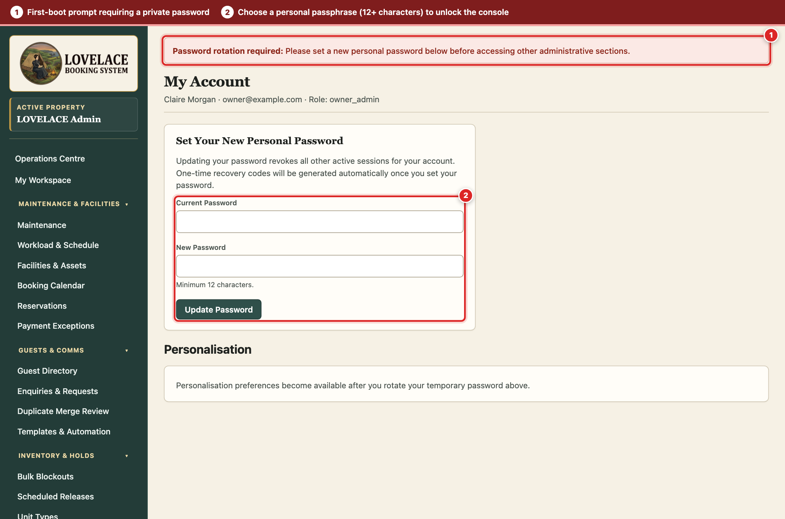

3. **Save Your 8 One-Time Recovery Codes:**
   - Immediately upon rotating your password, **My Account (`/account`)** displays **8 single-use 16-character Recovery Codes** (`ABCD-EFGH-JKLM-NPQR`) with **Copy Codes** and **Download `.txt`** buttons (stored solely as keyed `HMAC-SHA256` digests in `admin_recovery_codes`).
   - Store these codes alongside `LOVELACE_ENCRYPTION_KEY` in your password manager (1Password, Bitwarden, etc.) and keep a printed offline copy.
4. **Self-Service Password Recovery Without Email (`/login/recover`):**
   - If you ever forget your password — even before SMTP email is configured — click **Forgot password? Use a recovery code** on `/login`, enter your email, one unused recovery code, and a new `12+` character password.
   - You can regenerate a fresh set of 8 codes anytime in **Settings → My Account (`/account`)** (generating a new set invalidates any older unused codes immediately).

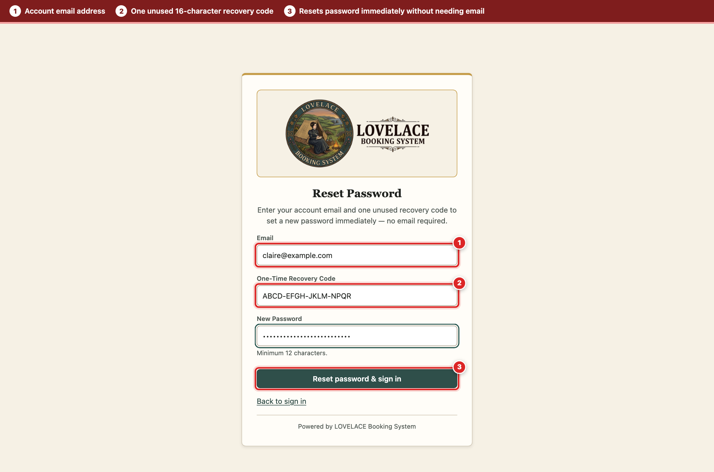

---

## 2. Complete Walkthrough of the 7-Step Guided Property Setup Wizard (`/onboarding`)

On a brand-new database (`0` properties), signing in launches `/onboarding` automatically. You can also re-open `/onboarding` anytime under **Settings → Setup Wizard**, or create additional properties via **Site Settings → + Add Another Property (`/onboarding?new=1`)**.

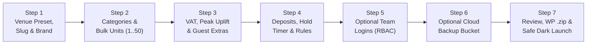

### Step 1 — Property Type, Identity & Brand Style
- Choose a venue preset (**Campsite, Glamping & Holiday Park** `campsite`, **Holiday Let, Cottage or Airbnb** `airbnb_cottage`, **Boutique Hotel, B&B or Guesthouse** `hotel_bnb`, or **Custom Venue** `custom`).
- Enter your **Property Name**, **Public URL Slug** (immutable once created; lowercase letters, digits, hyphens), **Country**, **ISO-4217 Currency** (`GBP`, `EUR`, `USD`, `CAD`, `AUD`, `NZD`), **IANA Timezone** (`Europe/London`, etc.), and **Check-In / Check-Out Times**.
- Expand **Optional: Customise Console Labels & Brand Colours** to tailor UI terminology (`Pitch`/`Pitches`, `Room`/`Rooms`, `Cottage`/`Cottages`) and primary/secondary hex colours (validated server-side for WCAG AA `>= 4.5:1` contrast).

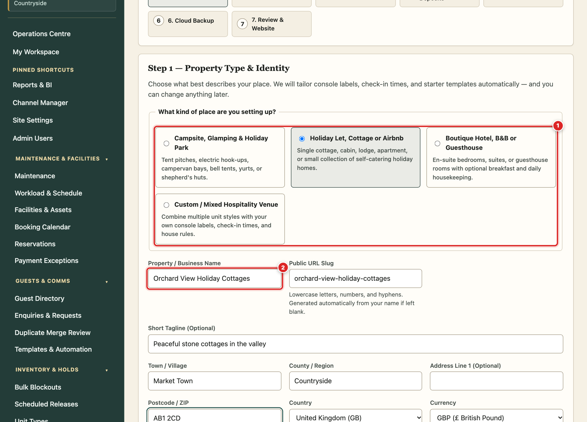

### Step 2 — Add Accommodation & Bulk Unit Generator
- Click any **Quick-fill starter template** button at the top of Step 2, or enter a custom accommodation category (`cabin`, `glamping`, `tent_pitch`, `touring_pitch`, `other`).
- Set **Quantity (`1`–`50`)**, **Base Nightly Price** (in major currency units, e.g. `145.00`), **Short Code Prefix** (e.g. `COT` or `MP`), and **Zone/Area** (e.g. `Lower Meadow` or `First Floor`). Submitting **Save & Add Another Type** lets you build mixed venues (e.g. `15` Grass Pitches + `4` Bell Tents + `1` Farmhouse Cottage) in seconds!

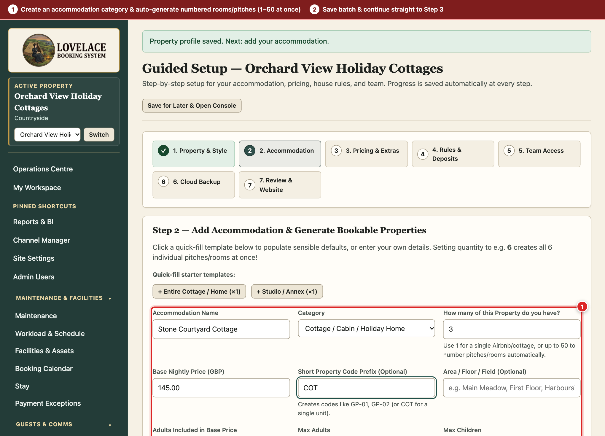

### Step 3 — Pricing, Seasonal Uplifts & Optional Extras
- Set optional **Extra Adult / Child / Infant per Night** charges (leave `0.00` if your base rate covers the whole cottage/room) and **VAT Registration** status.
- Optionally tick **Create a weekend or peak-season rate rule now** (`Friday & Saturday nights only` or `Every night in date range`).
- Tick any **Suggested Extras** (Dog Stay, Firewood Basket, Breakfast Hamper, Late Check-Out, Bedding Pack) or expand **+ Add a Custom Extra / Fee** (`per_stay`, `per_night`, `per_person_per_stay`, or `per_person_per_night`).

> [!TIP]
> **Currency Unit Convention:** Inside the **Setup Wizard (`/onboarding`)**, money fields accept decimal major currency units (`145.00`). On the advanced operational screens (**Unit Types `/unit-types`**, **Extras `/extras`**, and **Rates `/rates`**), prices are entered as exact integer minor units / pence (`14500` = `£145.00`) to prevent floating-point rounding drift.

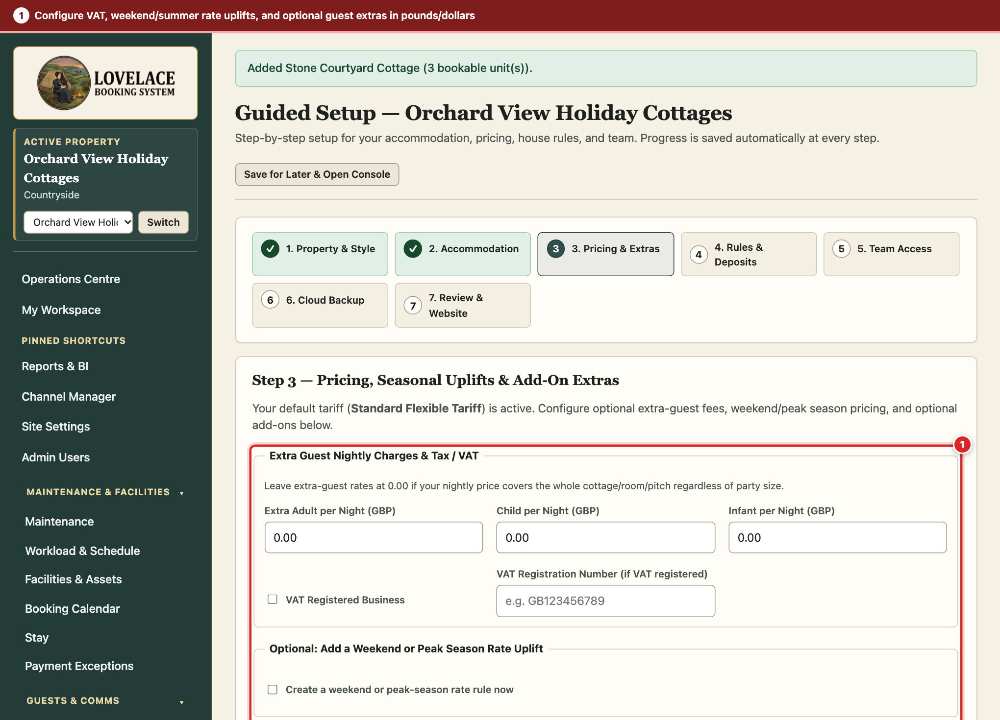

### Step 4 — Deposits, Checkout Hold Timer & House Rules
- Choose **Deposit Requirement**:
  - `FULL` — `100%` upfront at booking
  - `PERCENTAGE` — e.g. `30%` deposit now, remaining balance due `N` days before arrival
  - `FIXED` — fixed deposit amount per booking
- Set **Checkout Basket Hold Duration** (`5`–`120` minutes; default `15` minutes) and **Booking Terms Version** (`v1.0`).
- Review plain-English **Cancellation**, **Quiet Hours**, **Fire/BBQ/Wood-Burner**, **Dogs/Pets**, and **Privacy Notice** text (plus optional external Terms & Privacy URLs).

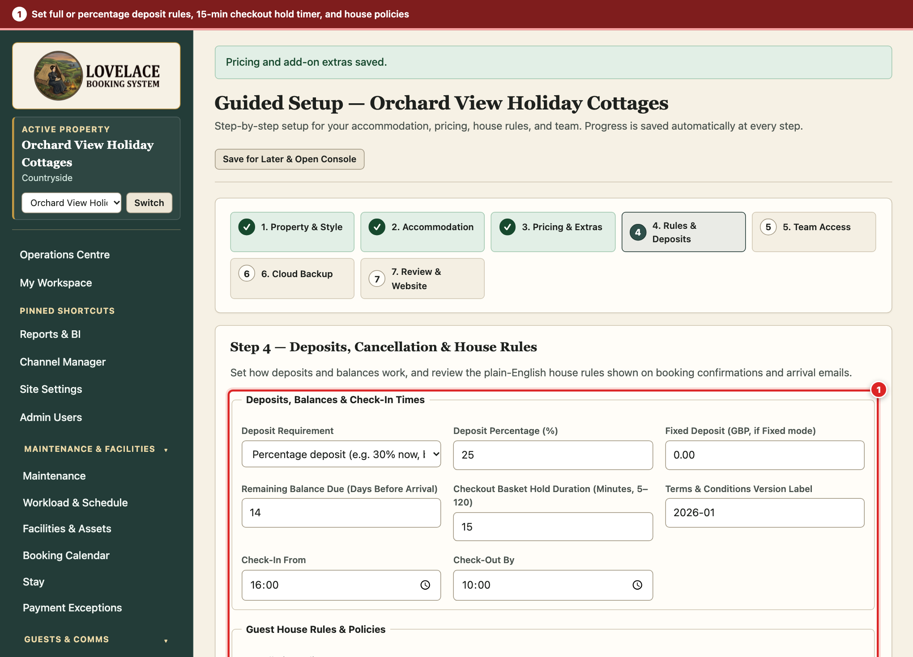

### Step 5 — Team & Staff Accounts *(Optional)*
- Solo operators can click **Continue to Step 6** immediately.
- Otherwise, add property-scoped colleagues (`manager`, `staff`, `housekeeping_staff`, `maintenance_staff`, `viewer`) with a `12+` character temporary password. Each colleague is forced to set their own private password and save their own 8 recovery codes on first sign-in.

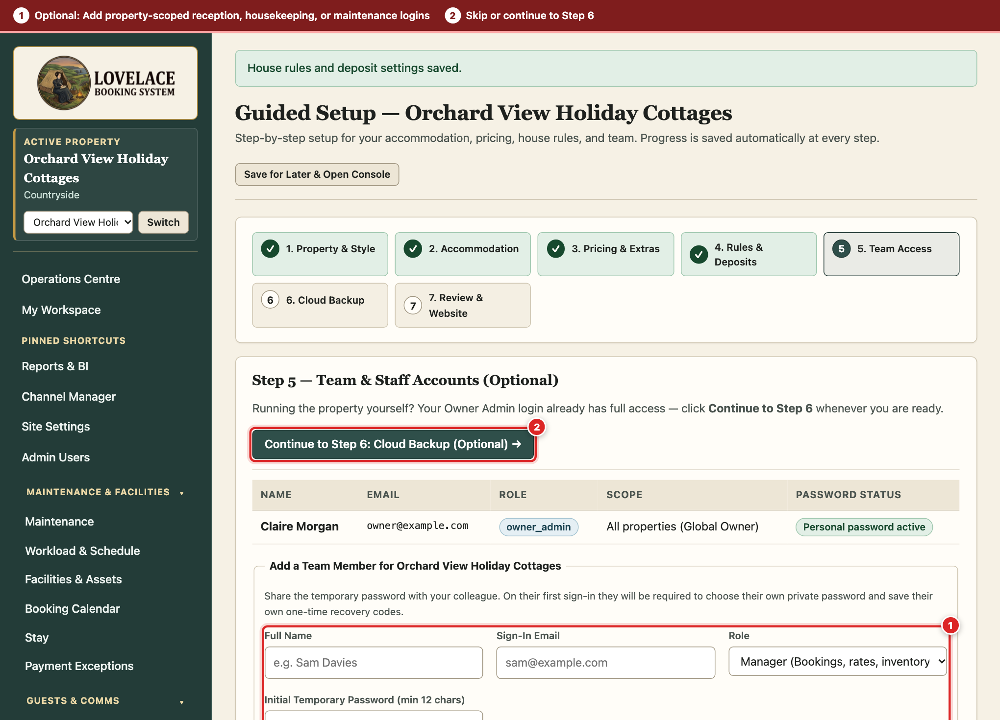

### Step 6 — Off-Site Cloud Backup Source *(Optional)*
- Optionally connect **Amazon S3 (`AWS_S3`)**, **Cloudflare R2 / Backblaze B2 / Wasabi (`S3_COMPATIBLE`)**, **Google Cloud Storage (`GCS`)**, or **Microsoft Azure Blob (`AZURE_BLOB`)** with scheduled intervals (`1`–`720` hours), retention pruning (`1`–`365` archives), and Argon2id + AES-256-GCM `.zip.enc` archive encryption — or click **Skip for Now** and configure local/cloud backups later in `/settings/backups`.

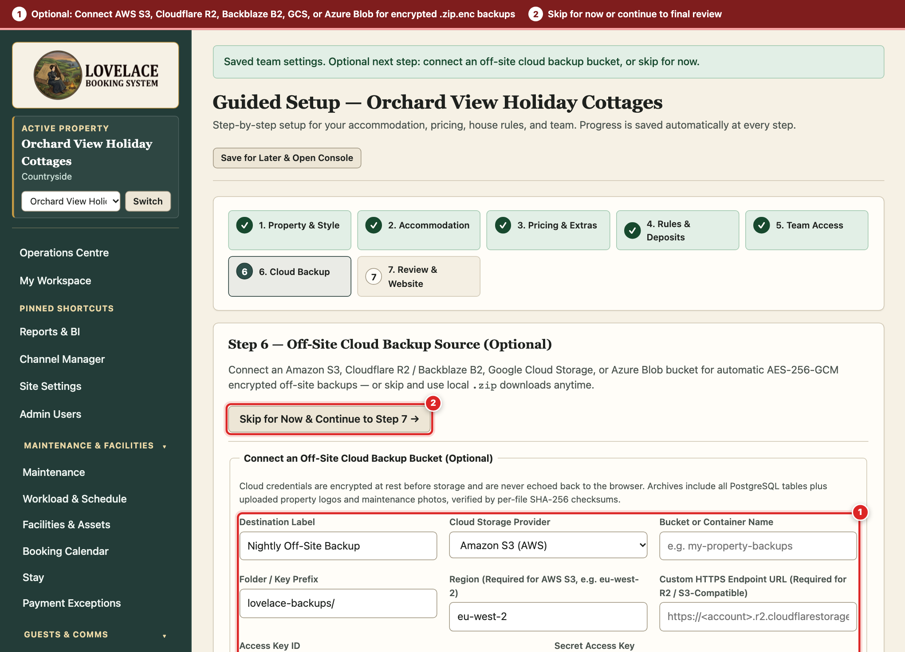

### Step 7 — Review Summary, Website Code & Safe Dark-by-Default Launch
- Inspect all configured sections, download your pre-configured **WordPress Plugin (`.zip`)** or copy HTML embed snippets, and click **Finish Setup & Open Operations Centre →**.
- New properties always launch in **Safe Dark-by-Default Mode** (`stripe_enabled = false`, `guest_portal_enabled = false`) so no live card payments or public portal sessions can occur until you explicitly enable them.

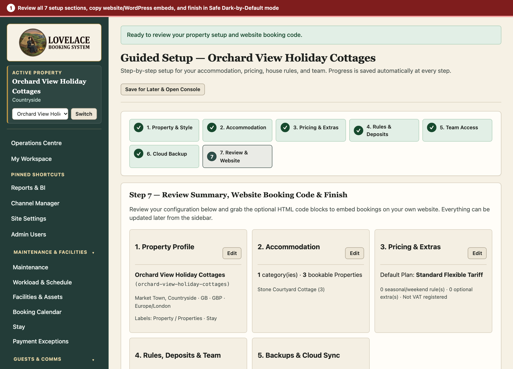

---

## 3. Advanced Property, Team & Operational Configuration

### A. Multi-Property Portfolio Setup & Public Storefront Routing
1. **Adding Additional Properties:** In **Settings → Site Settings (`/property`)**, click **+ Add Another Property** (`/onboarding?new=1`). Each property maintains strictly isolated accommodation, pricing, VAT status, reservations, guest directory, email templates, OTA connections, and accounting ledgers.
2. **Switching Properties in the Admin Console:** Once two or more properties exist, Global `owner_admin` users see the **ACTIVE PROPERTY** dropdown at the top-left of the sidebar (`POST /property/switch`).
3. **Routing Guests to Each Property on `lovelace-public-web`:**
   - Set `LOVELACE_PROPERTY_SLUG` on `lovelace-public-web` to your flagship property's slug (served by default at `/`, `/stays`, `/book`, `/lookup`, and `/portal`).
   - Direct links to secondary properties pass `?property=<slug>` (e.g. `https://book.yourdomain.com/stays?property=orchard-view-holiday-cottages`).
   - Website embeds target each property directly via `/embed/<property-slug>` or WordPress shortcode `[lovelace_booking property="orchard-view-holiday-cottages"]`.

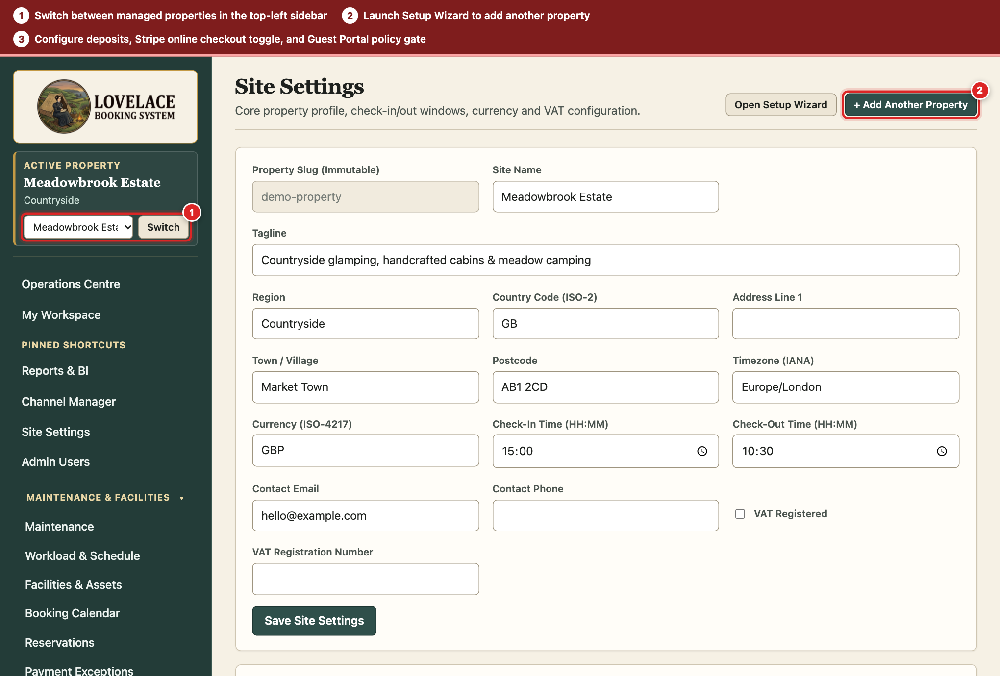

---

### B. Custom Property Branding, Logo Sanitization & Safe Preview (`PWE-4`)
Open **Settings → Site Settings → Property Branding (`/property#property-branding`)**:
- **Sanitized Logo Upload:** Upload a **PNG, JPEG, or WebP** logo (`<= 2 MiB`, dimensions `<= 2048×2048`). Lovelace verifies magic bytes, decodes and re-encodes the image to strip EXIF/metadata payloads, stores it outside the web root in `LOVELACE_ATTACHMENT_DIR`, and serves it safely with `X-Content-Type-Options: nosniff` on both the Admin Console (`/property/logo`) and Public Storefront (`/api/public/property/logo`).
- **WCAG AA Contrast Guardrails:** Primary and secondary hex colours are checked server-side (`>= 4.5:1` contrast ratio) before saving; inaccessible combinations return a clear validation message rather than rendering unreadable buttons.
- **Non-Destructive Preview Mode (`/property?preview=1`):** Preview unsaved or active branding tokens across the console without affecting other signed-in staff, and reset to defaults anytime via **Reset Property Branding**.

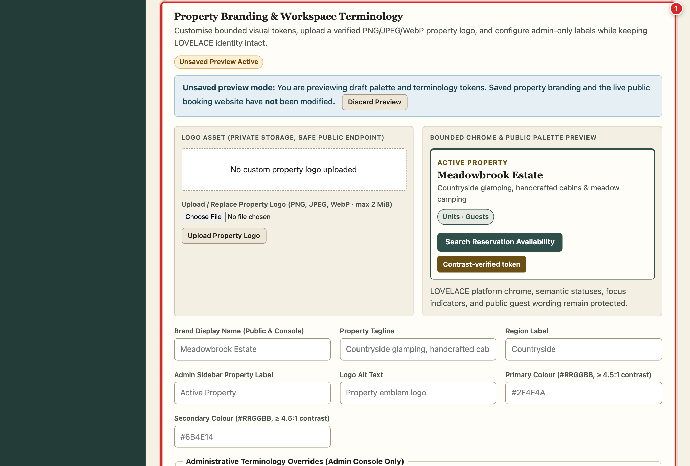

---

### C. Staff Accounts, 6-Role RBAC & Property Scoping (`/users`)
Open **Settings → Admin Users (`/users`)** to create, deactivate, or reset staff accounts:

| Role | Typical Person | Key Capabilities |
| :--- | :--- | :--- |
| `owner_admin` | Business Owner / Director | Full access across inventory, bookings, CRM, GDPR erasure/redaction, channel sync, reports/CSVs, users, and (when global) multi-property creation & system backups. |
| `manager` | General / Duty Manager | Full single-property operational & commercial control (rates, blockouts, releases, CRM merge/export/anonymise, `comms:reconcile`, OTA sync, maintenance inspection, accounting CSVs) — cannot manage users or system backups. |
| `staff` | Receptionist / Warden | Reservations, check-in/out, calendar, housekeeping board, blockouts, fault reporting/updates, guest profiles/enquiries/emails — cannot edit tariffs, inspect/close `UNAVAILABLE` repairs, reconcile `DISPATCH_UNKNOWN` emails, or export reports. |
| `housekeeping_staff` | Cleaner / Changeover Lead | Operations Centre, 5-stage Daily Changeover board (`CLEANING_REQUIRED` → `READY`), and fault reporting (`maintenance:report`) — zero access to guest contact PII, rates, or financials. |
| `maintenance_staff` | Handyman / Grounds Engineer | Operations Centre, Maintenance work orders (`REPORTED` → `COMPLETED`), work notes, photo uploads, and read-only blockouts — cannot approve own post-repair inspections (`maintenance:inspect`) or view guest CRM/financials. |
| `viewer` | Silent Partner / Auditor | Strictly read-only access to Operations, Calendar, Reservations, Blockouts, Maintenance, basic Guest Directory (notes/comms redacted), and BI Reports (CSV export disabled). |

> [!IMPORTANT]
> **Global vs. Property-Scoped `owner_admin` Rule:** The initial bootstrapped `owner_admin` has `property_id = NULL` (**Global Owner**, able to create properties, switch across all sites, and run `/settings/backups`). Creating a new user inside `/users` (or Onboarding Step 5) automatically scopes that account to the **currently active property (`property_id IS NOT NULL`)** for multi-tenant safety — even if assigned role `owner_admin`.

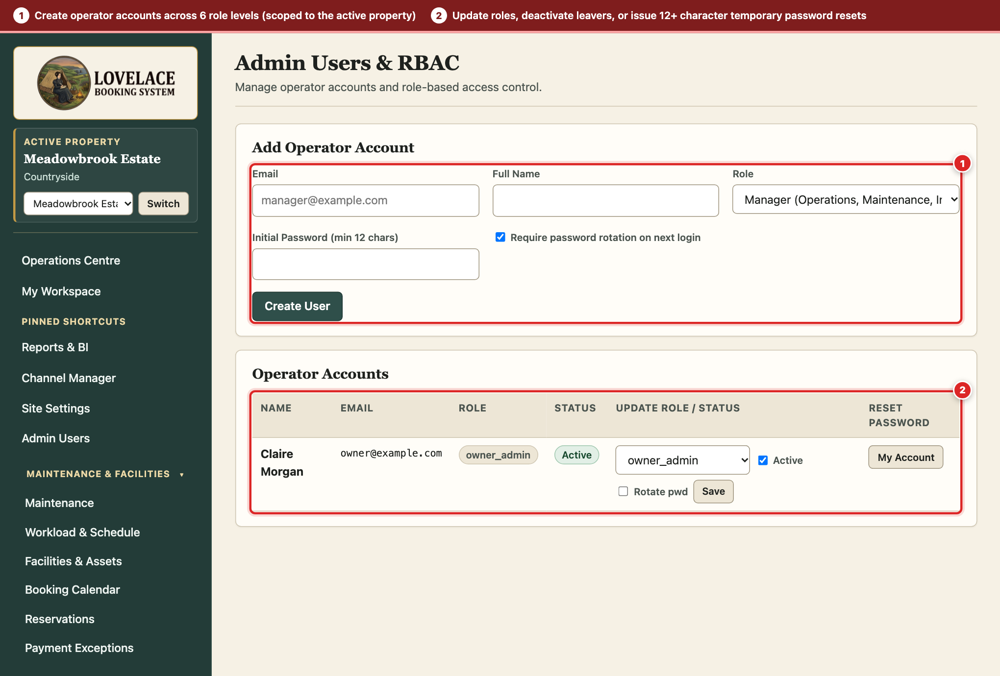

---

### D. Personalisation, Role Workspace Profiles & Dashboard Builder (`PWE-1`–`PWE-5`)
Every staff member can tailor their own interface without affecting colleagues:
1. **Global Display & Accessibility (`/account`):** Choose `Follow System`, `Light`, or `Dark` colour mode, 5 accent palettes, `Large` or `Extra Large` text scaling, `High Contrast`, `Reduced Motion`, default landing route, and up to `6` pinned sidebar shortcuts.
2. **Role Workspace Profiles & Custom Layout Builder (`/workspace?edit=1`):** Switch between curated profiles (**Owner Executive**, **Duty Manager**, **Front Desk**, **Housekeeping Lead**, **Maintenance Operations**, **Read-Only Observer**) or add, reorder, resize (`half` / `full`), and remove permission-gated operational widgets.
3. **Saved Operational Views:** Save reusable filter combinations directly on **Booking Calendar (`/calendar`)**, **Reservations (`/reservations`)**, and **Guest Directory (`/guests`)**.

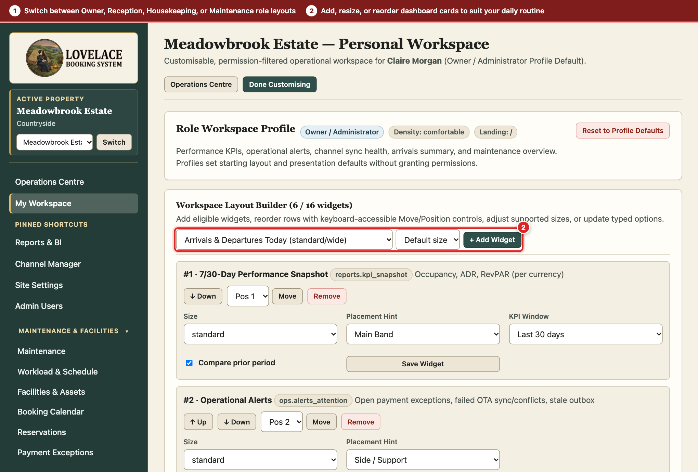

---

### E. Scheduled Availability Releases (`/releases`)
Prevent premature next-season bookings (before next year's peak rates are set) or give direct website guests a head start before OTAs open:
1. Open **Inventory & Holds → Scheduled Releases (`/releases`)**.
2. Choose **Scope** (`Entire Property`, `Accommodation Type`, or `Specific Unit`) and **Channel Scope** (`ALL` channels, or e.g. `AIRBNB` / `BOOKING_COM` so `DIRECT` stays open!).
3. Set the `[Start Date, End Date)` inventory window and **Release Date & Time** (evaluated in the property's local IANA timezone).
4. Click **Release Now** anytime to open held dates early, or **Cancel** to discard a rule.

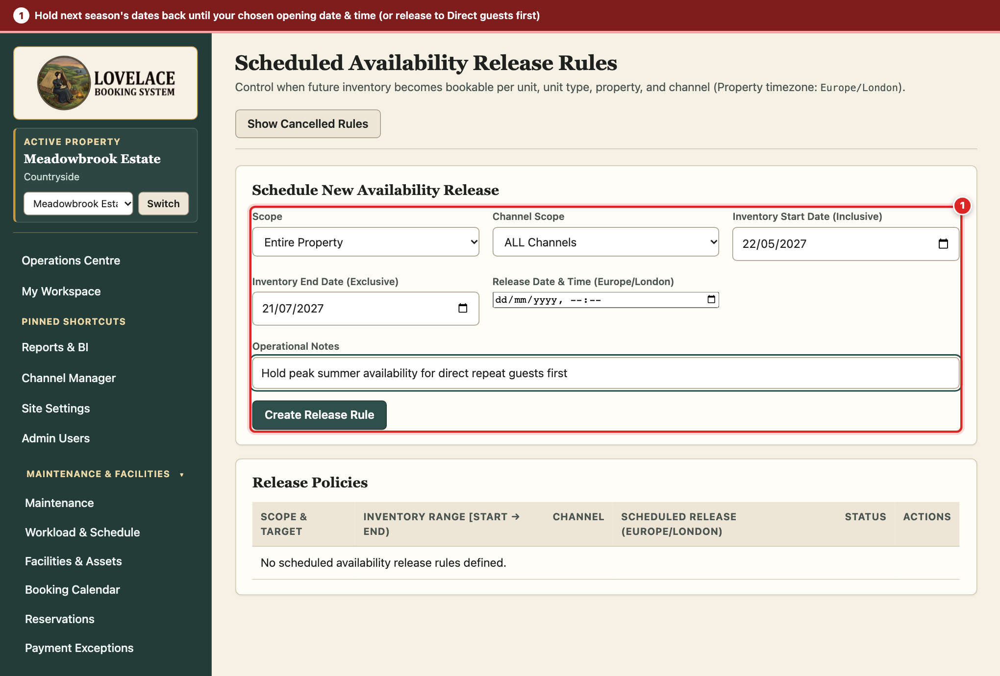

---

### F. Facilities Registry, Contractors & Preventative Maintenance Schedules
1. **Facilities & Contractors (`/maintenance/facilities`):** Register site **Categories** (Plumbing, Electrical, Canvas/Structure, Grounds, Hot Tub/Water), **Locations** (Shower Block, Reception, Boilers, or specific Units), **Assets** (serial numbers, install dates, warranty expiries), and **External Contractors** (Gas Safe engineers, electricians, hot-tub technicians).
2. **Preventative Maintenance Schedules (`/maintenance/schedule`):** Create `ONCE`, `WEEKLY`, `MONTHLY`, `QUARTERLY`, `SIX_MONTHLY`, or `ANNUALLY` rules (e.g. *Monthly Legionella Water Temperature Check* or *Annual Gas Safety Inspection*). The background sweeper automatically generates due `MNT-YYYY-NNNN` tickets every 30 seconds while preserving calendar `anchor_day` (e.g. `31st` of the month) and consolidating overdue catch-ups so missed windows never flood your queue.

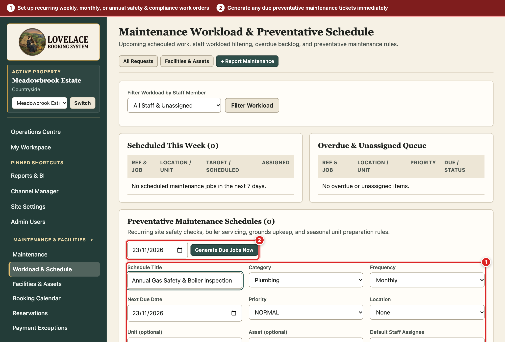

---

## 4. External Integrations, Website Embeds & Going Live

### A. Transactional Email, Templates, Automation & Delivery Webhooks (`/communications/settings`)
1. **SMTP Relay Setup:** Configure `LOVELACE_SMTP_ADDR` (`host:587` STARTTLS — e.g. Resend `smtp.resend.com:587`, Postmark `smtp.postmarkapp.com:587`, or AWS SES `email-smtp.<region>.amazonaws.com:587`), `LOVELACE_SMTP_USERNAME`, `LOVELACE_SMTP_PASSWORD`, and verified `LOVELACE_EMAIL_FROM`. *(Avoid implicit TLS port `465`; `SMTPSender` speaks plain SMTP upgraded via `STARTTLS` on port `587`.)*
2. **Optional Signed Delivery/Bounce Webhook:** To track downstream `DELIVERED`, `BOUNCED`, `FAILED`, and `COMPLAINT` receipts beyond initial SMTP `ACCEPTED` handoff, set `LOVELACE_EMAIL_WEBHOOK_SECRET` (`openssl rand -hex 32`) and point your mail relay's webhook adapter at:
   ```text
   POST https://<YOUR_ADMIN_DOMAIN>/api/v1/webhooks/email-events
   Header: X-Email-Signature: sha256=<hex_hmac_sha256_of_raw_body>
   ```
3. **Templates & Automation Rules (`/communications/settings`):** Edit versioned HTML + plain-text templates using safe `{{placeholders}}` (`{{guest_name}}`, `{{reservation_reference}}`, `{{arrival_date}}`, `{{departure_date}}`, `{{check_in_time}}`, `{{balance_due}}`, etc.) and toggle automated `BOOKING_CONFIRMATION`, `PRE_ARRIVAL`, `ARRIVAL_INFO`, `DEPARTURE_INSTRUCTIONS`, `POST_STAY_THANK_YOU`, and `PAYMENT_REMINDER` schedules.
4. **Reconciling Uncertain Dispatches (`DISPATCH_UNKNOWN`):** If an SMTP connection drops *after* `DATA` begins, Lovelace fences the row as `DISPATCH_UNKNOWN` rather than risking duplicate sends. Managers/Owners reconcile it on `/communications/settings` using verified MTA/webhook evidence (`CONFIRMED_SENT`, `CONFIRMED_FAILED`, or `CANCEL`).

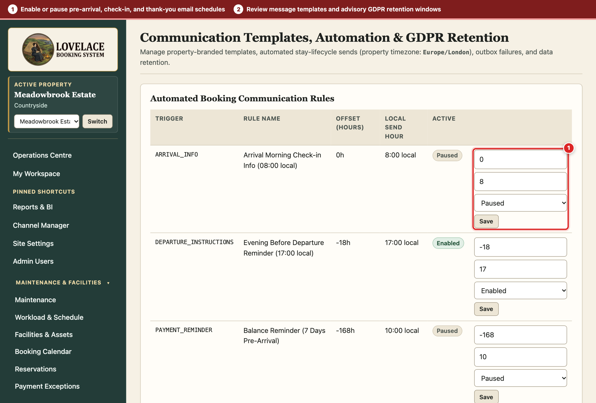

---

### B. Going Live with Stripe Online Card Checkout & Payment Exceptions
Follow this exact sequence so `/readyz` never fails closed:
1. **Create Live Stripe Webhook Endpoint:** In [Stripe Dashboard → Developers → Webhooks](https://dashboard.stripe.com/webhooks), register:
   ```text
   https://<YOUR_ADMIN_DOMAIN>/api/public/v1/webhooks/stripe
   ```
   Subscribe to events:
   - `checkout.session.completed`
   - `checkout.session.expired`
   - `charge.refunded`
2. **Configure Backend Secrets First:** Set `LOVELACE_STRIPE_SECRET_KEY` (`sk_live_...`, or restricted `rk_live_...` with **Checkout Sessions: Write**, **PaymentIntents: Read**, and **Charges/Refunds: Write** so automatic late-hold refunds work!) and `LOVELACE_STRIPE_WEBHOOK_SECRET` (`whsec_...`) on `lovelace-app`, ensure SMTP is configured, and restart `lovelace-app`.
3. **Verify `/readyz` Returns `200 OK`:** Confirm `payments` and `email` report healthy.
4. **Enable Property Checkout Toggle:** Open **Settings → Site Settings (`/property`)**, tick **Enable Public Online Checkout (Stripe)**, and click **Save Booking Policy**.
5. **Monitor `/payment-exceptions`:** If a guest pays right after their 15-minute hold expired (`EXPIRED_HOLD_PAID`) or if an automatic refund needs manual follow-up, Lovelace logs it in **Inventory & Holds → Payment Exceptions (`/payment-exceptions`)** and surfaces an alert on the Operations Centre until resolved with notes.

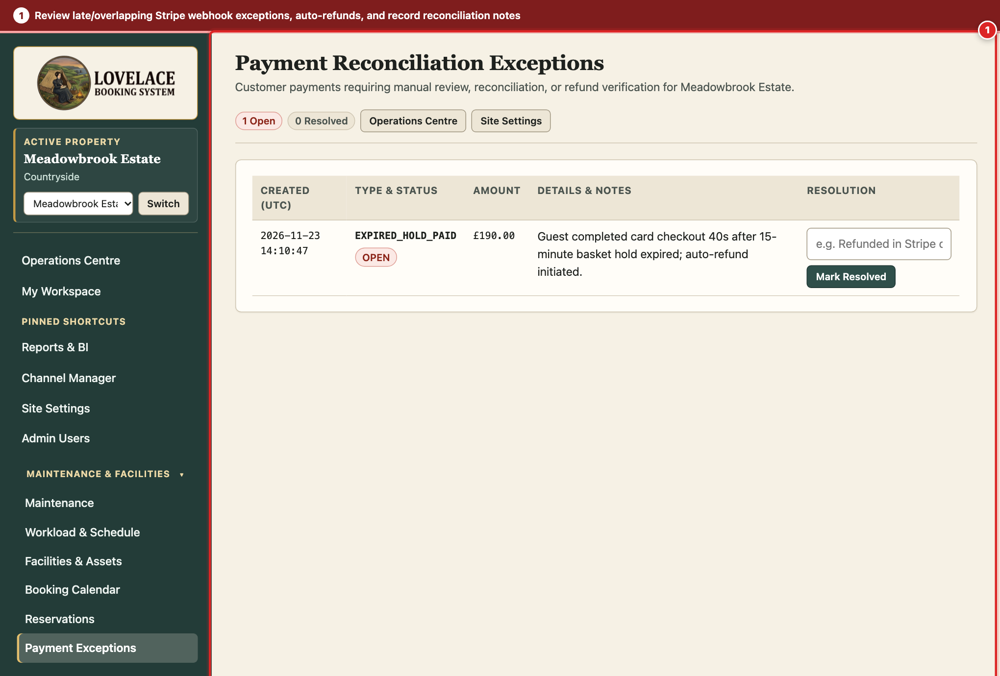

---

### C. Phase 4 Live OTA Channel Manager Sync (`Beds24`, `Smoobu`, `Lodgify`, `Channex`)
Open **Settings → Channel Manager (`/settings/integrations/channel-manager`)** to sync external OTAs (Airbnb, Booking.com, Expedia, VRBO, Pitchup):

| Provider | Auth Model | Outbound Availability & Rates | Inbound Bookings & Webhooks |
| :--- | :--- | :--- | :--- |
| **Beds24 (`beds24`)** | OAuth2 Refresh Token (`refresh_token`) | Supported (ARI push with SHA-256 checkpoint dedup) | Supported (pull + signed webhook) |
| **Smoobu (`smoobu`)** | API Key + HMAC Webhook Secret | Supported (rates & blocked-date sync) | Supported (Base64 HMAC-SHA256 `<= 5m` skew + replay nonce protection) |
| **Lodgify (`lodgify`)** | API Key (`X-ApiKey`) | **Rates supported; Outbound availability intentionally blocked (`422 capability_blocked`)** without Partner Connectivity API — use `READ_ONLY_IMPORT` mode | Supported (booking pull + webhook) |
| **Channex (`channex`)** | User API Key (`user-api-key`) + Hex HMAC | Supported (full ARI push) | Supported (revision feed + post-commit `/ack` + dual-secret `webhook_secret_previous` rotation) |

**Step-by-Step Connection & Mapping Flow:**
1. **Save Credentials:** Enter your provider API key / refresh token and webhook secret on `/settings/integrations/channel-manager` and click **Save Configuration & Encrypt Credentials** (status becomes `CONFIGURED` / `PENDING_VERIFICATION`).
2. **Verify Live Connection:** Click **Verify Live Connection** (`POST .../verify`). Lovelace probes the provider API live, populates the **Provider Capability Matrix**, and promotes the connection to **`CONNECTED`**.
3. **Register Inbound Webhook URL:** Copy the connection's callback URL shown on the card:
   ```text
   https://<YOUR_ADMIN_DOMAIN>/api/v1/webhooks/channels/<providerCode>/<connectionID>
   ```
4. **Create Explicit Listing Mappings:** Map each external `external_listing_id` to a local `Unit Type` (and optional specific `Unit` + `Rate Plan`), matching ISO currency (`GBP`, etc.), local timezone, booking channel (`AIRBNB`, `BOOKING_COM`, etc.), and ownership mode (`LOVELACE_ARI_PROVIDER_BOOKINGS` or `READ_ONLY_IMPORT`).
5. **Preview Before Sync:** Run **Sync Preview** before triggering outbound ARI pushes. Multi-listing pushes or date windows exceeding `14` days require explicit confirmation (`confirm_scope = true`).
6. **Triage Unmapped or Overbooked Arrivals:** External bookings whose listing isn't mapped yet land safely as `UNMAPPED`, and overlapping arrivals land as `CONFLICT_OVERBOOKED` without corrupting existing reservations — both trigger immediate alerts on `/settings/integrations/channel-manager` and `/reports`.

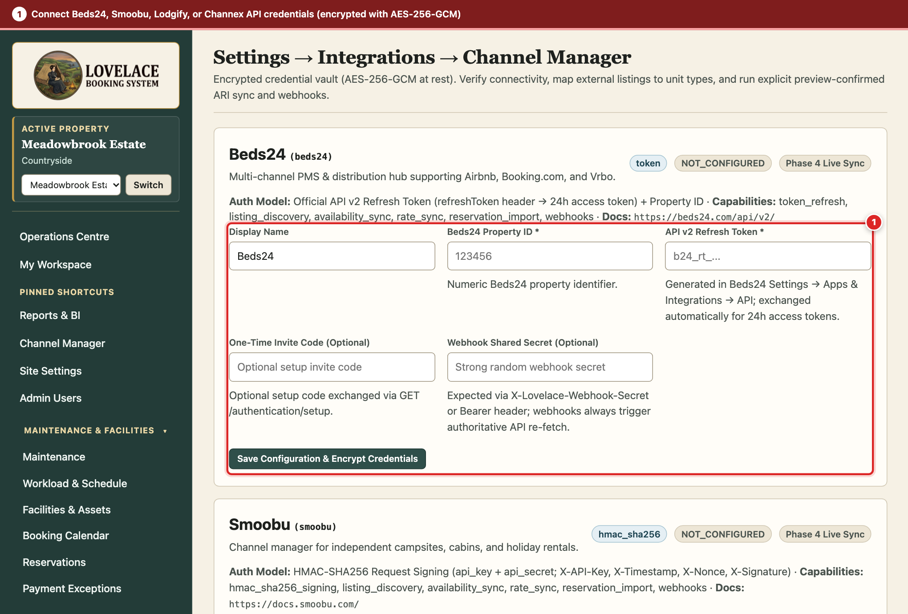

---

### D. Embedding Direct Bookings on Your Website or WordPress (`/property#website-embed`)

 Guests can book directly on your standalone storefront (`https://book.yourdomain.com/stays`) or inside your existing website:

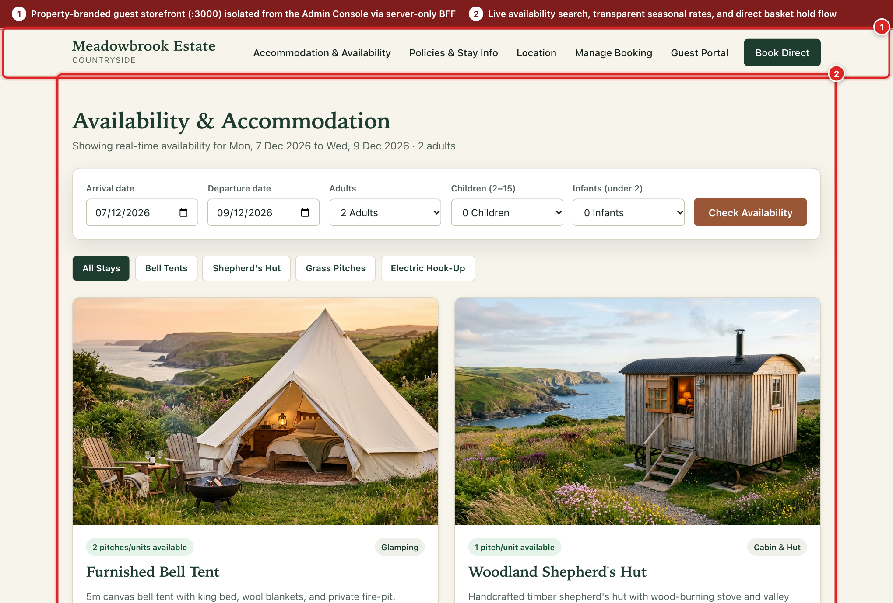

#### Option 1 — Official WordPress Plugin (`.zip`)
1. In **Settings → Site Settings → Website Booking Section (`/property#website-embed`)**, click **Download WordPress Plugin (`.zip`)** (`lovelace-booking-<slug>.zip` comes pre-populated with your `booking_origin`, `property_slug`, display name, and verified brand colours).
2. In WordPress Admin → **Plugins → Add New → Upload Plugin**, upload and **Activate** the `.zip`.
3. Open **Settings → Lovelace Booking** (note: `Public Booking Site URL` must use `https://` in production — non-HTTPS origins are hidden from logged-out visitors for security) and click **Test Connection & Sync Brand Colours** (which also refreshes the cached catalog transient).
4. Add any **Gutenberg Block** (`Lovelace Live Booking Section`, `Lovelace Availability Search Bar`, `Lovelace Book Direct Button`, `Lovelace Accommodation Cards`) or **Shortcode**:

| Shortcode | Gutenberg Block Slug | Supported Attributes |
| :--- | :--- | :--- |
| `[lovelace_booking]` | `lovelace/booking-widget` | `property="<slug>"`, `unit_type="<code-or-uuid>"`, `height="760"` (auto-resizes via origin-verified `postMessage`; Stripe 3DS breaks out cleanly into top window) |
| `[lovelace_search]` | `lovelace/search-bar` | `property="<slug>"`, `target="modal\|new_tab\|same_tab"`, `button_label="Check Availability"` |
| `[lovelace_book_button]` | `lovelace/book-button` | `property="<slug>"`, `unit_type="<code-or-uuid>"`, `mode="modal\|new_tab\|same_tab"`, `label="Book Direct"` |
| `[lovelace_accommodation]` | `lovelace/accommodation-cards` | `property="<slug>"`, `columns="1\|2\|3"`, `cta_mode="modal\|new_tab\|same_tab"`, `schema="true\|false"` (`LodgingBusiness` JSON-LD) |

#### Option 2 — Squarespace, Wix, Webflow, Shopify, or Static HTML
Copy any of the 3 ready-made HTML snippets from `/property#website-embed`:
1. **Option A — Full Auto-Resizing Live Booking `<iframe>`** (`https://book.yourdomain.com/embed/<property-slug>`)
2. **Option B — Zero-JS Pure HTML Availability Search Form** (works even on site builders that block `<script>` and `<iframe>` tags)
3. **Option C — Branded "Book Direct" Button**

---

### E. Enabling the Self-Service Guest Portal *(Optional Dual-Gate Feature)*
By default, `/portal` returns `404` so properties operate cleanly with zero public guest-account surface. To enable the self-service **Guest Portal** (where guests view upcoming direct stays, request date changes/cancellations, send stay enquiries, or submit GDPR data requests):
1. Ensure a `32`-byte `LOVELACE_ENCRYPTION_KEY` and working `LOVELACE_SMTP_ADDR` are configured on `lovelace-app`.
2. Set **`LOVELACE_GUEST_PORTAL_ENABLED=true`** in `lovelace-app`'s environment and restart `lovelace-app`.
3. Ensure `LOVELACE_TRUST_PROXY=true` and `NEXT_PUBLIC_SITE_URL=https://book.yourdomain.com` are set on `lovelace-public-web` so Origin/CSRF validation matches your public domain.
4. In **Settings → Site Settings (`/property`)**, tick **Enable Self-Service Guest Portal** (`guest_portal_enabled = true`) and click **Save Booking Policy**.
   - **Tier A (Single-Booking Lookup):** Guests authenticate with their Booking Reference + Confirmation Token (`30m` idle / `2h` absolute session).
   - **Tier B (Email OTP / Magic Link):** Guests enter their email to receive a 6-digit OTP (`HMAC-SHA256-V1`, `10m` expiry) or same-browser POST magic link (`2h` idle / `12h` absolute session, with a `15m` fresh step-up window for cancellations or privacy requests). If duplicate unmerged guest rows share an email, portal sign-in safely pauses (`duplicate_guest_verification_required`) until staff merge them in `/guests/merge` or send a verified invite from the guest's CRM profile!

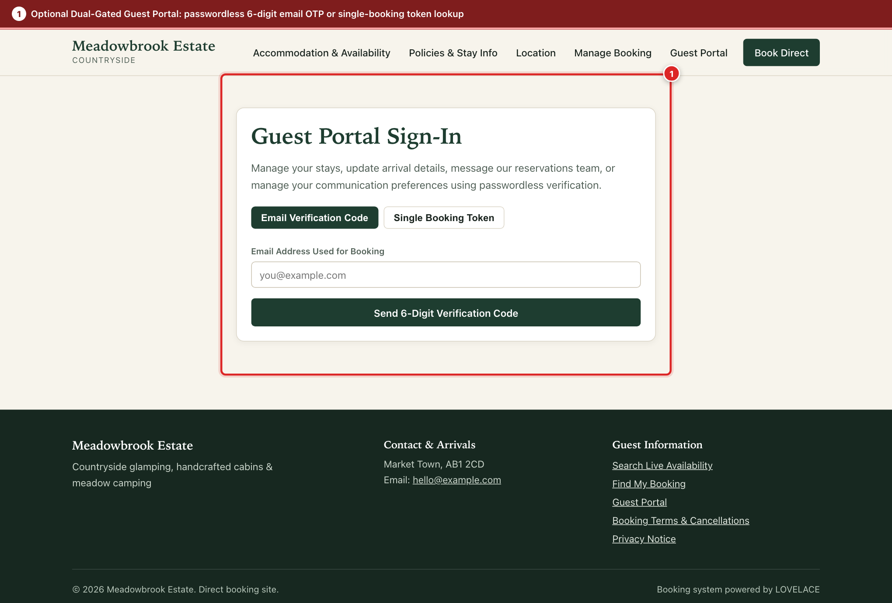

---

## 5. Day-2 Maintenance, Encrypted Backups, Upgrades & Secret Rotation

### A. Health Monitoring Endpoints
Point your uptime monitor at:
- **`https://<YOUR_ADMIN_DOMAIN>/healthz`** — lightweight container liveness probe (`200 OK`).
- **`https://<YOUR_ADMIN_DOMAIN>/readyz`** — deep readiness probe checking PostgreSQL connectivity, migration checksums (`0001`–`0031`), writable `LOVELACE_ATTACHMENT_DIR`, public BFF secret isolation, and SMTP/Stripe readiness (`200 OK` when ready, `503` if degraded). *(Note: `noteG-server -healthcheck` probes `/readyz`.)*
- **`https://<YOUR_PUBLIC_WEB_DOMAIN>/api/healthz`** — Next.js public BFF health probe (`200 OK`).

---

### B. 3-2-1 Backup Strategy, Verification & Empty-DB Disaster Restore (`/settings/backups`)

Open **Settings → Backups & Cloud Sync (`/settings/backups`)** (Global `owner_admin` only):

1. **On-Demand Portable Backups (`.zip` / `.zip.enc`, up to `48 MiB`):**
   - Exports all PostgreSQL tables in deterministic foreign-key restore order **plus** all sanitized blobs in `LOVELACE_ATTACHMENT_DIR` and a `manifest.json` containing per-file SHA-256 digests.
   - Supplying an **Archive Encryption Passphrase (`>= 12` characters)** seals the archive in **`LVBK1` format using Argon2id (`t=2, m=64 MiB, p=2`) key derivation + AES-256-GCM authenticated encryption** (`.zip.enc`). *(Note: This archive passphrase is completely independent of `LOVELACE_ENCRYPTION_KEY` so you can decrypt `.zip.enc` backups on any replacement server even if your old server was lost!)*
2. **Automated Off-Site Cloud Backups:**
   - Connect `AWS_S3`, `S3_COMPATIBLE` (Cloudflare R2 / Backblaze B2 / Wasabi), `GCS`, or `AZURE_BLOB` with automatic intervals (e.g. every `24h`) and retention pruning (e.g. keep newest `14` archives). For properties whose attachment volume grows beyond the `48 MiB` portable archive ceiling, pair cloud backups with native `pg_dump -Fc` + volume snapshots.
3. **Monthly Restore Drill (`Verify Backup Integrity`):**
   - Upload any `.zip` or `.zip.enc` archive on `/settings/backups` to verify passphrase decryption and 100% SHA-256 manifest integrity non-destructively.
4. **Disaster Recovery Into a Fresh Empty Instance:**
   - Boot a fresh Lovelace instance (`0` properties, `1` bootstrapped Global `owner_admin`), rotate your password, go **straight** to **Settings → Backups & Cloud Sync → Restore Into Empty Environment** (do *not* create a property in `/onboarding` first!), and upload your `.zip` / `.zip.enc` archive.
   - **Post-Restore Staff Security Lock:** Your signed-in `owner_admin` session remains active, while any *other* imported staff/manager accounts have their passwords replaced with a locked placeholder and `must_rotate_password = true` until you issue fresh temporary passwords in `/users`. If the new server uses a brand-new `LOVELACE_ENCRYPTION_KEY`, re-enter external OTA API keys (`/settings/integrations/channel-manager`), cloud backup bucket keys (`/settings/backups`), and regenerate your 8 recovery codes (`/account`).

---

### C. Safe Zero-Data-Loss Upgrade Procedure

#### 1. Self-Hosted Docker Compose Server
```bash
cd /opt/lovelace

# 1. Take a pre-upgrade snapshot (via /settings/backups UI AND/OR pg_dump):
docker exec lovelace-postgres pg_dump -U "${POSTGRES_BOOTSTRAP_USER:-postgres}" -Fc "${POSTGRES_DB:-lovelace}" \
  > "/opt/lovelace/pre_upgrade_$(date +%Y%m%d_%H%M%S).dump"

# 2. Pull the latest release commit/tag:
git fetch origin main
git checkout main
git merge --ff-only origin/main

# 3. Rebuild and roll forward (db-bootstrap + migrate run automatically before app restarts):
#    NEVER pass `-v` to docker compose!
docker compose up -d --build

# 4. Verify readiness:
curl -fsS http://127.0.0.1:8080/readyz
curl -fsS http://127.0.0.1:3000/api/healthz
```

#### 2. AWS / GCP / Azure / Railway
1. Trigger an off-site backup in **Settings → Backups & Cloud Sync** (or take an RDS / Cloud SQL / Azure / Railway volume snapshot).
2. Run `lovelace-migrate` (`MIGRATION_DATABASE_URL` as `lovelace_migrator`) when upgrading across releases with new files in `migrations/`.
3. Run `./scripts/postgres/ensure-roles.sh` once if new tables were introduced so `lovelace_app` receives DML grants on them.
4. Deploy updated `lovelace-app` and `lovelace-public-web` images and confirm `/readyz` returns `200 OK`.

---

### D. Rotating Secrets Safely
- **Admin & Staff Passwords:** Rotate anytime in **My Account (`/account`)** or **Settings → Admin Users (`/users`)**.
- **Public BFF Secret (`LOVELACE_PUBLIC_API_SECRET`):** Generate a new `openssl rand -hex 32` value, update it on both `lovelace-app` and `lovelace-public-web`, and redeploy both services together.
- **Database Role Passwords (`lovelace_app` / `lovelace_migrator`):** Update `LOVELACE_APP_PASSWORD` / `LOVELACE_MIGRATOR_PASSWORD`, run `./scripts/postgres/ensure-roles.sh` (or `docker compose up -d --no-deps db-bootstrap`), and restart `lovelace-app`.
- **`LOVELACE_ENCRYPTION_KEY`:** Keep this 32-byte key backed up! Rotating it invalidates ciphertext/HMACs keyed by the old key (`channel_connections`, `backup_targets`, `admin_recovery_codes`, and active `guest_portal_challenges`), so after rotating `LOVELACE_ENCRYPTION_KEY` you must regenerate recovery codes in `/account` and re-save OTA and cloud-backup credentials.

---

## Next Steps
- For everyday non-technical instructions, share the **[Property Owner's Everyday Handbook](../owner-handbook/README.md)** with your team.
- If anything goes wrong, jump to **[Guide 5: Deep Troubleshooting & Hospitality Catastrophe Playbook](05-troubleshooting-and-disaster-recovery.md)**.
- For complete CLI, API, worker, and RBAC matrices, see **[Guide 6: Complete Feature, Tool, CLI & Permission Reference](06-complete-feature-and-tool-reference.md)**.
