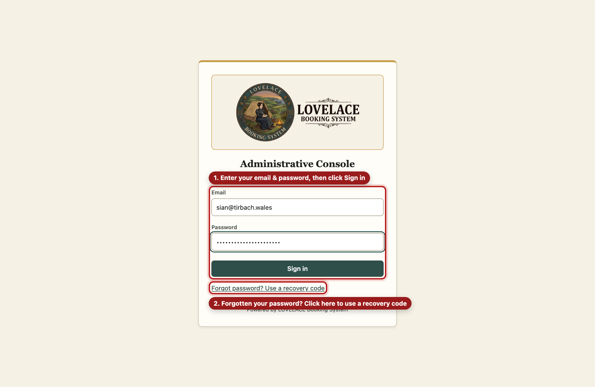
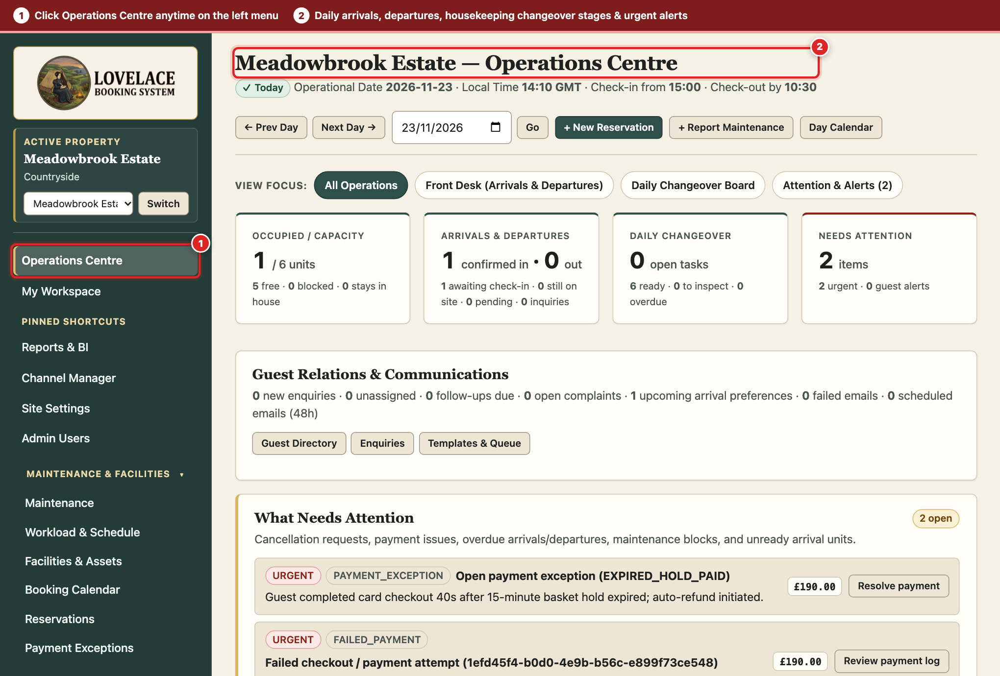
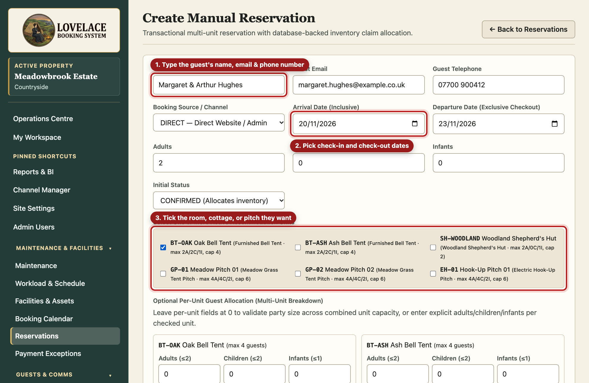
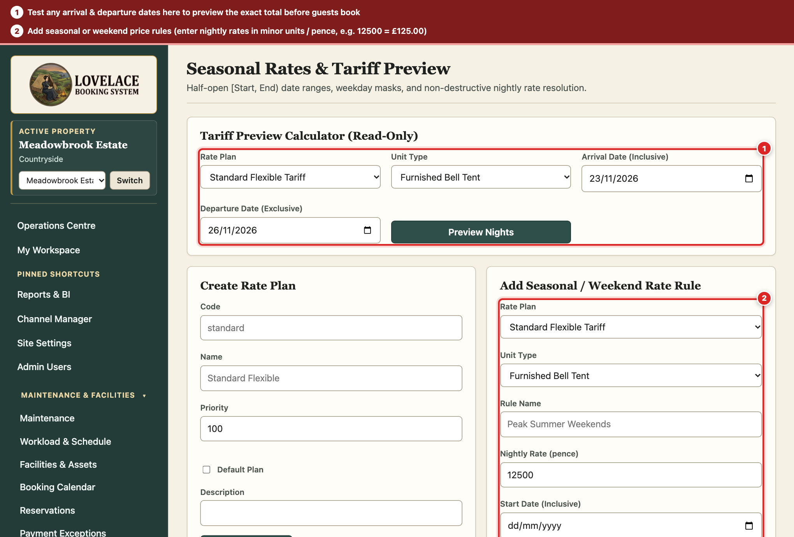
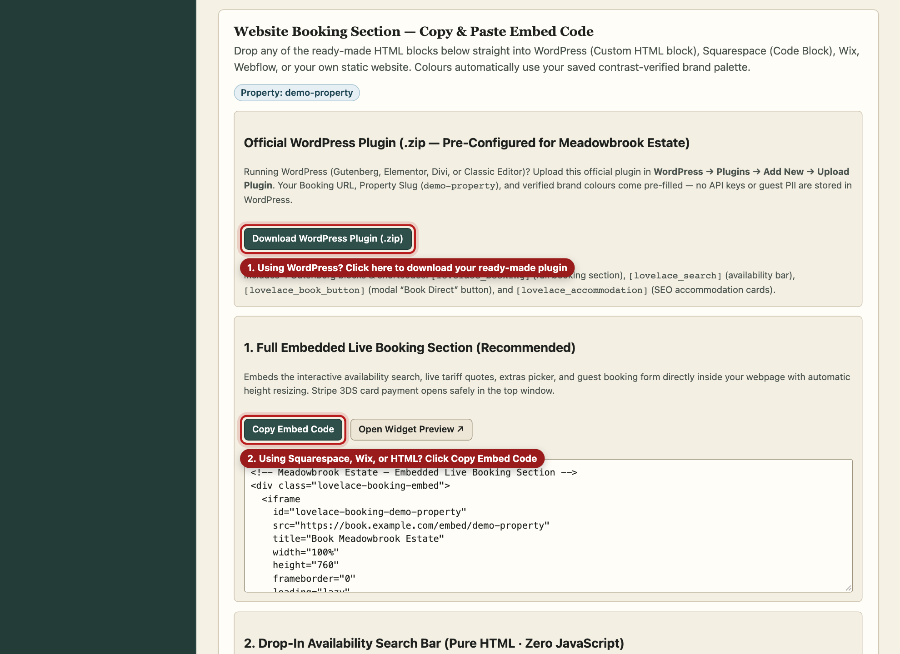

# The Property Owner's Everyday Guide to Lovelace

Welcome! This handbook is written in plain English — with zero technical jargon — to walk you step by step through the everyday tasks of running your campsite, holiday cottage, Airbnb, B&B, or small hotel with **Lovelace**.

> **Reassurance before you start:** You cannot "break" your website by clicking around and exploring. Every important action has a clear confirmation button, and Lovelace will never double-book a room, cottage, or pitch — even if two people try to book at the exact same moment.

---

## Quick Jump to Any Task

1. [Signing In (and What to Do If You Forget Your Password)](#task-1-signing-in-and-what-to-do-if-you-forget-your-password)
2. [Making the Writing Bigger & Easier to Read](#task-2-making-the-writing-bigger--easier-to-read)
3. [Setting Up Your Property for the First Time](#task-3-setting-up-your-property-for-the-first-time)
4. [Checking Who Is Arriving & Leaving Today](#task-4-checking-who-is-arriving--leaving-today)
5. [Reading Your Booking Calendar](#task-5-reading-your-booking-calendar)
6. [Taking a Telephone or Walk-In Booking](#task-6-taking-a-telephone-or-walk-in-booking)
7. [Blocking Off Dates for Family Use, Repairs, or Winter](#task-7-blocking-off-dates-for-family-use-repairs-or-winter)
8. [Checking or Changing Seasonal & Weekend Prices](#task-8-checking-or-changing-seasonal--weekend-prices)
9. [Putting Your Booking Box onto Your Own Website (or WordPress)](#task-9-putting-your-booking-box-onto-your-own-website-or-wordpress)
10. [Saving a Safety Copy (Backup) of All Your Bookings](#task-10-saving-a-safety-copy-backup-of-all-your-bookings)
11. ["Don't Panic!" — Quick Fixes When Something Goes Wrong](#dont-panic--quick-fixes-when-something-goes-wrong)

---

## Task 1: Signing In (and What to Do If You Forget Your Password)

### How to sign in normally
1. Open your Lovelace Admin web address in your browser (tip: bookmark it on your computer or iPad so it is always one click away).
2. Type your **Email** and **Password**.
3. Click the green **Sign in** button.

### Saving your 8 Emergency Recovery Codes (do this once!)
The first time you choose your own password, Lovelace gives you **8 Emergency Recovery Codes**. Think of these like a spare set of house keys kept in a kitchen drawer:

1. Click **Settings → My Account** in the left-hand menu.
2. When your 8 codes appear, click **Download .txt** (or write them on a card / print the page) and keep them somewhere safe.

### If you ever forget your password
You **do not** need to wait for a reset email or look inside any computer files:
1. On the sign-in screen, click **Forgot password? Use a recovery code**.
2. Type your email address, **any one** of your 8 emergency codes, and the new password you would like to use.
3. Click **Reset Password** — you will be signed straight back in! *(Cross that code off your list, as each code is used once.)*

---

## Task 2: Making the Writing Bigger & Easier to Read

If you find computer screens tiring on the eyes, Lovelace can make all writing and buttons noticeably larger just for you:

1. Look down the dark green menu on the left-hand side, open **Settings**, and click **My Account**.
2. Scroll down to **Global Appearance, Accessibility & Navigation**.
3. Under **Colour Mode**, pick **Light** (warm cream paper background) or **Dark**.
4. Under **Text Size**, change *Default* to **Large** or **Extra Large**. *(You can also tick **High Contrast Borders & Surfaces** for sharper outlines.)*
5. Click **Save Global Preferences**.

---

## Task 3: Setting Up Your Property for the First Time

When you sign in to a brand-new Lovelace system (or click **Settings → Setup Wizard** on the left), Lovelace asks you a simple series of questions to set everything up for you:

1. **Step 1 — Pick Your Style:** Click **Campsite, Glamping & Holiday Park**, **Holiday Let, Cottage or Airbnb**, or **Boutique Hotel, B&B or Guesthouse**, and type the name of your business. Lovelace fills in sensible check-in times and wording automatically.
2. **Step 2 — Add Your Rooms, Cottages, or Pitches:** Tell Lovelace what guests stay in and how many you have (for example, *"6 Meadow Pitches"* — Lovelace numbers them `01` to `06` for you automatically!).
3. **Step 3 — Prices & Optional Extras:** Add things like a dog fee, firewood basket, breakfast hamper, or weekend price uplift.
4. **Step 4 — Deposits & House Rules:** Choose whether guests pay in full or pay a deposit (such as 30% upfront), and check over your quiet hours, pet rules, and cancellation wording.
5. **Step 5 — Helpers & Staff *(Optional)*:** Running the place yourself? Just click **Continue**. If you have a cleaner, receptionist, or handyman, you can give them their own login here.
6. **Step 6 — Automatic Cloud Backup *(Optional)*:** Click **Skip for Now** unless you already have a cloud storage bucket you want to connect.
7. **Step 7 — Review & Finish:** Check your summary and click **Finish Setup & Open Operations Centre →**.

---

## Task 4: Checking Who Is Arriving & Leaving Today

Every morning with your cup of tea, click **Operations Centre** at the very top of the left-hand menu:

- **Occupied / Capacity:** Shows how many of your rooms, cottages, or pitches are occupied tonight and how many are free.
- **Arrivals & Departures:** Shows how many guests are due to check in today and check out today.
- **Daily Changeover:** Shows which rooms or pitches need cleaning or checking before the next guest arrives.
- **What Needs Attention:** Highlights anything waiting on you (such as a guest enquiry or a cancellation request). If everything is sorted, it says **All clear** in green!

---

## Task 5: Reading Your Booking Calendar

To see your diary across the next fortnight or month:

1. In the left-hand menu (under **Maintenance & Facilities**), click **Booking Calendar**.
2. Along the left column you will see each of your rooms, cottages, or pitches. Across the top are the dates.
   - **Open** cells are free to book.
   - **Green** cells show confirmed guest stays with the guest's name.
   - Use **← Prev** and **Next →** to flip backward or forward through the calendar.

---

## Task 6: Taking a Telephone or Walk-In Booking

When a guest rings up on the telephone or walks into reception wanting to stay:

1. From **Operations Centre** or **Booking Calendar**, click the green **+ New Reservation** button in the top-right corner.
2. Type the guest's **Full Name**, **Email** (if they have one), and **Telephone** number.
3. Choose their **Arrival Date** (the afternoon they arrive) and **Departure Date** (the morning they leave), plus the number of **Adults** and **Children**.
4. Tick the box next to the **room, cottage, or pitch** they want.
5. Scroll to the bottom and click **Create Reservation**.

Lovelace checks immediately that those dates are free and puts their name straight onto your calendar so nobody else can book that space online!

---

## Task 7: Blocking Off Dates for Family Use, Repairs, or Winter

Need to close a cottage while the plumber visits, keep a room back for visiting family, or close your campsite for winter?

1. Click **Bulk Blockouts** (top-right of the **Booking Calendar**, or under **Inventory & Holds → Bulk Blockouts** on the left).
2. Under **Target Scope**, pick whether you are closing **Single Unit**, **Selected Multiple Units**, or **All Units on Property** (your whole site).
3. Under **Restriction Category**, pick why:
   - **OWNER_USE** (family or personal use)
   - **MAINTENANCE** (repairs or decorating)
   - **SEASONAL_CLOSURE** (closed for winter)
4. Pick the **Start Date** and the **End / Reopen Date**, type a short note to remind yourself why, and click **Preview Affected Inventory & Conflicts**.
5. Lovelace will check that no existing guest is already booked on those nights, then give you a green **Confirm & Commit Bulk Blockout** button to lock it in.

---

## Task 8: Checking or Changing Seasonal & Weekend Prices

Wondering *"How much will Lovelace charge for 3 nights over the August Bank Holiday?"* or want to raise your summer weekend rate?

1. In the left-hand menu under **Inventory & Holds**, click **Rates & Preview**.
2. **To check a price safely:** Pick the accommodation type, Arrival Date, and Departure Date in the top **Tariff Preview Calculator** box and click **Preview Nights**. It shows you a night-by-night price breakdown without changing anything!
3. **To add a summer or weekend price:** Use the **Add Seasonal / Weekend Rate Rule** box on the right — give it a clear name (such as *"Summer Holidays"*), enter the nightly price in pence (for example, `12500` for `£125.00`), pick the start and end dates, and save.

---

## Task 9: Putting Your Booking Box onto Your Own Website (or WordPress)

Already have a website for your business? You can let guests check dates and book directly on your website without paying commission to big travel sites:

1. In the left-hand menu under **Settings**, click **Site Settings** and scroll down to **Website Booking Section — Copy & Paste Embed Code**.
2. **If your website uses WordPress:**
   - Click **Download WordPress Plugin (.zip)**.
   - Sign in to your WordPress site, click **Plugins → Add New → Upload Plugin**, choose that `.zip` file, and click **Install Now** then **Activate**.
   - Everything is already pre-filled with your property's details! Edit any page in WordPress and add the **Lovelace Live Booking Section** block (or type `[lovelace_booking]`).
3. **If your website uses Squarespace, Wix, Webflow, or a web designer:**
   - Click **Copy Embed Code** (it will briefly say **Copied!**).
   - Paste it into a "Custom HTML" or "Code" block on your website — or email the copied code to whoever looks after your website.

---

## Task 10: Saving a Safety Copy (Backup) of All Your Bookings

For complete peace of mind, we recommend downloading a safety copy of your bookings once a week (for instance, every Sunday evening) onto your computer or a USB memory stick:

1. In the left-hand menu under **Settings**, click **Backups & Cloud Sync**.
2. In box **1. Download Local Portable Backup (.zip)**:
   - *(Optional)* Type a memorable 12-character passphrase if you want the backup file locked with encryption, or leave that box blank for a standard `.zip` file.
   - Type your **Current Admin Password** in the right-hand box.
   - Click **Download Local Backup Archive**.
3. Your computer will save a single `.zip` file into your **Downloads** folder containing all of your bookings, guest records, prices, and uploaded photos!

*(And if you or an IT helper ever want Lovelace to save backups automatically every night to Amazon, Cloudflare, Google, or Microsoft cloud storage, you can fill in box **2. Cloud Bucket Destinations** right underneath.)*

---

## Handy Everyday Tips

- **Switching between multiple properties:** If you look after more than one cottage or site, use the property selector right underneath the **LOVELACE** badge at the top-left of the screen to switch between them.
- **Online card payments stay safely off until you are ready:** Guests cannot accidentally pay live card money while you are still setting up. Whenever you are ready to take live card payments with Stripe, open **Settings → Site Settings**, tick **Enable Public Online Checkout (Stripe)**, and click **Save Booking Policy**.
- **Signing out on a shared reception computer:** Always click **Sign out** at the bottom-left of the dark green sidebar if other people use the same computer.

---

## "Don't Panic!" — Quick Fixes When Something Goes Wrong

Even on a busy Friday afternoon with the phone ringing, almost every mistake in Lovelace can be undone in under a minute:

### 1. *"Help! I entered `140` instead of `14000` and listed our £140 room for £1.40 a night!"*
- **Why it happened:** On the **Rates & Preview** screen, seasonal rate rules ask for the price **in pence** (`14000` = `£140.00`).
- **How to fix it right now:** Open **Inventory & Holds → Rates & Preview**, scroll down to your rules list, click **Archive** next to the `£1.40` rule, and add a new rule with `14000`. Use the **Tariff Preview Calculator** at the top of that page to double-check the total in `£`!

### 2. *"I meant to close Room 2 for decorating, and accidentally closed our WHOLE hotel all summer!"*
- **How to fix it right now:** Open **Inventory & Holds → Bulk Blockouts**, scroll down to **Blockout Groups**, and click **Release** next to the accidental blockout. Every room will be open for bookings again within one second.

### 3. *"A guest wanted Friday AND Saturday night, so I put Arrival = Friday, Departure = Saturday — and only booked 1 night!"*
- **Why it happened:** **Departure Date** always means **the morning the guest checks out and goes home** (so Friday + Saturday night means Arrival = **Friday**, Departure = **Sunday**).
- **How to fix it right now:** Open **Reservations**, click the guest's booking reference, and extend their departure date to Sunday (or move them to a free room if Saturday was taken). Always glance at the **`Nights`** count (`2 nights`) to be sure!

### 4. *"The plumber finished fixing the shower and marked the job Completed, so why is that room STILL blocked?"*
- **Why it happened:** Lovelace keeps repaired rooms closed until someone checks that the room is clean and ready for guests!
- **How to fix it right now:** Open **Maintenance & Facilities → Maintenance**, click that repair job, and mark the **Inspection** as **PASSED**. The room reopens automatically.

### 5. *"Guests keep ringing to say our website says 'Online Card Checkout Unavailable'!"*
- **Why it happened:** New properties start with live card payments switched **off** for safety until you turn them on.
- **How to fix it right now:** Once your Stripe account is connected, open **Settings → Site Settings**, tick **Enable Public Online Checkout (Stripe)**, and click **Save Booking Policy**.

### 6. *"I typed the wrong password too many times and now it won't let me sign in (or I lost my 8 recovery codes)!"*
- **If you typed wrong passwords 8 times:** Wait **15 minutes** with a cup of tea — the safety lock clears automatically after 15 minutes.
- **If another owner/partner has an Owner Admin login:** Ask them to sign in, go to **Settings → Admin Users**, and give you a temporary password.
- **If you are the only owner and lost both your password AND your 8 recovery codes:** Ask the person who looks after your server/hosting to follow **Catastrophe 2** in the [Deep Troubleshooting & Catastrophe Playbook](../guides/05-troubleshooting-and-disaster-recovery.md#catastrophe-2-the-total-owner-lockout) — they can issue you a fresh temporary password in 60 seconds without losing a single booking!

