# The Property Owner's Everyday Guide to Lovelace

Welcome! This handbook is written in plain English — with zero technical jargon — to walk you step by step through **every everyday tool** for running your campsite, glamping retreat, holiday cottage, Airbnb, B&B, or small hotel with **Lovelace**.

> **Reassurance before you start:** You cannot "break" your website by clicking around and exploring. Every important action has a clear confirmation button, and Lovelace will never double-book a room, cottage, or pitch — even if two people try to book at the exact same moment.

---

## Quick Jump to Any Task

1. [Signing In (and What to Do If You Forget Your Password)](#task-1-signing-in-and-what-to-do-if-you-forget-your-password)
2. [Making the Writing Bigger & Tailoring Your Personal Workspace](#task-2-making-the-writing-bigger--tailoring-your-personal-workspace)
3. [Setting Up Your Property (or Adding a Second Site & Custom Logo)](#task-3-setting-up-your-property-or-adding-a-second-site--custom-logo)
4. [Morning Check: Arrivals, Departures & Housekeeping Changeovers](#task-4-morning-check-arrivals-departures--housekeeping-changeovers)
5. [Reading Your Booking Calendar & Saving Favourite Views](#task-5-reading-your-booking-calendar--saving-favourite-views)
6. [Taking Phone Bookings, Checking Guests In/Out & Amending Stays](#task-6-taking-phone-bookings-checking-guests-inout--amending-stays)
7. [Managing Rooms, Cottages, Pitches & Optional Guest Extras](#task-7-managing-rooms-cottages-pitches--optional-guest-extras)
8. [Blocking Off Dates & Holding Next Season's Dates Back](#task-8-blocking-off-dates--holding-next-seasons-dates-back)
9. [Checking or Changing Seasonal & Weekend Prices](#task-9-checking-or-changing-seasonal--weekend-prices)
10. [Repairs, Safety Inspections, Contractors & Recurring Maintenance](#task-10-repairs-safety-inspections-contractors--recurring-maintenance)
11. [Guest Directory, Dietary Notes, Enquiries & Automated Emails](#task-11-guest-directory-dietary-notes-enquiries--automated-emails)
12. [Connecting Airbnb, Booking.com & Travel Channel Managers](#task-12-connecting-airbnb-bookingcom--travel-channel-managers)
13. [Staff Logins, Reports & Downloading Spreadsheets for Your Accountant](#task-13-staff-logins-reports--downloading-spreadsheets-for-your-accountant)
14. [Putting Your Booking Box onto Your Own Website (or WordPress)](#task-14-putting-your-booking-box-onto-your-own-website-or-wordpress)
15. [Saving, Testing & Restoring a Safety Copy (Backup) of Your Bookings](#task-15-saving-testing--restoring-a-safety-copy-backup-of-your-bookings)
16. ["Don't Panic!" — Quick Fixes When Something Goes Wrong](#dont-panic--quick-fixes-when-something-goes-wrong)

---

## Task 1: Signing In (and What to Do If You Forget Your Password)

### How to sign in normally
1. Open your Lovelace Admin web address in your browser (tip: bookmark it on your computer or iPad so it is always one click away).
2. Type your **Email** and **Password**.
3. Click the green **Sign in** button. *(The very first time you sign in, Lovelace will ask you to swap your starter password for a private 12-character password of your own choosing.)*

### Saving your 8 Emergency Recovery Codes (do this once!)
Right after you set your password, Lovelace gives you **8 Emergency Recovery Codes**. Think of these like a spare set of house keys kept in a kitchen drawer:

1. Click **Settings → My Account** in the left-hand menu.
2. When your 8 codes appear, click **Download .txt** (or write them on a card / print the page) and keep them somewhere safe.

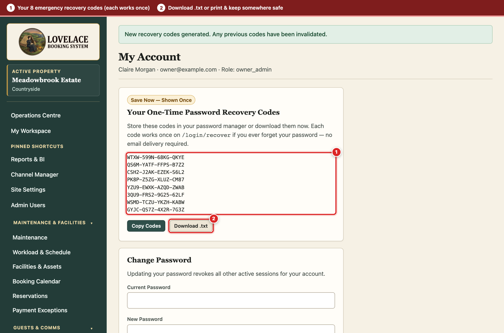

### If you ever forget your password
You **do not** need to wait for a reset email or look inside any computer files:
1. On the sign-in screen, click **Forgot password? Use a recovery code**.
2. Type your email address, **any one** of your 8 emergency codes, and the new password you would like to use.
3. Click **Reset Password** — you will be signed straight back in! *(Cross that code off your list, as each code works once.)*

---

## Task 2: Making the Writing Bigger & Tailoring Your Personal Workspace

### Making the writing larger and easier on the eyes
1. Open **Settings → My Account** on the left-hand menu and scroll down to **Global Appearance, Accessibility & Navigation**.
2. Under **Colour Mode**, pick **Light** (warm cream paper background) or **Dark**.
3. Under **Text Size**, change *Default* to **Large** or **Extra Large**. *(You can also tick **High Contrast Borders & Surfaces** and pin up to **6 favourite links** to the top of your left menu!)*
4. Click **Save Global Preferences** — this changes the screen *only* for your own login without affecting anyone else.

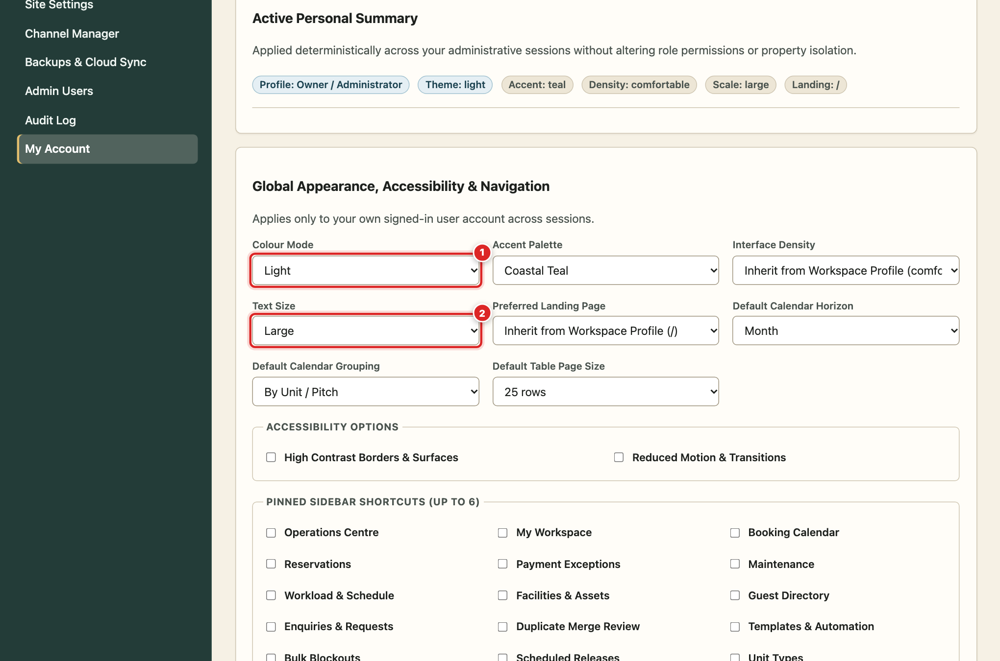

### Arranging your Personal Workspace (`My Workspace`)
Click **My Workspace** near the top-left of the dark green sidebar:
- **Switch Role Layouts:** Pick a ready-made layout for **Owner / Administrator**, **Duty Manager**, **Front Desk**, **Housekeeping**, or **Maintenance**.
- **Customise Cards:** Click **Customise Layout** (`?edit=1`) to add, remove, or reorder summary cards (such as *Arrivals & Departures Today*, *30-Day Performance*, or *Operational Alerts*) to suit your morning routine.

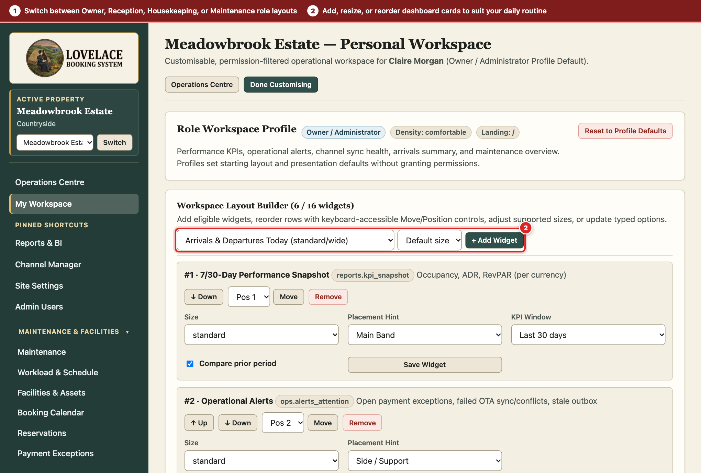

---

## Task 3: Setting Up Your Property (or Adding a Second Site & Custom Logo)

When you sign in to a brand-new Lovelace system (or click **Settings → Setup Wizard** on the left), Lovelace walks you through 7 simple steps:

1. **Step 1 — Pick Your Style:** Click **Campsite, Glamping & Holiday Park**, **Holiday Let, Cottage or Airbnb**, or **Boutique Hotel, B&B or Guesthouse**, and type the name of your business. Lovelace fills in sensible check-in times and wording automatically.
2. **Step 2 — Add Your Rooms, Cottages, or Pitches:** Tell Lovelace what guests stay in and how many you have (for example, *"6 Meadow Pitches"* — Lovelace numbers them `01` to `06` for you automatically!).
3. **Step 3 — Prices & Optional Extras:** Add things like a dog fee, firewood basket, breakfast hamper, or weekend price uplift.
4. **Step 4 — Deposits & House Rules:** Choose whether guests pay in full or pay a deposit (such as 30% upfront), and check over your quiet hours, pet rules, and cancellation wording.
5. **Step 5 — Helpers & Staff *(Optional)*:** Running the place yourself? Just click **Continue**. If you have a cleaner, receptionist, or handyman, you can give them their own login here.
6. **Step 6 — Automatic Cloud Backup *(Optional)*:** Click **Skip for Now** unless you already have a cloud storage bucket you want to connect.
7. **Step 7 — Review & Finish:** Check your summary and click **Finish Setup & Open Operations Centre →**.

> **Uploading your logo or adding a second property later:** Open **Settings → Site Settings** anytime to upload your property's PNG/JPEG logo, test new brand colours safely with **Preview**, or click **+ Add Another Property** if you manage more than one site.

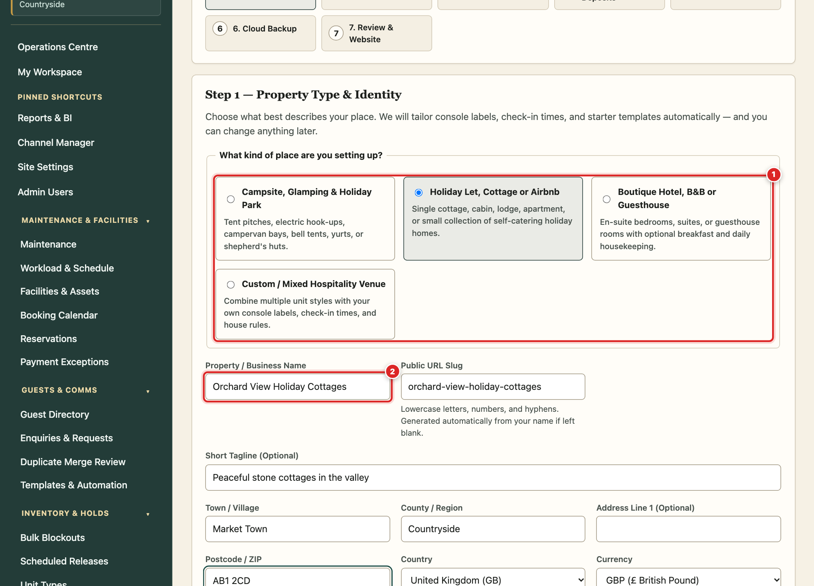

---

## Task 4: Morning Check: Arrivals, Departures & Housekeeping Changeovers

Every morning with your cup of tea, click **Operations Centre** at the very top of the left-hand menu:

- **Occupied / Capacity:** Shows how many of your rooms, cottages, or pitches are occupied tonight and how many are free.
- **Arrivals & Departures:** Shows everyone due to check in today (including any dietary or room notes!) and everyone checking out today.
- **5-Stage Daily Changeover Board (Housekeeping):** Tracks each departing space step by step so no guest ever walks into an uncleaned room:
  1. `GUEST_DEPARTING` → 2. `CLEANING_REQUIRED` (queued automatically as soon as you check a guest out!) → 3. `CLEANING_IN_PROGRESS` → 4. `INSPECTION_REQUIRED` → 5. **`READY`**.
- **What Needs Attention:** Highlights anything waiting on you (such as an unanswered guest enquiry, an unready room with an arrival today, or a payment exception). When everything is sorted, it says **All clear** in green!

---

## Task 5: Reading Your Booking Calendar & Saving Favourite Views

To see your diary across the next week, fortnight, or month:

1. In the left-hand menu, click **Booking Calendar**.
2. Along the left column you will see each of your rooms, cottages, or pitches. Across the top are the dates.
   - **Open** cells are free to book.
   - **Green** cells show confirmed guest stays with the guest's name (click any booking to open its full details).
   - **Amber / Grey / Purple** cells show temporary basket holds, maintenance/owner blockouts, or unreleased future season dates.
   - Use **← Prev** and **Next →** to flip backward or forward, and use **Save View** if you want to save a favourite filter (such as *"Bell Tents — 30-Day View"*).

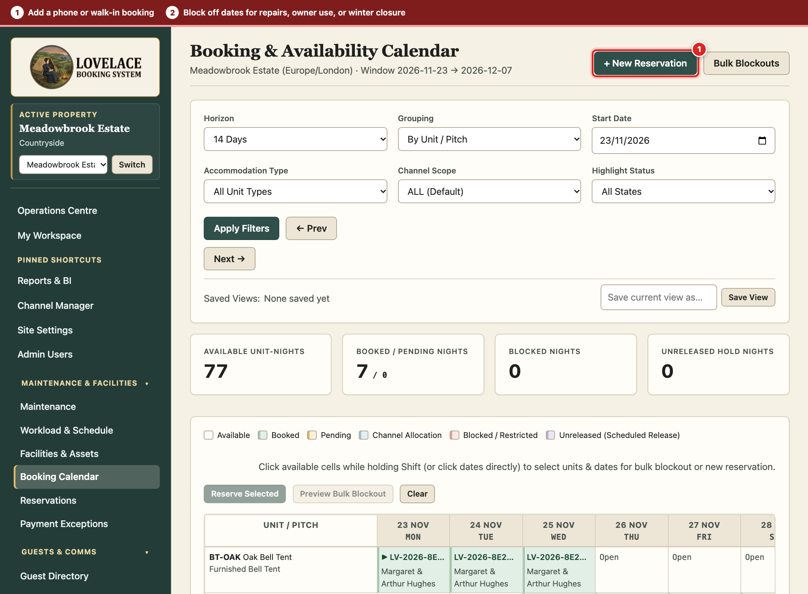

---

## Task 6: Taking Phone Bookings, Checking Guests In/Out & Amending Stays

### Taking a new telephone or walk-in booking
1. From **Operations Centre**, **Booking Calendar**, or **Reservations**, click **+ New Reservation**.
2. Type the guest's **Full Name**, **Email** (if they have one), and **Telephone** number.
3. Choose their **Arrival Date** (the afternoon they arrive) and **Departure Date** (**the morning they pack up and leave**), plus **Adults**, **Children**, and **Infants**.
4. Tick one or more **rooms, cottages, or pitches** (great when two friends want adjacent pitches on one booking!).
5. Scroll down and click **Create Reservation**.

### Checking guests in, checking them out, amending dates & checking payments
Click any booking on your **Booking Calendar** or in **Reservations** to open its booking card:
- **Check-In / Check-Out / Cancel:** Use the status transition box to mark guests **`CHECKED_IN`** when they arrive and **`CHECKED_OUT`** when they leave (which automatically queues cleaning on the Housekeeping board!), or **`CANCELLED` / `NO_SHOW`** (which immediately frees those dates).
- **Change Dates, Party Size, or Notes:** Update stay dates, guest counts, or private staff notes right on the page — Lovelace checks automatically that the new dates don't clash with anyone else.
- **Payment Ledger & Payment Exceptions:** View deposits paid, balances due, and refunds. If a website guest ever pays seconds *after* their 15-minute checkout timer expired, Lovelace flags it clearly in **Payment Exceptions** (left menu) and initiates an automatic Stripe refund so you are never caught out.

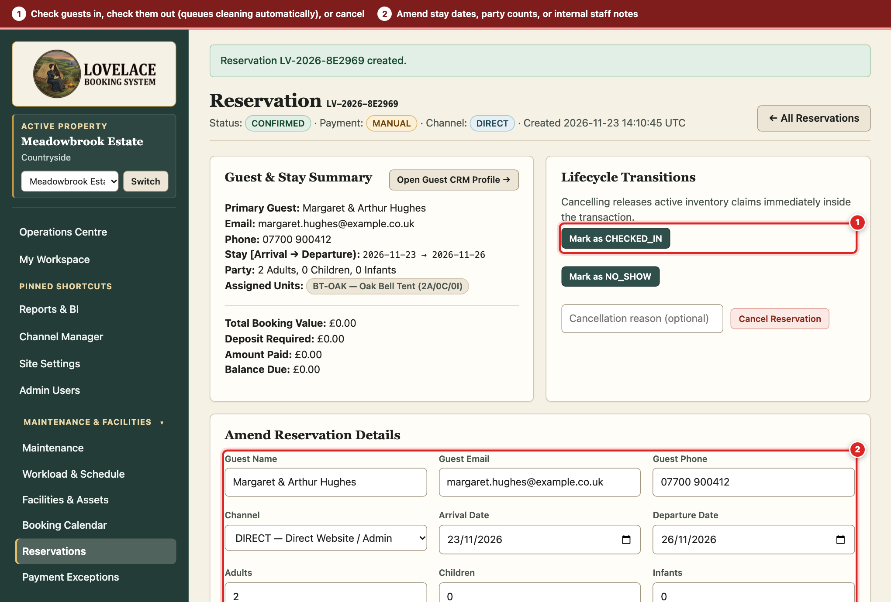

---

## Task 7: Managing Rooms, Cottages, Pitches & Optional Guest Extras

Under **Inventory & Holds** in the left-hand menu, you have three simple lists for managing what you sell:

1. **Unit Types (`/unit-types`):** Your accommodation categories (e.g. *Furnished Bell Tent* or *Harbour Cottage*), where you set maximum adults/children/dogs, **Minimum Nights** (e.g. `2` nights minimum), and base nightly price in pence (`12000` = `£120.00`).
2. **Units & Pitches (`/units`):** Your individual numbered rooms, cottages, or pitches (e.g. `BT-OAK`, `GP-01`) where you can add gate/keybox notes or mark an individual space `active` or `inactive`.
3. **Extras & Add-ons (`/extras`):** Optional items guests can add to their stay — such as a **Dog Fee**, **Firewood Basket**, **Breakfast Hamper**, or **Late Check-Out** — billed *once per stay (`per_stay`)*, *per night (`per_night`)*, or *per person*.

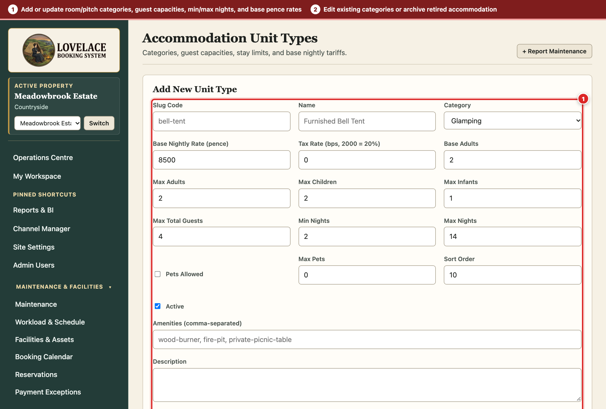

---

## Task 8: Blocking Off Dates & Holding Next Season's Dates Back

### Blocking off dates for family use, repairs, weather, or winter (`Bulk Blockouts`)
1. Click **Inventory & Holds → Bulk Blockouts**.
2. Under **Target Scope**, choose **Single Unit**, **Selected Multiple Units**, **Accommodation Type**, or **All Units on Property** (your whole site).
3. Under **Restriction Category**, pick **OWNER_USE**, **MAINTENANCE**, **WEATHER_CLOSURE**, or **SEASONAL_CLOSURE**.
4. Choose the **Start Date** and **End / Reopen Date** and click **Preview Affected Inventory & Conflicts** — Lovelace warns you if any guest is already booked before you click **Confirm & Commit**. *(Click **Release** anytime to reopen early!)*

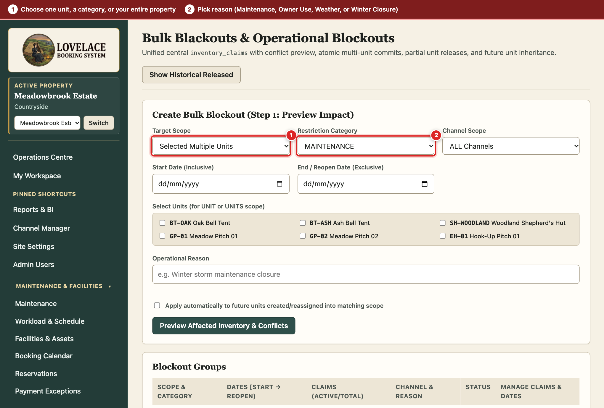

### Holding next year's summer dates back until you are ready (`Scheduled Releases`)
Want to stop regulars snapping up next August before you have decided next year's prices — or let **Direct website guests** book summer two weeks before Airbnb opens?
1. Click **Inventory & Holds → Scheduled Releases**.
2. Pick the dates you want to hold back, choose **`ALL Channels`** (or just an external channel like `AIRBNB`), and pick the **Release Date & Time** when bookings should open automatically.
3. Change your mind and want to open the season today? Just click **Release Now**!

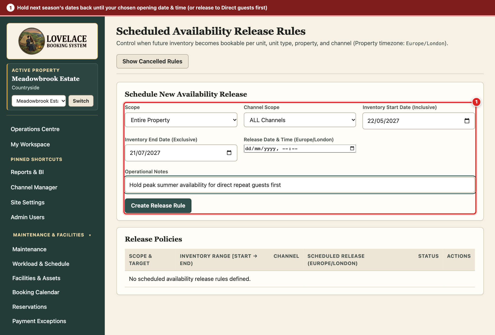

---

## Task 9: Checking or Changing Seasonal & Weekend Prices

Wondering *"How much will Lovelace charge for 3 nights over the August Bank Holiday?"* or want to raise your summer weekend rate?

1. Click **Inventory & Holds → Rates & Preview**.
2. **To check a price safely:** Pick the accommodation type, Arrival Date, and Departure Date in the top **Tariff Preview Calculator** box and click **Preview Nights**. It shows a night-by-night breakdown without changing anything!
3. **To add a summer or weekend price:** Use **Add Seasonal / Weekend Rate Rule** — give it a clear name (such as *"Summer School Holidays"*), enter the nightly price **in pence** (for example, `14500` for `£145.00`), pick the start and end dates, and save.

---

## Task 10: Repairs, Safety Inspections, Contractors & Recurring Maintenance

Under **Maintenance & Facilities** on the left-hand menu:

1. **Report & Track Repairs (`Maintenance`):** Log any repair job (e.g. leaking tap, torn bell-tent canvas, or boiler service), upload photos from your phone, and choose whether the space is still fine to sleep in (`NONE` / `PARTIAL`) or needs closing (`UNAVAILABLE`).
   - **Important Safety Check:** Once a serious repair is finished, a Manager or Owner marks the **Inspection** as **`PASSED`**, closes the job, **and clicks `Release Restriction`** when the room/pitch is clean and ready to welcome guests again.
2. **Facilities & Contractors (`Facilities & Assets`):** Keep a tidy list of your site areas (shower block, boiler room), appliances/warranties, and trusted local tradespeople (plumber, electrician, Gas Safe engineer).
3. **Recurring Safety Checks (`Workload & Schedule`):** Set up automatic weekly, monthly, or annual reminders — such as *Monthly Water Temperature Checks*, *Chimney Sweeping*, or *Annual Gas Safety Certificates* — so compliance jobs appear on your list automatically!

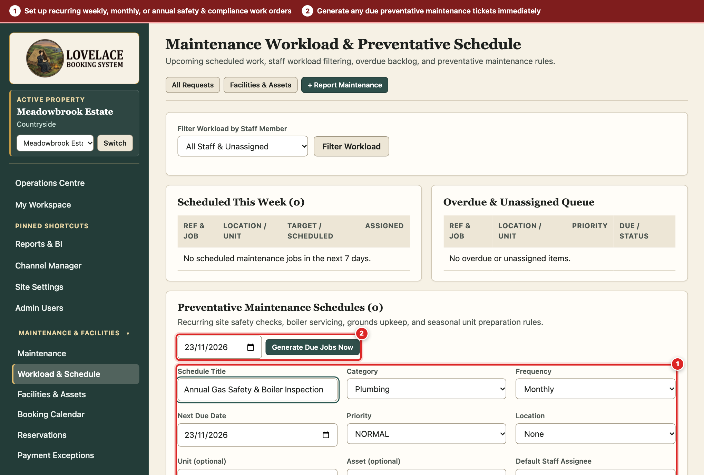

---

## Task 11: Guest Directory, Dietary Notes, Enquiries & Automated Emails

Under **Guests & Comms** on the left-hand menu:

1. **Guest Directory (`Guest Directory`):** Click any guest's name to see all their past and upcoming stays, mark loyal regulars as **`VIP`**, record permanent **Preferences** (such as *"Coeliac — gluten-free breakfast"* or *"Ground-floor room — no steep stairs"*), or jot down private **Internal Staff Notes** (which are *never* emailed or shown to guests).
2. **Merging Duplicate Guests (`Duplicate Merge Review`):** If the same guest booked twice with a slight typo, Lovelace spots the match so you can **Merge** their history cleanly (or click **Dismiss** if they are two different people with the same surname).
3. **Guest Enquiries (`Enquiries`):** Keep track of special questions, group requests, or lost-property messages in one place until resolved.

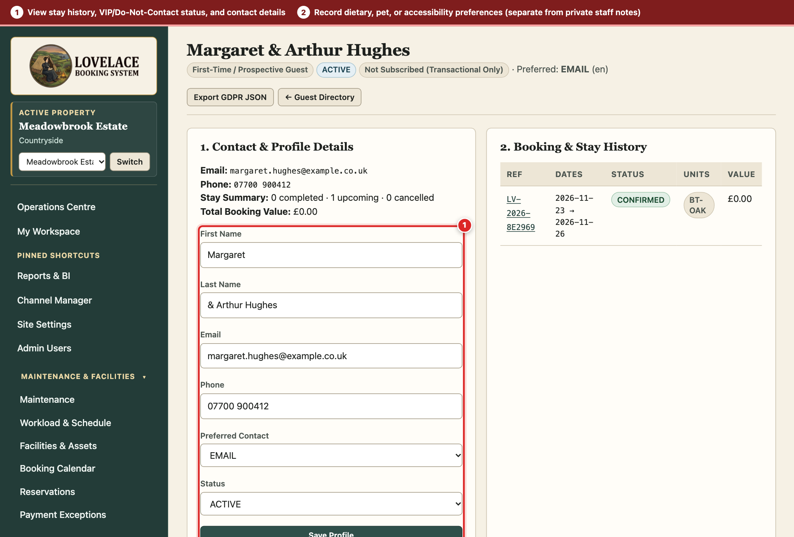

4. **Automated Emails (`Templates & Automation`):** Customize your booking confirmation, pre-arrival directions (e.g. gate code & arrival instructions 3 days before check-in!), and thank-you emails, or pause/enable any automated rule in one click.
5. **How Guests Check Their Own Booking Online:** Every confirmation email gives direct guests a link to **Manage Booking (`/lookup`)** (and, if you choose to switch it on in Site Settings, the passwordless **Self-Service Guest Portal `/portal`**) where they can check their dates, balance, and arrival times without needing to phone reception.

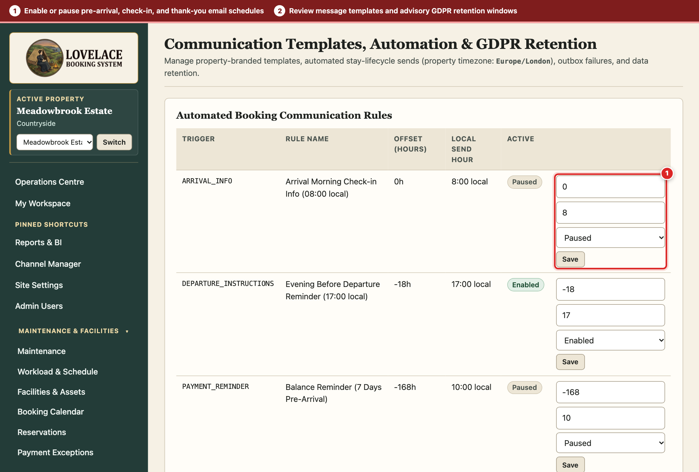

---

## Task 12: Connecting Airbnb, Booking.com & Travel Channel Managers

If you also list cottages, rooms, or glamping pods on Airbnb, Booking.com, Expedia, or VRBO through **Beds24**, **Smoobu**, **Lodgify**, or **Channex**:

1. Click **Settings → Channel Manager** in the left-hand menu.
2. Paste your provider API key into the encrypted vault, click **Save Configuration**, and click **Verify Live Connection**.
3. Match each external listing to your Lovelace accommodation category so incoming bookings block your calendar automatically! *(If an external booking ever arrives for an unmapped listing or clashes with a phone booking you took seconds earlier, Lovelace highlights it clearly as an alert so you can move one guest onto a free space calmly.)*

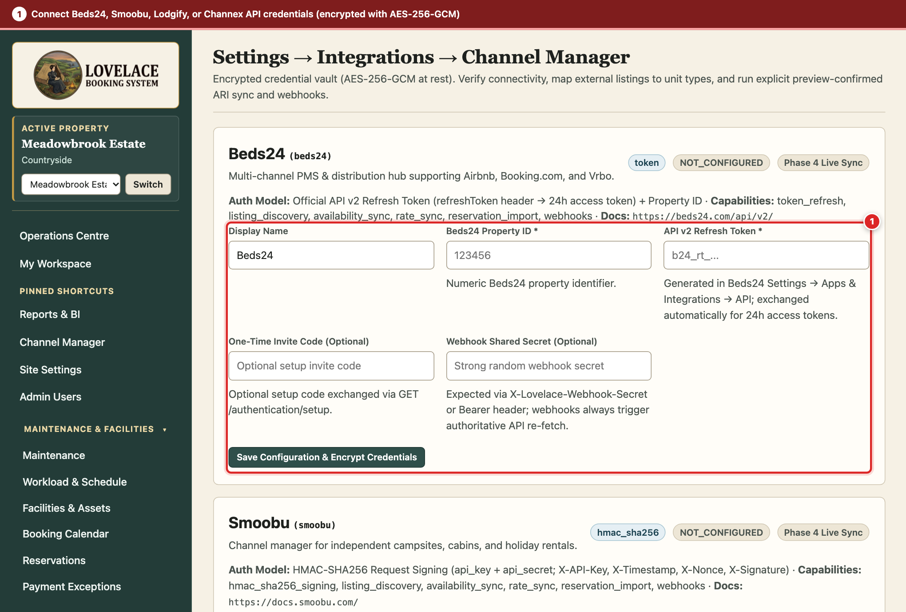

---

## Task 13: Staff Logins, Reports & Downloading Spreadsheets for Your Accountant

### Giving helpers their own login (`Settings → Admin Users`)
Never share your own Owner password with seasonal helpers! In **Settings → Admin Users**, you can create individual logins in 30 seconds:
- **Cleaner (`housekeeping_staff`):** Sees today's cleaning list and can report faults — cannot see guest emails, phone numbers, or finances.
- **Handyman (`maintenance_staff`):** Sees repair jobs and photos — cannot edit bookings or prices.
- **Receptionist (`staff`):** Can take bookings, check guests in/out, and answer enquiries — cannot alter room tariffs or export company accounts.
- **Manager (`manager`):** Runs day-to-day operations, prices, and reports for that property.

### Checking Occupancy, Revenue & Downloading Accountant CSVs (`Reports & BI`)
Click **Reports & BI** in the left-hand menu:
1. Pick any date range (such as last month or your tax quarter) and click **Run Report** to see your **Occupancy %**, **Average Nightly Rate (ADR)**, **30-Day Forward Forecast**, **Repeat Guest %**, and **Direct vs OTA Channel Mix**.
2. Scroll down to **Accounting Exports** to download ready-made **CSV spreadsheets** (*Bookings*, *Payments*, and *Refunds*) that open straight in Excel, Numbers, Xero, or QuickBooks for your bookkeeper — with zero personal guest emails or phone numbers inside the spreadsheet!

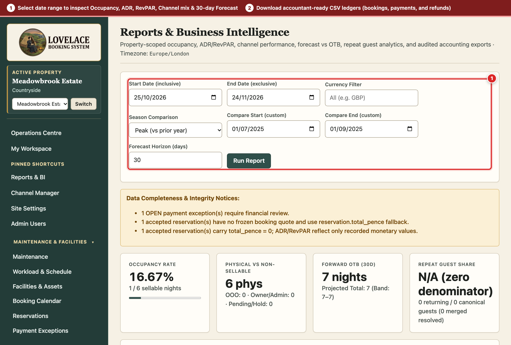

---

## Task 14: Putting Your Booking Box onto Your Own Website (or WordPress)

Already have a website for your business? Let guests check dates and book directly on your website with zero commission:

1. Click **Settings → Site Settings** and scroll down to **Website Booking Section — Copy & Paste Embed Code**.
2. **If your website uses WordPress:**
   - Click **Download WordPress Plugin (.zip)**.
   - In your WordPress dashboard, click **Plugins → Add New → Upload Plugin**, choose that `.zip` file, and click **Install Now** then **Activate**.
   - Everything comes pre-filled with your property's details and colours! Edit any page in WordPress and add the **Lovelace Live Booking Section** block (or type `[lovelace_booking]`).
3. **If your website uses Squarespace, Wix, Webflow, or a web designer:**
   - Click **Copy Embed Code** (it will briefly say **Copied!**) and paste it into a "Custom HTML" / "Code" block on your website — or email it to whoever looks after your site.

---

## Task 15: Saving, Testing & Restoring a Safety Copy (Backup) of Your Bookings

For complete peace of mind, we recommend downloading a safety copy of your bookings once a week (for instance, every Sunday evening) onto your computer or a USB memory stick:

1. Click **Settings → Backups & Cloud Sync**.
2. **To save a copy now (`Box 1`):** Optionally type a memorable 12-character passphrase to lock the file (`.zip.enc`), type your **Current Admin Password**, and click **Download Local Backup Archive**.
3. **To test a backup safely (`Verify Backup Integrity`):** Upload any saved `.zip` or `.zip.enc` file into the verification box — Lovelace checks every single file inside and gives you a green **✓ Integrity Verified** badge without touching your live bookings!
4. **If your computer/server ever needs replacing (`Restore Into Empty Environment`):** Sign in to your fresh empty Lovelace installation *before* adding any property in the Setup Wizard, open **Backups & Cloud Sync**, and upload your `.zip` / `.zip.enc` safety copy to bring all your properties, bookings, guests, and photos straight back.

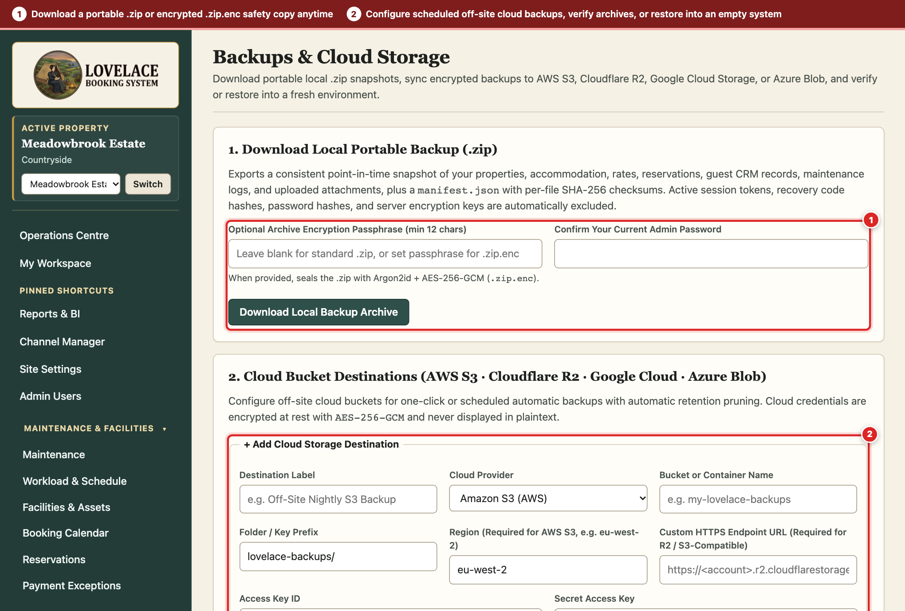

---

## "Don't Panic!" — Quick Fixes When Something Goes Wrong

Whether you run a grassy campsite, luxury glamping pods, a cosy B&B, a holiday cottage, or several properties at once, almost every mistake in Lovelace can be undone in under a minute:

### 1. *"Help! I entered `140` instead of `14000` and listed a £140 stay for £1.40 a night!"*
- **Why it happened:** On the **Rates & Preview** screen, seasonal rate rules ask for the price **in pence** (`14000` = `£140.00`).
- **How to fix it right now:** Open **Inventory & Holds → Rates & Preview**, scroll down to your rules list, click **Archive** next to the `£1.40` rule, and add a new rule with `14000`. Use the **Tariff Preview Calculator** at the top of that page to double-check the total in `£`!

### 2. *"I meant to close one pitch/room/cottage, and accidentally closed our WHOLE site all summer!"*
- **How to fix it right now:** Open **Inventory & Holds → Bulk Blockouts**, scroll down to **Blockout Groups**, and click **Release** next to the accidental blockout. Every pitch, pod, or room reopens within one second.

### 3. *"Heavy rain flooded our lower camping meadow (or we booked our own B&B holiday)!"*
- **Campsite washout:** Move incoming campers on the **Booking Calendar** onto dry pitches first, then open **Bulk Blockouts**, tick the muddy pitches under `Selected Multiple Units`, choose **`WEATHER_CLOSURE`**, and preview & confirm.
- **B&B owner holiday:** Open **Bulk Blockouts**, choose `All Units on Property` + **`OWNER_USE`** — Lovelace automatically warns you if any guest is already booked on those dates!

### 4. *"A guest wanted Friday AND Saturday night, so I put Arrival = Friday, Departure = Saturday — and only booked 1 night!"*
- **Why it happened:** **Departure Date** always means **the morning the guest packs up and leaves** (so Friday + Saturday night means Arrival = **Friday**, Departure = **Sunday**).
- **How to fix it right now:** Open **Reservations**, click the guest's booking reference, and extend their departure date to Sunday (or move them to a free space if Saturday was taken). Always glance at the **`Nights`** count (`2 nights`) to be sure!

### 5. *"We repaired a torn bell-tent canvas / leaking shower and marked Inspection PASSED — why is that unit STILL blocked?"*
- **Why it happened:** Lovelace never reopens a maintenance blockout behind your back before you confirm the room/tent is dry, cleaned, and ready! *(Tip for glamping hosts: if only an outdoor hot tub is awaiting a part while the hut itself is fine to sleep in, choose `PARTIAL` impact instead of `UNAVAILABLE`.)*
- **How to fix it right now:** Open **Maintenance & Facilities → Maintenance**, click that repair job, make sure **Inspection** is **`PASSED`**, **and click `Release Restriction`** inside the repair card (also check **Units & Pitches** to make sure the unit is set to `active`).

### 6. *"Why did Lovelace quote £280 just to bring one dog to our campsite?!"*
- **Why it happened:** When setting up your **Dog Fee (£10)** in **Extras & Add-ons**, the billing type was set to *per person per night* instead of **once per stay (`per_stay`)** or **per night (`per_night`)**!
- **How to fix it right now:** Open **Inventory & Holds → Extras & Add-ons** and change its billing model to `per_stay` or `per_night`.

### 7. *"I run more than one property — and I just edited prices (or copied website code) while on the WRONG property!"*
- **How to fix wrong edits:** Open **Settings → Audit Log** to see every edit you just made in exact time order (and if you need the exact previous numbers, your IT helper or browser can view `/api/v1/audit-logs` to read `before_state`), then copy your original settings back and use the **Switch** dropdown at the top-left of the green sidebar to pick the right property! *(Tip: give each property its own distinct brand colour in **Site Settings** so you can tell them apart at a glance!)*
- **How to fix the wrong website booking box:** Switch to the right property in the top-left corner first, check the blue **`Property: ...`** badge in **Site Settings → Website Booking Section**, and re-copy the code (or update **Property Slug** in WordPress **Settings → Lovelace Booking**).

### 8. *"Guests keep ringing to say our website says 'Online Card Checkout Unavailable'!"*
- **Why it happened:** New properties start with live card payments switched **off** for safety until you turn them on.
- **How to fix it right now:** Once your Stripe account is connected on the server, open **Settings → Site Settings**, tick **Enable Public Online Checkout (Stripe)**, and click **Save Booking Policy**.

### 9. *"I typed the wrong password too many times and got locked out (or lost my 8 recovery codes)!"*
- **If you typed wrong passwords 8 times:** Wait **15 minutes** with a cup of tea — the safety lock clears automatically after 15 minutes.
- **If another owner/partner has an Owner Admin login:** Ask them to sign in, go to **Settings → Admin Users**, and give you a temporary password.
- **If you are the only owner and lost both your password AND your 8 recovery codes:** Ask the person who looks after your server/hosting to follow **Catastrophe 2** in the [Deep Troubleshooting & Hospitality Catastrophe Playbook](../guides/05-troubleshooting-and-disaster-recovery.md#catastrophe-2-the-total-owner-lockout-lost-password--lost-recovery-codes--rate-limited) — they can issue you a fresh temporary password in 60 seconds without losing a single booking!
