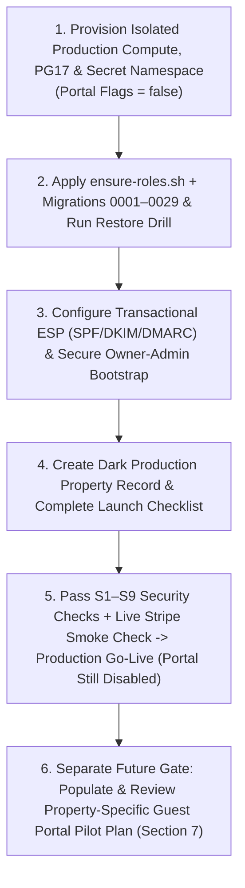

# LOVELACE — Production Foundation & Launch-Readiness Plan (Guest Portal Remains Disabled)

- **Repository:** `Prestwickuk/lovelace` (`https://github.com/Prestwickuk/lovelace.git`)
- **Verified `main` Baseline SHA:** `c7b009778f4afa46e91da42d78a7478029a18519` (`3 / 3` hosted GitHub Actions runs green: `44293798238`, `44293798265`, `44293798218`; identical runtime code, config, and SQL migrations `0001`–`0029` to staging-approved candidate `0e2a6fdc5ddca1007dd54dab09da9950edc2b23f`)
- **Plan Date & Inspection Timestamp:** `2026-11-18T11:37Z`
- **Document Scope:** **Planning Only** — no cloud resources provisioned or purchased, no DNS records modified, no secrets created or exposed, no production deployment performed, and no guest data seeded.
- **Guest Portal Rollout Invariant:** **`TIRBACH_GUEST_PORTAL_ENABLED=false`** and **`property_booking_policies.guest_portal_enabled=false`** across all environments and throughout initial production foundation launch. A property-scoped Guest Portal pilot is a strictly separate, post-foundation gate (Section 7) requiring explicit `Tir Bach Owner-Admin` review and authorization.

---

## 1. Confirmed Production Infrastructure Finding & Read-Only Evidence (`2026-11-18`)

Read-only inspection of GitHub (`Prestwickuk/lovelace`) and Railway workspace `3f9d4f60****d73` at `2026-11-18T11:37Z` confirmed that **no production foundation for LOVELACE has been provisioned yet**:

| Inspection Surface | Read-Only Check | Verified Non-Secret Evidence (`2026-11-18T11:37Z`) | Finding |
|---|---|---|---|
| **GitHub Repository (`Prestwickuk/lovelace`)** | `repos/Prestwickuk/lovelace/environments` & `/deployments`; CI on `c7b009778f4afa46e91da42d78a7478029a18519` | `environments.total_count = 0`; `deployments = 0`; CI runs `44293798238` (Phase 3), `44293798265` (Phase 4), `44293798218` (Phase 5) all `completed / success`. | Codebase and CI are green; zero GitHub production deployment targets exist. |
| **Railway Non-Staging Project (`charismatic-upliftment`)** | `railway status`, `domain list`, `tcp-proxy list`, `volume list`, `deployment list`, and redacted variable-key check on project `dbf31085****b4cd` / env `f89e70a5****9a86` (`production`) | Services = `["lovelace"]` (`5eb76bd5****2fe3`, single initial starter build `5beec663****` at `2026-11-18T08:08:32Z`); **PostgreSQL 17 services = `0`**; **`public-web` BFF services = `0`**; **persistent volumes = `0`**; **HTTPS domains = `0`**; **TCP proxies = `0`**; **application variables (`DATABASE_URL`, `TIRBACH_ENCRYPTION_KEY`, `TIRBACH_PUBLIC_API_SECRET`, SMTP, Stripe) = `0` (`unset`)**; **seeded `properties` records = `0`**. | Placeholder project only; cannot serve production traffic or host a property pilot until the production foundation below is provisioned and verified. |
| **Railway Hosted Staging Project (`lovelace-m4-staging`)** | Post-`M4-R1` state check (`9ff6b60c****d704` / env `6ebd332b****9484` `staging`) | Isolated staging stack (`lovelace-staging-pg17`, `lovelace-staging-mailsink`, `lovelace-staging-app`, `lovelace-staging-public-web`) verified and rolled back at `2026-11-18T10:47:25Z` (`TIRBACH_GUEST_PORTAL_ENABLED=false`, `guest_portal_enabled=false`, synthetic `@example.test` data only). | Staging remains strictly isolated and must **never** be promoted, shared, or connected to production domains, secrets, or guest data. |

---

## 2. Dedicated Production Compute, HTTPS Domains, TLS, DNS & Routing

### 2.1 Compute Isolation & Single-Instance Rate-Limit Invariant
1. **Dedicated Production Project / VPC:** Provision a clean production project (`lovelace-production`, retiring or replacing unconfigured starter project `dbf31085****b4cd`) with zero shared private network, database, volume, or variable namespace with `lovelace-m4-staging` (`9ff6b60c****d704`).
2. **Replica Topology (`1x Go` + `1x Next.js`):** Per [operations.md](operations.md) Section 5, both Go (`internal/httpx/ratelimit.go`) and Next.js (`apps/public-web/src/lib/rate-limit.ts`) enforce **process-local** sliding-window rate limiters. Launch production with **exactly 1 replica of `lovelace-prod-app` and 1 replica of `lovelace-prod-public-web`** (`0` horizontal scaling multiplication of rate budgets); introduce a shared store (e.g., Redis) before scaling past 1 replica per tier.
3. **Container Hardening & Two-Tier Separation ([ADR-0001](adr/0001-public-admin-separation-and-pwe-boundaries.md)):**
   - **`lovelace-prod-public-web` (`apps/public-web/Dockerfile`, port `3000`, non-root `USER nextjs` UID `10001`):**
     - Hosts the customer-facing Next.js storefront and `server-only` BFF route handlers.
     - Connects upstream **exclusively** over the private internal network (`LOVELACE_API_BASE_URL=http://lovelace-prod-app.railway.internal:8080`) authenticated via `X-Lovelace-Public-Key` (`LOVELACE_PUBLIC_API_SECRET`).
     - **Zero** `DATABASE_URL`, **zero** `TIRBACH_ENCRYPTION_KEY`, **zero** Stripe secret keys, and **zero** `/admin` or `/api/v1/*` routes.
     - Required runtime settings: `LOVELACE_ENV=production`, `PORT=3000`, `HOSTNAME=::`, `LOVELACE_PROPERTY_SLUG=tir-bach`, `NEXT_PUBLIC_SITE_URL=https://book.tirbach.wales`, `LOVELACE_SITE_URL=https://book.tirbach.wales`, `LOVELACE_TRUST_PROXY=true`, explicit `LOVELACE_TRUSTED_PROXIES` (ingress proxy CIDRs only), `LOVELACE_STRIPE_SANDBOX=false`.
   - **`lovelace-prod-app` (`Dockerfile`, port `8080`, non-root `USER tirbach`):**
     - Hosts the LOVELACE Admin Console, `/api/v1/*`, signed provider webhooks, background 30-second leased workers (hold expiry, outbox email dispatch, maintenance schedules, automated comms, Phase 4 channel sync, portal state pruning), and BFF-gated `/api/public/v1/*`.
     - Mounts a dedicated persistent encrypted volume at `/var/lib/lovelace/attachments` (`TIRBACH_ATTACHMENT_DIR=/var/lib/lovelace/attachments`) initialized with writable `tirbach:tirbach` ownership so `ValidateProductionStartup` (`internal/service/service.go:408`) passes `/readyz` without running the container as `root`.
     - Required runtime settings: `TIRBACH_ENV=production`, `PORT=8080`, `TIRBACH_LISTEN_ADDR=:8080`, `TIRBACH_COOKIE_SECURE=true`, `TIRBACH_TRUST_PROXY=true`, explicit `TIRBACH_TRUSTED_PROXIES` (mandatory in `production` per `internal/config/config.go:210`), `TIRBACH_PUBLIC_ORIGIN=https://book.tirbach.wales`, `TIRBACH_AUTO_SEED=false`, `TIRBACH_STRIPE_SANDBOX=false`, `TIRBACH_REQUIRE_EMAIL=true`, and **`TIRBACH_GUEST_PORTAL_ENABLED=false`**.

### 2.2 Production HTTPS Domains, TLS, DNS & Routing Rules
| Domain | Target Service & Port | Allowed Public Paths | TLS, DNS & Security Posture |
|---|---|---|---|
| **`https://book.tirbach.wales`** | `lovelace-prod-public-web:3000` | Public booking storefront (`/`, `/search`, `/checkout/*`, `/booking/*`) & `/api/public/*` BFF (`404` on `/portal/*` while disabled; `404` on `/admin` & `/api/v1/*`) | `CNAME` to production edge (`TTL=300s` pre-cutover -> `3600s` steady-state); managed TLS 1.2+/1.3 + HTTP->HTTPS redirect + HSTS + strict CSP (`next.config.ts`). |
| **`https://admin.tirbach.wales`** | `lovelace-prod-app:8080` | Staff Admin WebUI, `/api/v1/*` (`tirbach_session` + CSRF), `/readyz`, `/api/public/v1/webhooks/stripe`, `/api/v1/webhooks/email-events`, `/api/v1/webhooks/channels/*` | `CNAME` to production edge; TLS 1.2+/1.3; `/api/public/v1/*` returns `401` to any external caller lacking `X-Lovelace-Public-Key` and `403` if `X-Forwarded-Host` != `book.tirbach.wales`. |
| **`tirbach.wales` (DNS Zone)** | Authoritative DNS + ESP | `CAA` (`letsencrypt.org` / platform CA), `SPF`, `DKIM` (`2048-bit`), `DMARC` (`v=DMARC1; p=quarantine; rua=...`) | Prevents unauthorized certificate issuance and ensures transactional booking emails pass SPF/DKIM/DMARC alignment. |

---

## 3. Separate PostgreSQL 17 Production Database, Backups, Roles & Migrations

### 3.1 Dedicated Instance & Network Boundary
- Provision a dedicated **PostgreSQL 17 (`17.x`)** production service (`lovelace-prod-pg17`) with dedicated encrypted persistent storage (`PGDATA=/var/lib/postgresql/data/pgdata`) and **zero public TCP proxies** (`lovelace-prod-pg17.railway.internal:5432` internal-only, `sslmode=require`/`verify-full` where internal TLS certs are provisioned).
- Never connect `lovelace-prod-pg17` to staging services or import synthetic staging rows.

### 3.2 Backup, Retention & Restore Verification Strategy
1. **Continuous Point-in-Time Recovery (`PITR`):** Enable continuous WAL archiving (`>= 14–30` days retention, target **RPO `< 5 minutes`**).
2. **Daily Off-Project Encrypted Snapshots (`pg_dump` + Attachments):**
   - Run scheduled daily `pg_dump -U "$POSTGRES_BOOTSTRAP_USER" -Fc "$POSTGRES_DB"` encrypted (`AES-256` / KMS) to an independent object-storage bucket in a separate credential scope, paired with a co-timestamped encrypted backup of `/var/lib/lovelace/attachments` (`maintenance_attachments` blobs).
   - Retain `30` daily + `12` monthly snapshots; preserve accounting/payment ledger history in compliance with the owner-approved **6 years + current tax year** HMRC retention rule (`Section 7.2.1`).
3. **Mandatory Pre-Launch & Quarterly Restore Drill (Target RTO `< 60 minutes`):**
   - Before enabling live public bookings (and quarterly thereafter), restore the latest `pg_dump -Fc` archive into a disposable isolated database (`pg_restore --clean --if-exists`), verify `SELECT count(*), max(filename) FROM schema_migrations;` (`29` / `0029_security_and_integrity_hardening.sql`), verify `audit_logs_effective` read integrity, and destroy the disposable drill instance.

### 3.3 Least-Privilege Role Model & Controlled Migration Process
Execute [ensure-roles.sh](../scripts/postgres/ensure-roles.sh) and `tirbach-migrate` (`cmd/migrate`) under strict three-role separation:
1. **`postgres` (Bootstrap / Backup Superuser):** Used solely during initial cluster bootstrap (`btree_gist` extension + role provisioning) and `pg_dump`/`pg_restore`; credentials are stored offline/sealed and **never** injected into `lovelace-prod-app` or `lovelace-prod-public-web`.
2. **`lovelace_migrator` (`NOSUPERUSER NOCREATEDB NOCREATEROLE NOINHERIT`):** Owns schema `public` and executes one-shot `tirbach-migrate` (`MIGRATION_DATABASE_URL`) under advisory lock `748291043` to apply migrations `0001_init.sql` through `0029_security_and_integrity_hardening.sql`.
3. **`lovelace_app` (`NOSUPERUSER NOCREATEDB NOCREATEROLE`):** Runtime `DATABASE_URL` role for `lovelace-prod-app`. Holds `USAGE` only (`CREATE` revoked) on `public`, DML on application tables, `INSERT`-only on `audit_logs`, `SELECT`-only on `schema_migrations` & `audit_logs_effective`, and `0` access to raw `audit_log_redactions`. `tirbach-server` (`cmd/server/main.go:62`) fails closed at startup in `production` if connected with `SUPERUSER`, `CREATEDB`, or `CREATEROLE`.
4. **Upgrade Sequence for Future Migrations (`0030+`):** Mandatory `pg_dump -Fc` snapshot -> quiesce/stop `lovelace-prod-app` workers -> run `tirbach-migrate` as `lovelace_migrator` -> re-run `ensure-roles.sh` idempotently -> verify `schema_migrations` checksums & `email_outbox` (`DISPATCHING`/`DISPATCH_UNKNOWN = 0`) -> deploy and boot `lovelace-prod-app`.

---

## 4. Secret Governance, Mail Delivery, Monitoring & Secure Owner-Admin Bootstrap

### 4.1 Production Secret Storage & Rotation Schedule
- Store all secrets exclusively in the isolated `lovelace-production` sealed/encrypted secret namespace (never in Git, Docker images, CLI argv, or chat; `internal/config/config.go:20` rejects all known dev/test placeholders).
- **Required Fresh CSPRNG Production Secrets:**
  - `TIRBACH_ENCRYPTION_KEY`: 32-byte (`64` hex chars via `openssl rand -hex 32`) AES-256-GCM key for `channel_connections.encrypted_credentials` and HKDF-derived portal HMAC subkeys.
  - `TIRBACH_PUBLIC_API_SECRET` (= `LOVELACE_PUBLIC_API_SECRET` on `public-web`): `>= 36`-byte CSPRNG shared BFF header secret.
  - `POSTGRES_BOOTSTRAP_PASSWORD`, `LOVELACE_MIGRATOR_PASSWORD`, `LOVELACE_APP_PASSWORD`: Three distinct `>= 24`-byte CSPRNG passwords.
  - `TIRBACH_STRIPE_SECRET_KEY` (`sk_live_...` or least-privilege `rk_live_...` with Checkout Sessions write, PaymentIntents read, Refunds write) + `TIRBACH_STRIPE_WEBHOOK_SECRET` (`whsec_...` live signing secret): Required when `property_booking_policies.stripe_enabled = TRUE` (`sk_test_`/`rk_test_` fail production startup at `config.go:270`).
  - `TIRBACH_SMTP_USERNAME` / `TIRBACH_SMTP_PASSWORD` + `TIRBACH_EMAIL_WEBHOOK_SECRET` (`32`-byte hex HMAC key for `X-Email-Signature`).
- **Rotation Cadence & Procedure:**
  - **90-day / Incident Rotation:** Rotate `LOVELACE_APP_PASSWORD` & `LOVELACE_MIGRATOR_PASSWORD` via `ensure-roles.sh` + coordinated variable update; rotate `TIRBACH_PUBLIC_API_SECRET` during a brief maintenance window across `app` + `public-web`; rotate webhook secrets using provider dual-secret overlap (`webhook_secret_previous` on Channex / dual endpoint overlap on Stripe); rotate `TIRBACH_ENCRYPTION_KEY` only via a scripted decrypt-and-re-encrypt maintenance transaction on `channel_connections`.

### 4.2 Production Transactional Mail Delivery
- Configure a dedicated production transactional ESP (`Postmark`, `AWS SES` out of sandbox, or `Resend`) over authenticated TLS (`:587` STARTTLS or `:465` TLS) with `TIRBACH_REQUIRE_EMAIL=true` and `TIRBACH_EMAIL_FROM=bookings@tirbach.wales`.
- Verify `SPF`, `DKIM`, and `DMARC` DNS records on `tirbach.wales` before enabling public checkout (`ValidateProductionStartup` refuses live bookings if SMTP is unconfigured).
- Point ESP delivery/bounce/complaint webhooks to `POST https://admin.tirbach.wales/api/v1/webhooks/email-events` signed with `TIRBACH_EMAIL_WEBHOOK_SECRET` (`X-Email-Signature`); triage any `FAILED` or `DISPATCH_UNKNOWN` alerts in Operations Centre under `comms:reconcile` (`owner_admin` / `manager`).

### 4.3 Monitoring, Logging & Alerting (Zero PII)
| Signal / Probe | Cadence / Source | Alert Threshold & Action | Escalation Owner |
|---|---|---|---|
| **`GET https://admin.tirbach.wales/readyz`** | `60s` external HTTPS check | `!= 200` or `"ready": false` (`database`, `attachments`, `payments`, `email`, `public_api`) for `2` consecutive checks -> page immediately | Platform / Security Operator |
| **`GET https://book.tirbach.wales/api/healthz`** | `60s` external HTTPS check | `!= 200` or TLS expiry `< 14 days` -> page immediately | Platform / Security Operator |
| **Payment & Webhook Integrity** | Structured `slog` JSON & Operations Centre | Any `payment.webhook_livemode_mismatch` (`> 0`) or open `payment_exceptions` (`EXPIRED_HOLD_PAID`, `OVERLAP_ON_CONFIRM`, `AMOUNT_MISMATCH`, `ORPHAN_PAYMENT`) -> immediate alert | Platform / Security Operator + Tir Bach Owner-Admin |
| **Outbox & OTA Sync Health** | Structured `slog` JSON & Operations Centre | Any `DISPATCH_UNKNOWN` outbox item, `FAILED`/`BOUNCED` delivery, or Phase 4 `CONFLICT_OVERBOOKED` / `FAILED` sync job -> operational alert | Tir Bach Owner-Admin / Manager |
| **Infrastructure Capacity & Backups** | Platform metrics & backup cron | PostgreSQL/attachment volume `> 80%` used, memory `> 85%`, `5xx` rate `> 1%`, or missed daily `pg_dump` snapshot -> page | Platform / Security Operator |

### 4.4 Controlled `Owner-Admin` Bootstrap
1. Keep `TIRBACH_AUTO_SEED=false` permanently (`tirbach-server` refuses production boot if `true`).
2. Execute a one-shot authenticated bootstrap (`tirbach-seed` or isolated SQL/CLI bootstrap as `lovelace_app` with `MustRotatePassword=true`) supplying the owner's verified email (`e.g. owner@tirbach.wales`) and a high-entropy one-time passphrase via sealed stdin/env (never CLI flags or chat).
3. `Tir Bach Owner-Admin` signs in immediately at `https://admin.tirbach.wales`, completes mandatory password rotation (`>= 12` chars, Argon2id `64 MiB` / `t=3`), verifies `admin_user.created` & `admin_user.password_changed` in `/audit` (`audit_logs_effective`), and purges the one-time bootstrap secret.

---

## 5. Controlled Process for Creating & Verifying the Real Production Property Record

To prevent dev/demo placeholder facts (such as sample postcodes, sample quiet hours, or test rates) from ever reaching guests, the real production property is created dark and verified in four gated steps:

1. **Step 1 — Dark Property Shell Creation (`guest_portal_enabled = FALSE`, `stripe_enabled = FALSE`):**
   - Create the production `properties` record (`slug = 'tir-bach'`) with `public_enabled = FALSE` (or before public DNS cutover) and `property_booking_policies` explicitly set to **`stripe_enabled = FALSE`** and **`guest_portal_enabled = FALSE`**.
2. **Step 2 — Owner Fact & Policy Entry ([launch-readiness-checklist.md](launch-readiness-checklist.md)):**
   - `Tir Bach Owner-Admin` configures and verifies in `/property`: legal business name & tagline, real physical address & postcode, monitored `contact_email` & `contact_phone`, check-in/out times (`Europe/London`), HMRC VAT status/number, quiet hours, fire/BBQ & pet policies, deposit/cancellation terms, UK GDPR privacy notice & `booking_terms_version`, real accommodation `unit_types` & physical `units`, seasonal `rate_plans`/`rate_rules`, `availability_release_rules`, and contrast-validated PWE-4 public branding.
3. **Step 3 — Authoritative ID/Slug & Flag Verification:**
   - `Platform / Security Operator` and `Tir Bach Owner-Admin` run and record the read-only verification query:
     ```sql
     SELECT p.id, p.slug, p.name, p.public_enabled, pol.stripe_enabled, pol.guest_portal_enabled
     FROM properties p
     JOIN property_booking_policies pol ON pol.property_id = p.id
     ORDER BY p.slug;
     ```
   - Confirm the authoritative production `(property.id UUID, property.slug)` pair matches owner records and **`pol.guest_portal_enabled = FALSE` for every row**.
4. **Step 4 — Controlled Live Checkout & Refund Smoke Check (Guest Portal Still Disabled):**
   - Configure live `sk_live_`/`rk_live_` + live `whsec_`, set `stripe_enabled = TRUE`, perform **one** owner-executed low-value live card booking + webhook confirmation + confirmation email delivery + full refund reconciliation check, while verifying `GET https://book.tirbach.wales/portal` renders the disabled notice and `POST https://book.tirbach.wales/api/public/portal/auth/challenge` returns **`404`**.

---

## 6. Security Gate Checklist, Owners, Dependencies, Costs & Foundation Rollback

### 6.1 Pre-Launch Security Checks (Must All Pass Before DNS Cutover)
- [ ] **S1 — Runtime DB Role:** Startup log confirms `role="lovelace_app" superuser=false createdb=false createrole=false` and `has_schema_privilege('lovelace_app','public','CREATE') = false`.
- [ ] **S2 — Schema & Audit Integrity:** `schema_migrations` count = `29` (`0001`–`0029`); `UPDATE`/`DELETE`/`TRUNCATE` on `audit_logs` fails closed.
- [ ] **S3 — BFF / Public API Boundary:** Direct external `GET https://admin.tirbach.wales/api/public/v1/properties/tir-bach` without `X-Lovelace-Public-Key` returns `401`; `public-web` container holds zero DB/admin/Stripe secrets.
- [ ] **S4 — Public vs. Admin Origin Separation:** `https://book.tirbach.wales/api/v1/properties` and `/admin` return `404`; `Origin: null` and spoofed `Origin`/`Host`/`X-Forwarded-Host` return `403`.
- [ ] **S5 — Cookie, TLS & Header Hardening:** TLS 1.2+/1.3 valid, HSTS active, `tirbach_session` carries `HttpOnly; Secure; SameSite=Lax`, strict CSP active on both tiers.
- [ ] **S6 — Stripe Live-Mode Fencing:** `TIRBACH_STRIPE_SANDBOX=false`; test-mode webhook probe (`livemode: false`) against production is rejected as `payment.webhook_livemode_mismatch`.
- [ ] **S7 — Email Auth & Outbox:** `SPF`, `DKIM`, `DMARC` pass on `tirbach.wales`; `/readyz` reports `email.status = "configured"`.
- [ ] **S8 — Backup Restore Drill:** Pre-launch `pg_dump -Fc` -> isolated `pg_restore` drill verified clean.
- [ ] **S9 — Guest Portal Confirmed Disabled:** `TIRBACH_GUEST_PORTAL_ENABLED=false` and `property_booking_policies.guest_portal_enabled=false` across all properties (`POST /api/public/portal/auth/challenge -> 404`).

### 6.2 Operational Owners, Dependencies & Sequence
| Workstream | Accountable Owner | Key External Dependencies |
|---|---|---|
| **Compute, PG17, TLS/DNS, Secrets, Backups, Monitoring & Security Gate (`S1`–`S9`)** | **Platform / Security Operator** | Domain DNS access (`tirbach.wales`), Railway Pro (or equivalent isolated Linux container + PG17 host), off-project encrypted backup bucket |
| **Property Facts, Inventory/Tariffs, VAT/Legal Terms, Stripe Live Account, GDPR SOPs & Go-Live Sign-Off** | **Property Owner / Data Controller (`Tir Bach Owner-Admin`)** | Verified Stripe UK live merchant account (`acct_...`), verified transactional ESP sending domain, HMRC/accounting confirmation |



### 6.3 Estimated Monthly Cost Envelope (Single-Property Footprint)
| Component | Sizing / Tier | Estimated Cost (Approx.) | Notes |
|---|---|---|---|
| **Production Compute + PG17 + Volumes** | Railway Pro base + `1x` Go (`512MB–1GB`), `1x` Next.js (`512MB–1GB`), `1x` PG17 (`1–2GB` + encrypted SSD volume + backups) | **~$25–$45 / mo** (~£20–£36 / mo) | Excludes staging (~$10–$15/mo if kept warm; ~$2/mo if scaled down between runs). |
| **Off-Project Backup Object Storage** | Encrypted S3/R2 bucket (`10–50 GB` `pg_dump` + attachments) | **~$1–$3 / mo** (~£1–£2.50 / mo) | Zero egress on Cloudflare R2 or low-cost S3 Glacier Instant Retrieval. |
| **Transactional Email Provider (ESP)** | Postmark / AWS SES / Resend (`<= 10,000` emails/mo) | **$0–$15 / mo** (~£0–£12 / mo) | SES is ~$0.10/1,000 emails; Postmark base tier is $15/mo for 10k emails. |
| **Domain & DNS** | `tirbach.wales` registration + authoritative DNS | **~$15–$25 / yr** (~£1–£2 / mo) | Managed TLS certificates via Let's Encrypt are $0. |
| **Stripe Payment Processing** | Live Checkout (`stripe_enabled=true`) | **Variable per booking** (~`1.5% + 20p` UK standard cards) | $0 fixed monthly fee. |
| **Estimated Fixed Total** | Full production foundation | **~$30–$65 / mo** (~£24–£52 / mo) + Stripe per-booking fees | Confirm provider pricing at purchase time. |

### 6.4 Production Foundation Rollback Approach
1. **Pre-Cutover Abort:** Before switching public `book.tirbach.wales` DNS, abort at zero customer impact if any `S1`–`S9` check fails.
2. **Online Checkout Freeze (`< 30 seconds`):** Set `property_booking_policies.stripe_enabled = FALSE` in `/property` (or SQL) to halt new public holds/checkouts cleanly (`409 stripe_disabled`) without taking down Admin Operations Centre or existing reservation records.
3. **Application Rollback (`< 2 minutes`):** Redeploy the previous immutable verified container deployment on `lovelace-prod-app` / `lovelace-prod-public-web` (all migrations `0001`–`0029` are backward-compatible additive; never run destructive `DROP` DDL in production).
4. **DNS Cutover Revert (`~5 minutes` with `TTL=300s`):** Repoint `book.tirbach.wales` CNAME to a static maintenance page if ingress/compute experiences a provider outage.
5. **Database Disaster Recovery (`< 60 minutes`):** Quiesce `lovelace-prod-app`, restore via PITR or latest verified `pg_dump -Fc` + attachment snapshot, reconcile any in-flight Stripe webhooks (`payment_webhook_events`) and `DISPATCH_UNKNOWN` emails, and re-verify `/readyz` (`200 OK`) before reopening traffic.

---

## 7. Post-Foundation Gate: Property-Specific Guest Portal Pilot Change Plan (Template for Future Owner Review)

> **CRITICAL SEQUENCING & AUTHORIZATION RULE:**
> Do **not** populate or execute this pilot change plan until **after** Sections 2–6 are separately provisioned, verified, and live with `TIRBACH_GUEST_PORTAL_ENABLED=false` and `guest_portal_enabled=false`. Even once populated, **do not execute** until `Tir Bach Owner-Admin` reviews the completed table below and provides explicit written `YES` authorization for every `<REQUIRED>` field.

### 7.1 Pilot Change-Plan Gate Record (To Be Completed After Production Foundation Verification)
| Field | Planned Specification / Required Owner Input | Pre-Execution Verification Rule |
|---|---|---|
| **1. Production Deployment Target** | Dedicated `lovelace-production` (`https://book.tirbach.wales` & `https://admin.tirbach.wales`) | Verify `S1`–`S9` passed and `/readyz` + `/api/healthz` are `200 OK` before pilot window. |
| **2. Authorized Production Property** | **Slug:** `<REQUIRED: e.g. tir-bach>` · **Verified UUID:** `<REQUIRED: verified from production properties.id>` | Query production `properties` table to confirm exact `(id, slug)` match and confirm `count(*)` of any other properties. |
| **3. Approved Deployment Commit** | `<REQUIRED: c7b009778f4afa46e91da42d78a7478029a18519 (or newer 3/3 CI-green main SHA; never a docs/feature branch)>` | Confirm hosted Phase 3, Phase 4, and Phase 5 GitHub Actions runs are `success` on the exact SHA. |
| **4. Authorized Pilot Window & Timezone** | **Start:** `<REQUIRED: YYYY-MM-DD HH:MM Europe/London (UTC offset)>`<br>**End:** `<REQUIRED: YYYY-MM-DD HH:MM Europe/London (UTC offset)>` | Do not enable before Start; do not continue past End without separate owner extension approval. |
| **5. Pre-Change Flag State** | `TIRBACH_GUEST_PORTAL_ENABLED=false`; **all** rows in `property_booking_policies` have `guest_portal_enabled=false` | Record pre-change SQL output & `POST /api/public/portal/auth/challenge -> 404` with UTC timestamp. |
| **6. Exact Pilot Flag Scope** | Set `TIRBACH_GUEST_PORTAL_ENABLED=true` on `lovelace-prod-app` **and** `guest_portal_enabled=TRUE` **solely** where `property_id = '<AUTHORIZED_PROPERTY_UUID>'`; **every other property remains `FALSE`** | Immediately verify via SQL that `COUNT(*) WHERE guest_portal_enabled = TRUE` equals `1` (the authorized UUID only). |
| **7. Non-Disruptive Smoke Checks & Monitoring** | Check `/readyz` (`200`), `/portal` headers (`no-store`, `no-referrer`, `noindex`), spoofed `Origin: null` (`403`), query-token ban (`400`), and owner-owned test booking sign-in **only if explicitly approved** — **zero test emails or challenges to real guest addresses** | Monitor `/readyz`, `5xx` rate, `email_outbox` challenge scrubbing (`0` unredacted), and `portal.tamper.*` / `portal.auth.rate_limited` logs continuously during window. |
| **8. Rollback Triggers & Authorized Caller** | **Authorized Caller:** `<REQUIRED: named Tir Bach Owner-Admin and/or Platform/Security Operator>`<br>**Automatic/Immediate Triggers:** `<REQUIRED: owner-confirmed thresholds — recommended: any cross-guest/cross-property exposure, any unredacted challenge body, portal 5xx > 1%, /readyz != 200 for > 2m, unexpected mail bounce/rate spike, or end of authorized pilot window>` | Any single trigger invokes immediate rollback below without waiting for secondary approval. |
| **9. Immediate Pilot Rollback Procedure (`< 2m`)** | 1. `UPDATE property_booking_policies SET guest_portal_enabled = FALSE WHERE property_id = '<AUTHORIZED_PROPERTY_UUID>';` + revoke active `guest_portal_sessions` / unredeemed `guest_portal_challenges`.<br>2. Set `TIRBACH_GUEST_PORTAL_ENABLED=false` on `lovelace-prod-app` and redeploy.<br>3. Verify `POST https://book.tirbach.wales/api/public/portal/auth/challenge -> 404`, `GET /portal` shows disabled notice, and `/readyz -> 200 OK`. | Record UTC rollback timestamp, post-rollback flag SQL output, and `404` verification in tracked readiness report. |
| **10. Explicit `Tir Bach Owner-Admin` Sign-Off** | - Authorize candidate deploy: `<EXPLICIT YES REQUIRED>`<br>- Authorize `TIRBACH_GUEST_PORTAL_ENABLED=true` + single-property `guest_portal_enabled=true`: `<EXPLICIT YES REQUIRED>`<br>- Confirm property ID/slug, window, & rollback caller: `<EXPLICIT YES REQUIRED>` | **STOP** if any field above is missing or unconfirmed. |
