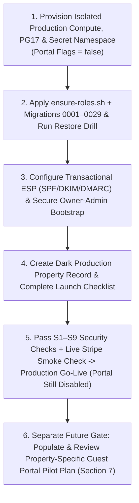

# LOVELACE — Production Foundation & Launch-Readiness Plan (Guest Portal Remains Disabled)

- **Repository:** `Prestwickuk/lovelace` (`https://github.com/Prestwickuk/lovelace.git`)
- **Verified `main` Baseline SHA:** `c7b009778f4afa46e91da42d78a7478029a18519` (`3 / 3` hosted GitHub Actions runs green: `44293798238`, `44293798265`, `44293798218`; identical runtime code, config, and SQL migrations `0001`–`0029` to staging-approved candidate `0e2a6fdc5ddca1007dd54dab09da9950edc2b23f`)
- **Plan Date & Inspection Timestamp:** `2026-11-18T11:37Z` (Empty Foundation Provisioned & Verified: `2026-11-18T13:04Z–13:56Z` — see Section 8)
- **Document Scope & Current Gate Status:** **Empty Production Foundation Provisioned & Verified (`lovelace-production`, `b4b8220a****30e3`); Launch Readiness BLOCKED / HELD OPEN** pending **Backup Gate (`S8` — AWS S3 encrypted backup + retention + restore drill deferred by owner)**, **Stripe UK Live Merchant Credential & Webhook Onboarding (`S6`)**, **Custom Domain Registration & Resend SPF/DKIM/DMARC DNS (`S7`)**, and **Dark Production Property Creation**. Zero guest/booking/property rows exist (`0` rows), zero public customer DNS traffic is routed, and zero live charges have been processed.
- **Guest Portal Rollout Invariant:** **`TIRBACH_GUEST_PORTAL_ENABLED=false`** and **`property_booking_policies.guest_portal_enabled=false`** across all environments and throughout initial production foundation launch. A property-scoped Guest Portal pilot is a strictly separate, post-foundation gate (Section 7) requiring explicit `Tir Bach Owner-Admin` review and authorization.

---

## 1. Confirmed Production Infrastructure Finding & Read-Only Evidence (`2026-11-18`)

Read-only inspection of GitHub (`Prestwickuk/lovelace`) and Railway workspace `3f9d4f60****d73` at `2026-11-18T11:37Z` confirmed that **no production foundation for LOVELACE has been provisioned yet**:

| Inspection Surface | Read-Only Check | Verified Non-Secret Evidence (`2026-11-18T11:37Z`) | Finding |
|---|---|---|---|
| **GitHub Repository (`Prestwickuk/lovelace`)** | `repos/Prestwickuk/lovelace/environments` & `/deployments`; CI on `c7b009778f4afa46e91da42d78a7478029a18519` | `environments.total_count = 0`; `deployments = 0`; CI runs `44293798238` (Phase 3), `44293798265` (Phase 4), `44293798218` (Phase 5) all `completed / success`. | Codebase and CI are green; zero GitHub production deployment targets exist. |
| **Railway Non-Staging Project (`charismatic-upliftment`)** | `railway status`, `domain list`, `tcp-proxy list`, `volume list`, `deployment list`, and redacted variable-key check on project `dbf31085****b4cd` / env `f89e70a5****9a86` (`production`) | Services = `["lovelace"]` (`5eb76bd5****2fe3`, single initial starter build `5beec663****` at `2026-11-18T08:08:32Z`); **PostgreSQL 17 services = `0`**; **`public-web` BFF services = `0`**; **persistent volumes = `0`**; **HTTPS domains = `0`**; **TCP proxies = `0`**; **application variables (`DATABASE_URL`, `TIRBACH_ENCRYPTION_KEY`, `TIRBACH_PUBLIC_API_SECRET`, SMTP, Stripe) = `0` (`unset`)**; **seeded `properties` records = `0`**. | Placeholder project only; cannot serve production traffic or host a property pilot until the production foundation below is provisioned and verified. |
| **Railway Hosted Staging Project (`lovelace-m4-staging`)** | Post-`M4-R1` state check (`9ff6b60c****d704` / env `6ebd332b****9484` `staging`) | Isolated staging stack (`lovelace-staging-pg17`, `lovelace-staging-mailsink`, `lovelace-staging-app`, `lovelace-staging-public-web`) verified and rolled back at `2026-11-18T10:47:25Z` (`TIRBACH_GUEST_PORTAL_ENABLED=false`, `guest_portal_enabled=false`, synthetic `@example.test` data only). | Staging remains strictly isolated and must **never** be promoted, shared, or connected to production domains, secrets, or guest data. |

---

## 2. Dedicated Production Compute, HTTPS Domains, TLS, DNS & Routing

### 2.1 Compute Isolation & Single-Instance Rate-Limit Invariant
1. **Dedicated Production Project / VPC:** Provision a clean isolated production project (`lovelace-production`, `b4b8220a****30e3`, preserving both `lovelace-m4-staging` `9ff6b60c****d704` and existing `charismatic-upliftment` `dbf31085****b4cd` untouched) with zero shared private network, database, volume, or variable namespace with staging.
2. **Replica Topology (`1x Go` + `1x Next.js`):** Per [operations.md](operations.md) Section 5, both Go (`internal/httpx/ratelimit.go`) and Next.js (`apps/public-web/src/lib/rate-limit.ts`) enforce **process-local** sliding-window rate limiters. Launch production with **exactly 1 replica of `lovelace-prod-app` and 1 replica of `lovelace-prod-public-web`** (`0` horizontal scaling multiplication of rate budgets); introduce a shared store (e.g., Redis) before scaling past 1 replica per tier.
3. **Container Hardening & Two-Tier Separation ([ADR-0001](adr/0001-public-admin-separation-and-pwe-boundaries.md)):**
   - **`lovelace-prod-public-web` (`apps/public-web/Dockerfile`, port `3000`, non-root `USER nextjs` UID `10001`):**
     - Hosts the customer-facing Next.js storefront and `server-only` BFF route handlers.
     - Connects upstream **exclusively** over the private internal network (`LOVELACE_API_BASE_URL=http://lovelace-prod-app.railway.internal:8080`) authenticated via `X-Lovelace-Public-Key` (`LOVELACE_PUBLIC_API_SECRET`).
     - **Zero** `DATABASE_URL`, **zero** `TIRBACH_ENCRYPTION_KEY`, **zero** Stripe secret keys, and **zero** `/admin` or `/api/v1/*` routes.
     - Required runtime settings: `LOVELACE_ENV=production`, `PORT=3000`, `HOSTNAME=::`, `LOVELACE_PROPERTY_SLUG=tir-bach`, `NEXT_PUBLIC_SITE_URL=https://book.tirbach.wales`, `LOVELACE_SITE_URL=https://book.tirbach.wales`, `LOVELACE_TRUST_PROXY=true`, explicit `LOVELACE_TRUSTED_PROXIES` (ingress proxy CIDRs only), `LOVELACE_STRIPE_SANDBOX=false`.
   - **`lovelace-prod-app` (`Dockerfile`, port `8080`, non-root `USER tirbach`):**
     - Hosts the LOVELACE Admin Console, `/api/v1/*`, signed provider webhooks, background 30-second leased workers (hold expiry, outbox email dispatch, maintenance schedules, automated comms, Phase 4 channel sync, portal state pruning), and BFF-gated `/api/public/v1/*`.
     - Mounts a dedicated persistent encrypted volume at `/var/lib/lovelace/attachments` (`TIRBACH_ATTACHMENT_DIR=/var/lib/lovelace/attachments`) initialized with writable `tirbach:tirbach` ownership so `ValidateProductionStartup` (`internal/service/service.go:408`) passes `/readyz` without running the container as `root`.
     - Required runtime settings: `TIRBACH_ENV=production`, `PORT=8080`, `TIRBACH_LISTEN_ADDR=:8080`, `TIRBACH_COOKIE_SECURE=true`, `TIRBACH_TRUST_PROXY=true`, explicit `TIRBACH_TRUSTED_PROXIES` (mandatory in `production` per `internal/config/config.go:210`), `TIRBACH_PUBLIC_ORIGIN=https://book.tirbach.wales`, `TIRBACH_AUTO_SEED=false`, `TIRBACH_STRIPE_SANDBOX=false`, `TIRBACH_REQUIRE_EMAIL=true`, and **`TIRBACH_GUEST_PORTAL_ENABLED=false`**.

### 2.2 Production HTTPS Domains, TLS, DNS & Routing Rules
| Domain | Target Service & Port | Allowed Public Paths | TLS, DNS & Security Posture |
|---|---|---|---|
| **`https://book.tirbach.wales`** | `lovelace-prod-public-web:3000` | Public booking storefront (`/`, `/search`, `/checkout/*`, `/booking/*`) & `/api/public/*` BFF (`404` on `/portal/*` while disabled; `404` on `/admin` & `/api/v1/*`) | `CNAME` to production edge (`TTL=300s` pre-cutover -> `3600s` steady-state); managed TLS 1.2+/1.3 + HTTP->HTTPS redirect + HSTS + strict CSP (`next.config.ts`). |
| **`https://admin.tirbach.wales`** | `lovelace-prod-app:8080` | Staff Admin WebUI, `/api/v1/*` (`tirbach_session` + CSRF), `/readyz`, `/api/public/v1/webhooks/stripe`, `/api/v1/webhooks/email-events`, `/api/v1/webhooks/channels/*` | `CNAME` to production edge; TLS 1.2+/1.3; `/api/public/v1/*` returns `401` to any external caller lacking `X-Lovelace-Public-Key` and `403` if `X-Forwarded-Host` != `book.tirbach.wales`. |
| **`tirbach.wales` (DNS Zone)** | Authoritative DNS + ESP | `CAA` (`letsencrypt.org` / platform CA), `SPF`, `DKIM` (`2048-bit`), `DMARC` (`v=DMARC1; p=quarantine; rua=...`) | Prevents unauthorized certificate issuance and ensures transactional booking emails pass SPF/DKIM/DMARC alignment. |

---

## 3. Separate PostgreSQL 17 Production Database, Backups, Roles & Migrations

### 3.1 Dedicated Instance & Network Boundary
- Provision a dedicated **PostgreSQL 17 (`17.x`)** production service (`lovelace-prod-pg17`) with dedicated encrypted persistent storage (`PGDATA=/var/lib/postgresql/data/pgdata`) and **zero public TCP proxies** (`lovelace-prod-pg17.railway.internal:5432` internal-only, `sslmode=require`/`verify-full` where internal TLS certs are provisioned).
- Never connect `lovelace-prod-pg17` to staging services or import synthetic staging rows.

### 3.2 Backup, Retention & Restore Verification Strategy
1. **Continuous Point-in-Time Recovery (`PITR`):** Enable continuous WAL archiving (`>= 14–30` days retention, target **RPO `< 5 minutes`**).
2. **Daily Off-Project Encrypted Snapshots (`pg_dump` + Attachments):**
   - Run scheduled daily `pg_dump -U "$POSTGRES_BOOTSTRAP_USER" -Fc "$POSTGRES_DB"` encrypted (`AES-256` / KMS) to an independent object-storage bucket in a separate credential scope, paired with a co-timestamped encrypted backup of `/var/lib/lovelace/attachments` (`maintenance_attachments` blobs).
   - Retain `30` daily + `12` monthly snapshots; preserve accounting/payment ledger history in compliance with the owner-approved **6 years + current tax year** HMRC retention rule (`Section 7.2.1`).
3. **Mandatory Pre-Launch & Quarterly Restore Drill (Target RTO `< 60 minutes`):**
   - Before enabling live public bookings (and quarterly thereafter), restore the latest `pg_dump -Fc` archive into a disposable isolated database (`pg_restore --clean --if-exists`), verify `SELECT count(*), max(filename) FROM schema_migrations;` (`29` / `0029_security_and_integrity_hardening.sql`), verify `audit_logs_effective` read integrity, and destroy the disposable drill instance.

### 3.3 Least-Privilege Role Model & Controlled Migration Process
Execute [ensure-roles.sh](../scripts/postgres/ensure-roles.sh) and `tirbach-migrate` (`cmd/migrate`) under strict three-role separation:
1. **`postgres` (Bootstrap / Backup Superuser):** Used solely during initial cluster bootstrap (`btree_gist` extension + role provisioning) and `pg_dump`/`pg_restore`; credentials are stored offline/sealed and **never** injected into `lovelace-prod-app` or `lovelace-prod-public-web`.
2. **`lovelace_migrator` (`NOSUPERUSER NOCREATEDB NOCREATEROLE NOINHERIT`):** Owns schema `public` and executes one-shot `tirbach-migrate` (`MIGRATION_DATABASE_URL`) under advisory lock `748291043` to apply migrations `0001_init.sql` through `0029_security_and_integrity_hardening.sql`.
3. **`lovelace_app` (`NOSUPERUSER NOCREATEDB NOCREATEROLE`):** Runtime `DATABASE_URL` role for `lovelace-prod-app`. Holds `USAGE` only (`CREATE` revoked) on `public`, DML on application tables, `INSERT`-only on `audit_logs`, `SELECT`-only on `schema_migrations` & `audit_logs_effective`, and `0` access to raw `audit_log_redactions`. `tirbach-server` (`cmd/server/main.go:62`) fails closed at startup in `production` if connected with `SUPERUSER`, `CREATEDB`, or `CREATEROLE`.
4. **Upgrade Sequence for Future Migrations (`0030+`):** Mandatory `pg_dump -Fc` snapshot -> quiesce/stop `lovelace-prod-app` workers -> run `tirbach-migrate` as `lovelace_migrator` -> re-run `ensure-roles.sh` idempotently -> verify `schema_migrations` checksums & `email_outbox` (`DISPATCHING`/`DISPATCH_UNKNOWN = 0`) -> deploy and boot `lovelace-prod-app`.

---

## 4. Secret Governance, Mail Delivery, Monitoring & Secure Owner-Admin Bootstrap

### 4.1 Production Secret Storage & Rotation Schedule
- Store all secrets exclusively in the isolated `lovelace-production` sealed/encrypted secret namespace (never in Git, Docker images, CLI argv, or chat; `internal/config/config.go:20` rejects all known dev/test placeholders).
- **Required Fresh CSPRNG Production Secrets:**
  - `TIRBACH_ENCRYPTION_KEY`: 32-byte (`64` hex chars via `openssl rand -hex 32`) AES-256-GCM key for `channel_connections.encrypted_credentials` and HKDF-derived portal HMAC subkeys.
  - `TIRBACH_PUBLIC_API_SECRET` (= `LOVELACE_PUBLIC_API_SECRET` on `public-web`): `>= 36`-byte CSPRNG shared BFF header secret.
  - `POSTGRES_BOOTSTRAP_PASSWORD`, `LOVELACE_MIGRATOR_PASSWORD`, `LOVELACE_APP_PASSWORD`: Three distinct `>= 24`-byte CSPRNG passwords.
  - `TIRBACH_STRIPE_SECRET_KEY` (`sk_live_...` or least-privilege `rk_live_...` with Checkout Sessions write, PaymentIntents read, Refunds write) + `TIRBACH_STRIPE_WEBHOOK_SECRET` (`whsec_...` live signing secret): Required when `property_booking_policies.stripe_enabled = TRUE` (`sk_test_`/`rk_test_` fail production startup at `config.go:270`).
  - `TIRBACH_SMTP_USERNAME` / `TIRBACH_SMTP_PASSWORD` + `TIRBACH_EMAIL_WEBHOOK_SECRET` (`32`-byte hex HMAC key for `X-Email-Signature`).
- **Rotation Cadence & Procedure:**
  - **90-day / Incident Rotation:** Rotate `LOVELACE_APP_PASSWORD` & `LOVELACE_MIGRATOR_PASSWORD` via `ensure-roles.sh` + coordinated variable update; rotate `TIRBACH_PUBLIC_API_SECRET` during a brief maintenance window across `app` + `public-web`; rotate webhook secrets using provider dual-secret overlap (`webhook_secret_previous` on Channex / dual endpoint overlap on Stripe); rotate `TIRBACH_ENCRYPTION_KEY` only via a scripted decrypt-and-re-encrypt maintenance transaction on `channel_connections`.

### 4.2 Production Transactional Mail Delivery
- Configure a dedicated production transactional ESP (`Postmark`, `AWS SES` out of sandbox, or `Resend`) over authenticated TLS (`:587` STARTTLS or `:465` TLS) with `TIRBACH_REQUIRE_EMAIL=true` and `TIRBACH_EMAIL_FROM=bookings@tirbach.wales`.
- Verify `SPF`, `DKIM`, and `DMARC` DNS records on `tirbach.wales` before enabling public checkout (`ValidateProductionStartup` refuses live bookings if SMTP is unconfigured).
- Point ESP delivery/bounce/complaint webhooks to `POST https://admin.tirbach.wales/api/v1/webhooks/email-events` signed with `TIRBACH_EMAIL_WEBHOOK_SECRET` (`X-Email-Signature`); triage any `FAILED` or `DISPATCH_UNKNOWN` alerts in Operations Centre under `comms:reconcile` (`owner_admin` / `manager`).

### 4.3 Monitoring, Logging & Alerting (Zero PII)
| Signal / Probe | Cadence / Source | Alert Threshold & Action | Escalation Owner |
|---|---|---|---|
| **`GET https://admin.tirbach.wales/readyz`** | `60s` external HTTPS check | `!= 200` or `"ready": false` (`database`, `attachments`, `payments`, `email`, `public_api`) for `2` consecutive checks -> page immediately | Platform / Security Operator |
| **`GET https://book.tirbach.wales/api/healthz`** | `60s` external HTTPS check | `!= 200` or TLS expiry `< 14 days` -> page immediately | Platform / Security Operator |
| **Payment & Webhook Integrity** | Structured `slog` JSON & Operations Centre | Any `payment.webhook_livemode_mismatch` (`> 0`) or open `payment_exceptions` (`EXPIRED_HOLD_PAID`, `OVERLAP_ON_CONFIRM`, `AMOUNT_MISMATCH`, `ORPHAN_PAYMENT`) -> immediate alert | Platform / Security Operator + Tir Bach Owner-Admin |
| **Outbox & OTA Sync Health** | Structured `slog` JSON & Operations Centre | Any `DISPATCH_UNKNOWN` outbox item, `FAILED`/`BOUNCED` delivery, or Phase 4 `CONFLICT_OVERBOOKED` / `FAILED` sync job -> operational alert | Tir Bach Owner-Admin / Manager |
| **Infrastructure Capacity & Backups** | Platform metrics & backup cron | PostgreSQL/attachment volume `> 80%` used, memory `> 85%`, `5xx` rate `> 1%`, or missed daily `pg_dump` snapshot -> page | Platform / Security Operator |

### 4.4 Controlled `Owner-Admin` Bootstrap
1. Keep `TIRBACH_AUTO_SEED=false` permanently (`tirbach-server` refuses production boot if `true`).
2. Execute a one-shot authenticated bootstrap (`tirbach-seed` or isolated SQL/CLI bootstrap as `lovelace_app` with `MustRotatePassword=true`) supplying the owner's verified email (`e.g. owner@tirbach.wales`) and a high-entropy one-time passphrase via sealed stdin/env (never CLI flags or chat).
3. `Tir Bach Owner-Admin` signs in immediately at `https://admin.tirbach.wales`, completes mandatory password rotation (`>= 12` chars, Argon2id `64 MiB` / `t=3`), verifies `admin_user.created` & `admin_user.password_changed` in `/audit` (`audit_logs_effective`), and purges the one-time bootstrap secret.

---

## 5. Controlled Process for Creating & Verifying the Real Production Property Record

To prevent dev/demo placeholder facts (such as sample postcodes, sample quiet hours, or test rates) from ever reaching guests, the real production property is created dark and verified in four gated steps:

1. **Step 1 — Dark Property Shell Creation (`guest_portal_enabled = FALSE`, `stripe_enabled = FALSE`):**
   - Create the production `properties` record (`slug = 'tir-bach'`) with `public_enabled = FALSE` (or before public DNS cutover) and `property_booking_policies` explicitly set to **`stripe_enabled = FALSE`** and **`guest_portal_enabled = FALSE`**.
2. **Step 2 — Owner Fact & Policy Entry ([launch-readiness-checklist.md](launch-readiness-checklist.md)):**
   - `Tir Bach Owner-Admin` configures and verifies in `/property`: legal business name & tagline, real physical address & postcode, monitored `contact_email` & `contact_phone`, check-in/out times (`Europe/London`), HMRC VAT status/number, quiet hours, fire/BBQ & pet policies, deposit/cancellation terms, UK GDPR privacy notice & `booking_terms_version`, real accommodation `unit_types` & physical `units`, seasonal `rate_plans`/`rate_rules`, `availability_release_rules`, and contrast-validated PWE-4 public branding.
3. **Step 3 — Authoritative ID/Slug & Flag Verification:**
   - `Platform / Security Operator` and `Tir Bach Owner-Admin` run and record the read-only verification query:
     ```sql
     SELECT p.id, p.slug, p.name, p.public_enabled, pol.stripe_enabled, pol.guest_portal_enabled
     FROM properties p
     JOIN property_booking_policies pol ON pol.property_id = p.id
     ORDER BY p.slug;
     ```
   - Confirm the authoritative production `(property.id UUID, property.slug)` pair matches owner records and **`pol.guest_portal_enabled = FALSE` for every row**.
4. **Step 4 — Controlled Live Checkout & Refund Smoke Check (Guest Portal Still Disabled):**
   - Configure live `sk_live_`/`rk_live_` + live `whsec_`, set `stripe_enabled = TRUE`, perform **one** owner-executed low-value live card booking + webhook confirmation + confirmation email delivery + full refund reconciliation check, while verifying `GET https://book.tirbach.wales/portal` renders the disabled notice and `POST https://book.tirbach.wales/api/public/portal/auth/challenge` returns **`404`**.

---

## 6. Security Gate Checklist, Owners, Dependencies, Costs & Foundation Rollback

### 6.1 Pre-Launch Security Checks (Must All Pass Before DNS Cutover)
- [x] **S1 — Runtime DB Role (`PASSED` `2026-11-18T13:25Z`):** Startup log confirmed `role="lovelace_app" superuser=false createdb=false createrole=false`, `has_schema_privilege('lovelace_app','public','CREATE') = false`, and `0` public TCP proxies on `lovelace-prod-pg17`.
- [x] **S2 — Schema & Audit Integrity (`PASSED` `2026-11-18T13:04Z`):** `schema_migrations` count = `29` (`0001_init.sql`–`0029_security_and_integrity_hardening.sql`); `DELETE FROM audit_logs` under `lovelace_app` failed closed (`permission denied`); `properties = 0`, `guests = 0`, `reservations = 0`.
- [x] **S3 — BFF / Public API Boundary (`PASSED` `2026-11-18T13:34Z`):** Direct external `GET /api/public/v1/properties/tir-bach` and `GET /api/public/v1/accommodation?property=tir-bach` without `X-Lovelace-Public-Key` returned `401`; `lovelace-prod-public-web` holds `0` DB/admin/encryption/Stripe/SMTP secrets.
- [x] **S4 — Public vs. Admin Origin Separation (`PASSED` `2026-11-18T13:34Z`):** `<prod-web>/api/v1/properties` and `<prod-web>/admin` returned `404`; `Origin: null` and `Origin: https://evil.example` against `POST /api/v1/auth/login` and `POST /api/public/portal/enquiries` returned `403`.
- [x] **S5 — Cookie, TLS & Header Hardening (`PASSED` `2026-11-18T13:26Z`):** TLS `1.3` (`TLS_AES_256_GCM_SHA384`) active on Railway managed HTTPS origins (`lovelace-prod-app-production.up.railway.app` & `lovelace-prod-public-web-production.up.railway.app`); HSTS, CSP, `X-Content-Type-Options: nosniff`, `Referrer-Policy`, `Cache-Control: no-store`, and `TIRBACH_COOKIE_SECURE=true` verified.
- [ ] **S6 — Stripe Live-Mode Credentials & Webhook Fencing (`BLOCKED / OPERATOR ACTION REQUIRED`):** `TIRBACH_STRIPE_SANDBOX=false` and `LOVELACE_STRIPE_SANDBOX=false` active; sandbox `sk_test_*` blocked from entering production (`config.go:270`); `/readyz` reports `payments: {status: "disabled", mode: "property_disabled"}`; unsigned/invalid `POST /api/public/v1/webhooks/stripe` fails closed (`401 invalid_signature`); `POST /api/public/booking/holds` returns `404` (`0` live charges processed). Injection of live `rk_live_`/`sk_live_` + live `whsec_` and `livemode: false` rejection probe remain gated on Stripe UK Live merchant onboarding.
- [ ] **S7 — Email Auth & Outbox (`PARTIAL — RESEND SMTP AUTH VERIFIED; CUSTOM DOMAIN DNS GATED`):** Resend SMTP (`smtp.resend.com:587`) STARTTLS (`TLSv1.3`) + `AUTH` (`235`) verified and live on `lovelace-prod-app` (`email: {status: "configured", mode: "smtp"}`); unsigned `POST /api/v1/webhooks/email-events` fails closed (`401`). Owner selected Railway managed hostnames for foundation verification (`tirbach.wales` has `0` existing public DNS/NS records — nothing overwritten); custom sending domain registration + `SPF`, `DKIM`, and `DMARC` DNS verification remain required before live public bookings.
- [ ] **S8 — Backup Restore Drill (`BLOCKED / INCOMPLETE — BACKUP GATE ACTIVE`):** Owner selected **AWS S3** as the off-project encrypted backup target and deferred S3 bucket, SSE-KMS/AES-256 encryption, retention lifecycle, and isolated `pg_restore` drill configuration (`2026-11-18T13:30Z`). Backup readiness is **NOT** complete; zero production data added and zero customer DNS traffic routed.
- [x] **S9 — Guest Portal & Public Checkout Confirmed Disabled (`PASSED` `2026-11-18T13:56Z`):** `TIRBACH_GUEST_PORTAL_ENABLED=false`, `property_booking_policies WHERE guest_portal_enabled = TRUE` count = `0`, `POST /api/public/portal/auth/challenge -> 404`, and `POST /api/public/booking/holds -> 404`.

### 6.2 Operational Owners, Dependencies & Sequence
| Workstream | Accountable Owner | Key External Dependencies |
|---|---|---|
| **Compute, PG17, TLS/DNS, Secrets, Backups, Monitoring & Security Gate (`S1`–`S9`)** | **Platform / Security Operator** | Domain DNS access (`tirbach.wales`), Railway Pro (or equivalent isolated Linux container + PG17 host), off-project encrypted backup bucket |
| **Property Facts, Inventory/Tariffs, VAT/Legal Terms, Stripe Live Account, GDPR SOPs & Go-Live Sign-Off** | **Property Owner / Data Controller (`Tir Bach Owner-Admin`)** | Verified Stripe UK live merchant account (`acct_...`), verified transactional ESP sending domain, HMRC/accounting confirmation |



### 6.3 Estimated Monthly Cost Envelope (Single-Property Footprint)
| Component | Sizing / Tier | Estimated Cost (Approx.) | Notes |
|---|---|---|---|
| **Production Compute + PG17 + Volumes** | Railway Pro base + `1x` Go (`512MB–1GB`), `1x` Next.js (`512MB–1GB`), `1x` PG17 (`1–2GB` + encrypted SSD volume + backups) | **~$25–$45 / mo** (~£20–£36 / mo) | Excludes staging (~$10–$15/mo if kept warm; ~$2/mo if scaled down between runs). |
| **Off-Project Backup Object Storage** | Encrypted S3/R2 bucket (`10–50 GB` `pg_dump` + attachments) | **~$1–$3 / mo** (~£1–£2.50 / mo) | Zero egress on Cloudflare R2 or low-cost S3 Glacier Instant Retrieval. |
| **Transactional Email Provider (ESP)** | Postmark / AWS SES / Resend (`<= 10,000` emails/mo) | **$0–$15 / mo** (~£0–£12 / mo) | SES is ~$0.10/1,000 emails; Postmark base tier is $15/mo for 10k emails. |
| **Domain & DNS** | `tirbach.wales` registration + authoritative DNS | **~$15–$25 / yr** (~£1–£2 / mo) | Managed TLS certificates via Let's Encrypt are $0. |
| **Stripe Payment Processing** | Live Checkout (`stripe_enabled=true`) | **Variable per booking** (~`1.5% + 20p` UK standard cards) | $0 fixed monthly fee. |
| **Estimated Fixed Total** | Full production foundation | **~$30–$65 / mo** (~£24–£52 / mo) + Stripe per-booking fees | Confirm provider pricing at purchase time. |

### 6.4 Production Foundation Rollback Approach
1. **Pre-Cutover Abort:** Before switching public `book.tirbach.wales` DNS, abort at zero customer impact if any `S1`–`S9` check fails.
2. **Online Checkout Freeze (`< 30 seconds`):** Set `property_booking_policies.stripe_enabled = FALSE` in `/property` (or SQL) to halt new public holds/checkouts cleanly (`409 stripe_disabled`) without taking down Admin Operations Centre or existing reservation records.
3. **Application Rollback (`< 2 minutes`):** Redeploy the previous immutable verified container deployment on `lovelace-prod-app` / `lovelace-prod-public-web` (all migrations `0001`–`0029` are backward-compatible additive; never run destructive `DROP` DDL in production).
4. **DNS Cutover Revert (`~5 minutes` with `TTL=300s`):** Repoint `book.tirbach.wales` CNAME to a static maintenance page if ingress/compute experiences a provider outage.
5. **Database Disaster Recovery (`< 60 minutes`):** Quiesce `lovelace-prod-app`, restore via PITR or latest verified `pg_dump -Fc` + attachment snapshot, reconcile any in-flight Stripe webhooks (`payment_webhook_events`) and `DISPATCH_UNKNOWN` emails, and re-verify `/readyz` (`200 OK`) before reopening traffic.

---

## 7. Post-Foundation Gate: Property-Specific Guest Portal Pilot Change Plan (Template for Future Owner Review)

> **CRITICAL SEQUENCING & AUTHORIZATION RULE:**
> Do **not** populate or execute this pilot change plan until **after** Sections 2–6 are separately provisioned, verified, and live with `TIRBACH_GUEST_PORTAL_ENABLED=false` and `guest_portal_enabled=false`. Even once populated, **do not execute** until `Tir Bach Owner-Admin` reviews the completed table below and provides explicit written `YES` authorization for every `<REQUIRED>` field.

### 7.1 Pilot Change-Plan Gate Record (To Be Completed After Production Foundation Verification)
| Field | Planned Specification / Required Owner Input | Pre-Execution Verification Rule |
|---|---|---|
| **1. Production Deployment Target** | Dedicated `lovelace-production` (`https://book.tirbach.wales` & `https://admin.tirbach.wales`) | Verify `S1`–`S9` passed and `/readyz` + `/api/healthz` are `200 OK` before pilot window. |
| **2. Authorized Production Property** | **Slug:** `<REQUIRED: e.g. tir-bach>` · **Verified UUID:** `<REQUIRED: verified from production properties.id>` | Query production `properties` table to confirm exact `(id, slug)` match and confirm `count(*)` of any other properties. |
| **3. Approved Deployment Commit** | `<REQUIRED: c7b009778f4afa46e91da42d78a7478029a18519 (or newer 3/3 CI-green main SHA; never a docs/feature branch)>` | Confirm hosted Phase 3, Phase 4, and Phase 5 GitHub Actions runs are `success` on the exact SHA. |
| **4. Authorized Pilot Window & Timezone** | **Start:** `<REQUIRED: YYYY-MM-DD HH:MM Europe/London (UTC offset)>`<br>**End:** `<REQUIRED: YYYY-MM-DD HH:MM Europe/London (UTC offset)>` | Do not enable before Start; do not continue past End without separate owner extension approval. |
| **5. Pre-Change Flag State** | `TIRBACH_GUEST_PORTAL_ENABLED=false`; **all** rows in `property_booking_policies` have `guest_portal_enabled=false` | Record pre-change SQL output & `POST /api/public/portal/auth/challenge -> 404` with UTC timestamp. |
| **6. Exact Pilot Flag Scope** | Set `TIRBACH_GUEST_PORTAL_ENABLED=true` on `lovelace-prod-app` **and** `guest_portal_enabled=TRUE` **solely** where `property_id = '<AUTHORIZED_PROPERTY_UUID>'`; **every other property remains `FALSE`** | Immediately verify via SQL that `COUNT(*) WHERE guest_portal_enabled = TRUE` equals `1` (the authorized UUID only). |
| **7. Non-Disruptive Smoke Checks & Monitoring** | Check `/readyz` (`200`), `/portal` headers (`no-store`, `no-referrer`, `noindex`), spoofed `Origin: null` (`403`), query-token ban (`400`), and owner-owned test booking sign-in **only if explicitly approved** — **zero test emails or challenges to real guest addresses** | Monitor `/readyz`, `5xx` rate, `email_outbox` challenge scrubbing (`0` unredacted), and `portal.tamper.*` / `portal.auth.rate_limited` logs continuously during window. |
| **8. Rollback Triggers & Authorized Caller** | **Authorized Caller:** `<REQUIRED: named Tir Bach Owner-Admin and/or Platform/Security Operator>`<br>**Automatic/Immediate Triggers:** `<REQUIRED: owner-confirmed thresholds — recommended: any cross-guest/cross-property exposure, any unredacted challenge body, portal 5xx > 1%, /readyz != 200 for > 2m, unexpected mail bounce/rate spike, or end of authorized pilot window>` | Any single trigger invokes immediate rollback below without waiting for secondary approval. |
| **9. Immediate Pilot Rollback Procedure (`< 2m`)** | 1. `UPDATE property_booking_policies SET guest_portal_enabled = FALSE WHERE property_id = '<AUTHORIZED_PROPERTY_UUID>';` + revoke active `guest_portal_sessions` / unredeemed `guest_portal_challenges`.<br>2. Set `TIRBACH_GUEST_PORTAL_ENABLED=false` on `lovelace-prod-app` and redeploy.<br>3. Verify `POST https://book.tirbach.wales/api/public/portal/auth/challenge -> 404`, `GET /portal` shows disabled notice, and `/readyz -> 200 OK`. | Record UTC rollback timestamp, post-rollback flag SQL output, and `404` verification in tracked readiness report. |
| **10. Explicit `Tir Bach Owner-Admin` Sign-Off** | - Authorize candidate deploy: `<EXPLICIT YES REQUIRED>`<br>- Authorize `TIRBACH_GUEST_PORTAL_ENABLED=true` + single-property `guest_portal_enabled=true`: `<EXPLICIT YES REQUIRED>`<br>- Confirm property ID/slug, window, & rollback caller: `<EXPLICIT YES REQUIRED>` | **STOP** if any field above is missing or unconfirmed. |


---

## 8. Empty Production Foundation Provisioning & Verification Ledger (`2026-11-18T13:04Z–13:56Z`)

### 8.1 Provisioned Resource Inventory & Isolation Evidence (Masked Identifiers Only)

| Resource / Boundary | Provisioned Target & Masked ID | Configuration & Isolation Evidence (`2026-11-18T13:56Z`) |
|---|---|---|
| **Railway Workspace & Spend Guardrail** | `Peter Vine's Projects` (`3f9d4f60****d73`) · Plan `HOBBY` (`ACTIVE`) | Workspace spend guardrail enforced via API (`softLimit = $75.00`, `hardLimit = $100.00`, `isOverLimit = false`). Existing projects `lovelace-m4-staging` (`9ff6b60c****d704`) and `charismatic-upliftment` (`dbf31085****b4cd`) preserved untouched (`0` resources deleted or replaced). |
| **Isolated Production Project & Environment** | `lovelace-production` (`b4b8220a****30e3`) · env `production` (`8e309cdc****7500`) | Dedicated VPC/private-network namespace (`*.railway.internal`), dedicated volumes, and dedicated variable store; zero shared network, database, or secret references with `lovelace-m4-staging`. Deployed from verified `main` commit `c7b009778f4afa46e91da42d78a7478029a18519`. |
| **Dedicated PostgreSQL 17 (`lovelace-prod-pg17`)** | Service `fb2c910c****0677` · Volume `49d26923****bd24` (`/var/lib/postgresql/data`) | `PostgreSQL 17.12 on x86_64-pc-linux-musl` (`postgres:17-alpine`, `PGDATA=/var/lib/postgresql/data/pgdata`, `numReplicas = 1`, `sleepApplication = false`). Reachable strictly on private network `lovelace-prod-pg17.railway.internal:5432`; **`0` public TCP proxies** remaining after migration bootstrap. |
| **Production Go Service (`lovelace-prod-app`)** | Service `71820c73****4e28` · Deploy `8ed6aef2****1d7c` (`SUCCESS`) · Volume `de4c5f13****e091` (`/var/lib/lovelace/attachments`) | `numReplicas = 1` (preserves process-local rate limiters), non-root `USER tirbach`, attachment volume initialized to `tirbach:tirbach 0750`, native health check `/readyz` (`timeout = 60s`), private DNS `lovelace-prod-app.railway.internal:8080`, Railway managed TLS 1.3 origin `https://lovelace-prod-app-production.up.railway.app`. |
| **Production Public Web BFF (`lovelace-prod-public-web`)** | Service `27439411****ce58` · Deploy `d8d5938a****1388` (`SUCCESS`) | `numReplicas = 1` (preserves process-local BFF rate limiters), non-root `USER nextjs`, native health check `/api/healthz` (`timeout = 60s`), upstream `LOVELACE_API_BASE_URL=http://lovelace-prod-app.railway.internal:8080`, Railway managed TLS 1.3 origin `https://lovelace-prod-public-web-production.up.railway.app`. Zero DB, encryption, SMTP, or Stripe secrets attached. |
| **DNS & Customer Traffic Routing** | Railway managed `*.up.railway.app` origins only | Owner elected Railway managed hostnames for foundation verification; preflight `dig` on `tirbach.wales` (`NS`, `A`, `MX`, `TXT`, `_dmarc`, `book.tirbach.wales`, `admin.tirbach.wales`) returned `NXDOMAIN` (`0` existing records; nothing modified or overwritten). **Zero public customer traffic routed.** |

### 8.2 Sealed Production Secret Metadata (Non-Reversible `SHA-256[:12]` Fingerprints Only)

All production secrets were generated via CSPRNG or read from local macOS Keychain directly over `--stdin` into the `lovelace-production` / `production` secret store (`0` values printed, logged, or committed; `100%` distinct from staging and development placeholders):

| Secret Key | Target Service(s) | Status | Salted `SHA-256[:12]` Metadata Fingerprint |
|---|---|---|---|
| `TIRBACH_ENCRYPTION_KEY` (`32`-byte hex) | `lovelace-prod-app` | Active | `987f7b3cf60c` |
| `TIRBACH_PUBLIC_API_SECRET` / `LOVELACE_PUBLIC_API_SECRET` | `lovelace-prod-app`, `lovelace-prod-public-web` | Active | `c7315a019fea` |
| `TIRBACH_EMAIL_WEBHOOK_SECRET` (`32`-byte hex) | `lovelace-prod-app` | Active | `d280adec7f2a` |
| `LOVELACE_MIGRATOR_PASSWORD` | One-shot `cmd/migrate` (`lovelace_migrator`) | Active (not mounted on app/web) | `a43f59caa5c2` |
| `LOVELACE_APP_PASSWORD` (`DATABASE_URL`) | `lovelace-prod-app` (`lovelace_app`) | Active | `3bee5e030ca2` |
| `TIRBACH_SMTP_PASSWORD` (Resend sending key) | `lovelace-prod-app` | Active (`235` SMTP AUTH verified) | `88f8c8c0de53` |
| `TIRBACH_STRIPE_SECRET_KEY` & `TIRBACH_STRIPE_WEBHOOK_SECRET` | `lovelace-prod-app` | **Unset / Gated (`S6`)** | Not injected — owner's Stripe account currently holds sandbox test keys only, which `config.go:270` prohibits in `TIRBACH_ENV=production`. |

### 8.3 Service Health, Database Role/Schema, & Foundation Check Results (`2026-11-18T13:56Z`)

| Check ID | Verification Probe | Observed Non-Secret Evidence | Outcome |
|---|---|---|---|
| **Health — Go Service (`/readyz`)** | `GET https://lovelace-prod-app-production.up.railway.app/readyz` | HTTP `200` · `{"attachments":{"status":"ok"},"database":{"status":"ok"},"email":{"mode":"smtp","status":"configured"},"payments":{"detail":"stripe disabled at property policy level","mode":"property_disabled","status":"disabled"},"public_api":{"status":"ok"},"ready":true,"status":"ready"}` | **PASSED** |
| **Health — Public Web (`/api/healthz`)** | `GET https://lovelace-prod-public-web-production.up.railway.app/api/healthz` | HTTP `200` · `{"status":"ok","app":"tir-bach-public-web"}` | **PASSED** |
| **`S1` — Least-Privilege Runtime DB Role** | `ensure-roles.sh` + SQL role check + `lovelace-prod-app` startup log | `lovelace_app:super=false,createdb=false,createrole=false`; `lovelace_migrator:super=false,createdb=false,createrole=false`; `has_schema_privilege('lovelace_app','public','CREATE') = false`; startup log: `database runtime role verified role="lovelace_app" superuser=false createdb=false createrole=false`; `pg_public_tcp_proxies_remaining = 0`. | **PASSED** |
| **`S2` — Migrations `0001`–`0029` & Empty Data Invariant** | `cmd/migrate` as `lovelace_migrator` + SQL counts + `DELETE FROM audit_logs` probe as `lovelace_app` | `schema_migrations = 29` (`0001_init.sql` .. `0029_security_and_integrity_hardening.sql`); `audit_logs` `DELETE` denied (`permission denied`); **`properties = 0`**, **`guests = 0`**, **`reservations = 0`**, **`property_booking_policies (guest_portal_enabled = TRUE) = 0`**. | **PASSED** |
| **`S3` — BFF / Public API Boundary** | External `GET /api/public/v1/accommodation?property=tir-bach` & `/api/public/v1/properties/tir-bach` without `X-Lovelace-Public-Key`; `public-web` env key audit | Both external calls returned HTTP `401`; `lovelace-prod-public-web` variable key list contains `0` `DATABASE_*`, `ENCRYPTION`, `STRIPE_SECRET`, `STRIPE_WEBHOOK`, or `SMTP_PASSWORD` keys. | **PASSED** |
| **`S4` — Origin Separation & Anti-Spoofing** | `<prod-web>/api/v1/properties` & `/admin`; `Origin: null` & `Origin: https://evil.example` on `POST /api/v1/auth/login` & `POST /api/public/portal/enquiries` | `/api/v1/properties -> 404`; `/admin -> 404`; `Origin: null -> 403` on both Go and Next.js tiers; `Origin: https://evil.example -> 403` on both Go and Next.js tiers. | **PASSED** |
| **`S5` — TLS 1.3 & Security Headers** | TLS socket handshake + `GET /login` & `GET /` header audit | Both origins negotiate `TLSv1.3` (`TLS_AES_256_GCM_SHA384`); Go sets `Strict-Transport-Security: max-age=31536000; includeSubDomains`, strict CSP (`frame-ancestors 'none'`), `X-Content-Type-Options: nosniff`, `Referrer-Policy: strict-origin-when-cross-origin`, `Cache-Control: no-store`, and `TIRBACH_COOKIE_SECURE=true`. | **PASSED** |
| **`S6` — Live Stripe Credentials & Fencing** | `TIRBACH_STRIPE_SANDBOX=false`, `POST /api/public/v1/webhooks/stripe` fail-closed check, `POST /api/public/booking/holds` check | Test-mode Stripe key (`sk_test_*`) blocked from entering production (`config.go:270`); forged/unsigned `POST /api/public/v1/webhooks/stripe -> 401 invalid_signature`; `POST /api/public/booking/holds -> 404 not_found`; **`0` live charges processed**. Live `rk_live_`/`sk_live_` + live `whsec_` injection and `livemode: false` rejection probe remain gated on Stripe UK Live merchant activation. | **BLOCKED / GATED** |
| **`S7` — Resend Transactional Mail & DNS** | `smtp.resend.com:587` STARTTLS + `AUTH` check; unsigned `POST /api/v1/webhooks/email-events` check; DNS audit | `smtp.resend.com:587` negotiated `EHLO 250` -> `STARTTLS 220` (`TLSv1.3` `TLS_AES_256_GCM_SHA384`) -> `AUTH 235` with restricted sending key (`0` guest emails sent); unsigned `POST /api/v1/webhooks/email-events -> 401`; `/readyz` reports `email: {status: "configured", mode: "smtp"}`. Custom sending domain `SPF`/`DKIM`/`DMARC` DNS records remain gated until custom domain registration. | **PARTIAL / DNS GATED** |
| **`S8` — Off-Project Encrypted Backup & Restore Drill** | Backup Gate status check | Owner selected **AWS S3** as the off-project backup target and deferred S3 bucket, SSE-KMS/AES-256 encryption, retention lifecycle, and isolated `pg_restore` verification drill (`2026-11-18T13:30Z`). Backup readiness is **NOT** complete. | **BLOCKED / INCOMPLETE** |
| **`S9` — Guest Portal & Public Checkout Disabled** | Flag audit + `POST /api/public/portal/auth/challenge` + `GET /portal` + `POST /api/public/booking/holds` | `TIRBACH_GUEST_PORTAL_ENABLED=false`, `TIRBACH_AUTO_SEED=false`, `guest_portal_enabled=true` count = `0`, `POST /api/public/portal/auth/challenge -> 404`, `GET /portal` returns `Cache-Control: no-store, no-cache, must-revalidate, private`, and `POST /api/public/booking/holds -> 404`. | **PASSED** |

### 8.4 Cost Tracking Against Approved `$100/month` Cap (`2026-11-18T13:56Z`)

| Cost Item | Plan / Scope | Actual Current-Period Charge (`2026-11-18T13:56Z`) | Estimated Steady-State Monthly Run-Rate | Cap Status (`$100.00/mo` Approved) |
|---|---|---|---|---|
| **Railway Workspace Subscription** | Hobby Plan (`3f9d4f60****d73`, includes `$5.00/mo` resource usage credit) | **`$5.00`** base subscription (`$5.00` credit balance active) | **`$5.00 / mo`** base | Workspace `softLimit = $75.00`, `hardLimit = $100.00` (`isOverLimit = false`) |
| **`lovelace-production` (`b4b8220a****30e3`)** | `1x` Go + `1x` Next.js + `1x` PG17 + `2x` persistent volumes | **`$0.0015`** (covered by Hobby `$5` credit) | **`~$8.00–$18.00 / mo`** | Within cap |
| **`lovelace-m4-staging` (`9ff6b60c****d704`)** | Isolated staging stack (idle, portal disabled) | **`$0.0030`** (covered by Hobby `$5` credit) | **`~$5.00–$10.00 / mo`** | Within cap |
| **Resend Transactional Email** | Free transactional tier (`<= 3,000` emails/mo) | **`$0.00`** | **`$0.00 / mo`** (`$20/mo` Pro only if volume exceeds free tier) | Within cap |
| **Stripe Live Processing** | Pay-as-you-go (`0` live charges processed) | **`$0.00`** | **`$0.00 / mo`** fixed (per-booking fees only after launch) | Within cap |
| **AWS S3 Off-Project Backups (Deferred)** | Selected target (`S8` deferred) | **`$0.00`** (not yet provisioned) | **`~$1.00–$3.00 / mo`** once provisioned | Within cap |
| **Total Actual / Estimated Monthly Spend** | Combined platform footprint | **`$5.00` billed (`$0.0045` metered usage; `$0.0177` Railway current-period projection)** | **`~$14.00–$31.00 / mo`** | **PASS (`< 35%` of `$100/mo` cap)** |

### 8.5 Blocked Gates & Required Operator Actions Before Production Launch Review

> **STOP GATE ENFORCED:** Production foundation verification is complete up to the explicit stop boundary. Production is **NOT** launch-ready, **zero** production guest/property/booking data has been added, **zero** customer DNS traffic is routed, and **both** Guest Portal flags and public bookings/payments remain disabled.

1. **Close Backup Gate (`S8` — Mandatory Before Any Production Data or DNS Cutover):**
   - Provision the dedicated off-project **AWS S3** bucket in `eu-west-2` (London) with default `SSE-KMS` / `AES-256` encryption, versioning, Object Lock / lifecycle retention (`30` daily + `12` monthly snapshots; accounting ledger retention aligned with `6 years + current tax year`), and least-privilege IAM backup credentials.
   - Configure scheduled encrypted `pg_dump -Fc` + `/var/lib/lovelace/attachments` snapshots and execute an end-to-end restore drill (`pg_restore` into a disposable isolated PG17 instance, verifying `schema_migrations = 29` and `audit_logs_effective` integrity) before marking `S8` complete.
2. **Complete Stripe UK Live Merchant Onboarding (`S6` — Zero Live Charges Until Launch Review):**
   - Activate Live mode on the Tir Bach Stripe UK merchant account (`acct_...`), generate a live restricted key (`rk_live_...` or `sk_live_...`), register live webhook endpoint `https://lovelace-prod-app-production.up.railway.app/api/public/v1/webhooks/stripe` (switching to `https://admin.<domain>/api/public/v1/webhooks/stripe` upon custom domain cutover), inject `TIRBACH_STRIPE_SECRET_KEY` and `TIRBACH_STRIPE_WEBHOOK_SECRET` via `--stdin`, and verify that a signed `livemode: false` probe is fenced as `REJECTED` (`payment.webhook_livemode_mismatch`) while keeping `property_booking_policies.stripe_enabled = FALSE`.
3. **Register Production Domain & Verify Resend `SPF` / `DKIM` / `DMARC` (`S7` — Preserve Existing DNS Records):**
   - Register the production domain (e.g., `tirbach.wales`), inspect existing zone records before adding non-conflicting Resend `SPF`, `2048-bit DKIM`, and `DMARC` records, update `TIRBACH_EMAIL_FROM=bookings@<domain>`, register the signed Resend delivery/bounce webhook targeting `/api/v1/webhooks/email-events`, and prepare custom TLS hostnames (`book.<domain>` & `admin.<domain>`) without routing customer DNS traffic until all launch gates pass.
4. **Separate Future Reviews & Explicit Owner Authorizations Required:**
   - **Production Launch Review:** Only after `S6`, `S7`, and `S8` are closed may the team perform controlled `Owner-Admin` bootstrap (Section 4.4), create the dark production property shell (`stripe_enabled = FALSE`, `guest_portal_enabled = FALSE`, Section 5), and conduct a separate Production Launch Readiness review before enabling bookings or routing customer DNS.
   - **Property-Scoped Guest Portal Pilot (Section 7):** Remains strictly disabled (`TIRBACH_GUEST_PORTAL_ENABLED=false` and `guest_portal_enabled=false`). Populating and executing Section 7.1 requires a separate post-launch owner review and explicit written `Tir Bach Owner-Admin` authorization for every required field.
